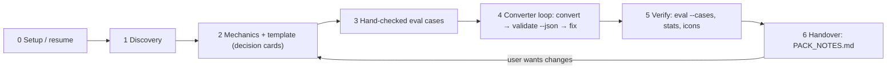

# Step 4 Design — `gamedata_tool`, Lazy Icons, AI Pack Authoring, Packs Split

**Status:** Final design (Step 4 design conversation). **Roadmap:** Step 4, decisions D3, D8, D12, D13.
**Inputs:** `docs/ROADMAP.md`, `docs/design/gamedata-v4-spec.md` (the spec), `docs/design/mechanics-matrix.md` §4.

This document defines the Step 4 tooling (`core_gamedata` + `gamedata_tool`), 50k-scale runtime icon loading, the AI-assisted pack authoring workflow, and the split into the main repo and `factory-planner-packs`. It contains no C++; tasks 4a–4f implement it.

---

## 0. Decisions recorded in the design conversation

| # | Topic | Decision |
|---|---|---|
| T1 | Shared code | A headless `core_gamedata` library is used by both the app and `gamedata_tool`, so validation never drifts. No per-game dump parsers in C++. No Data Browser and no hot reload. |
| T2 | Image libraries | **None added.** `gamedata_tool` only *checks* icons. Converters resize them (the AI agent or the user writes that step). |
| T3 | Converter dependencies | Python 3 **standard library by default**; existing system tools are OK. Third-party packages are allowed only **project-local** (`.venv/` in the workspace) and only **after the user confirms**. Anything that changes the global system is **forbidden**. |
| T4 | Tool output | Code under `src/tools/` may write user-facing output to a passed-in `std::ostream&` (an exception to the AGENTS.md logging rule). Diagnostics still go through absl `LOG` to stderr. |
| T5 | Repos | The **main repo** holds GPLv3 C++ code only: `data/game_data/` is removed in 4f, and tests use frozen JSON fixtures in `tests/data/`. **`factory-planner-packs`** commits **text only** (`raw/`, `.tmp_icons/`, `icons/`, `icons.pak` are gitignored) and publishes `<game>-<pkg>.zip` (JSON + `icons.pak`, no loose PNGs) on GitHub Releases. |
| T6 | Releases | `packs.ref` in the main repo pins a packs release tag. Main `release.yml` downloads the pack zips from that tag, validates them with `gamedata_tool validate --werror`, and ships an all-in-one archive that **includes `gamedata_tool`**. |
| T7 | Packs CI | Runs `validate --no-icons --werror` and `eval --cases`. `check-icons --werror` and `pack-icons --verify` run **locally** when release archives are built, because icons are not in git. |
| T8 | `icons.pak` location | Directly at `<package_root>/icons.pak`. A release zip needs no `icons/` folder. Lookup order: `<package_root>/icons.pak` → `<icon_root>/icons.pak` → loose PNGs under `<icon_root>/`. |
| T9 | No icons | A package with no `icons.pak` and no `<icon_root>/` is in valid **"no icons" mode**. It produces one *info* note, not a warning, so it passes `--werror`. |
| T10 | Cross-pack fallback | An app setting (off by default) with a user-ordered priority list of games. Matching is **same kind only**: exact id first, then slugified display name. If nothing matches, the default icon is shown. |
| T11 | Guide location | `docs/gamedata-v4.md` (author reference) and `docs/authoring/pack-author-prompt.md` live in the main repo and are embedded in the binary as `gamedata_tool guide`. |
| T12 | Converter scope | A converter cleans and rewrites **only** the JSON files of its targeted `<game>/<pkg>/`. It never touches sibling versions or `icons.pak`. |
| T13 | Order of work | Synthetic 50k benchmarks in 4a–4c. 4e dogfoods a **simpler game first**, then GTNH. 4f migrates `data/game_data/` last. |

---

## 1. Architecture

### 1.1 `core_gamedata` library

A new CMake target, `core_gamedata` (STATIC, headless). It links only `absl::log` and nlohmann/json, and has no ImGui, GLFW, GL or OR-Tools dependency.

| Contents | Notes |
|---|---|
| `src/core/expr/*` | Unchanged. |
| `src/core/data/GameDataV4.h`, `GameDataLoader.*`, `NodeEvaluator.*`, `GameDataScanner.h` | `Resource::texture` / `Machine::texture` and `using ImTextureID` in `GameData.h` are **removed**: core has no GL concepts. The `upsertResource` / `upsertMachine` helpers lose their `texture` parameter. |
| `src/common/StringUtils.h` | `slugify()` is shared by converters' expectations, `pack-icons` and the app's fallback matching. |
| **New** `src/core/data/IconPak.{h,cpp}` | `icons.pak` reader and writer (§3). |
| **New** `src/core/data/PngInfo.{h,cpp}` | Reads PNG signature + IHDR (width, height, colour type) without decoding. |
| **New** `src/core/data/RecipeSearchIndex.{h,cpp}` | Picker index (§4.4). |
| **New** `src/core/data/ReportGrouping.{h,cpp}` | Root-cause grouping of a `LoadReport` (§2.3). Kept in core so the app's error dialog can reuse it later. |

`factory_planner_lib` links `core_gamedata`. `GameDataManager` stays in the app library.

**Small `LoadReport` additions** (in 4a):
- `LoadDiagnostic::subject`: the offending token (an unknown id, a bad slug, a key). It is optional and filled where cheap. Grouping falls back to the first quoted token in `message`.
- `LoadReport::drop_root`: maps a dropped `kind:id` to its root `kind:id`, recorded while the §9.1 cascade runs.
- `LoadReport::notes`: info-level entries (e.g. "no icons" mode). Notes never affect `ok()` or `--werror`.

### 1.2 Tool layout

```
src/tools/gamedata_tool/
    main.cpp              argv → Args, dispatch, exit code
    Args.{h,cpp}          small hand-written subcommand parser (absl::flags is global and awkward for subcommands)
    Commands.h            int runInit/runValidate/runEval/runStats/runCheckIcons/runPruneIcons/runPackIcons/runGuide(
                              const Args&, std::ostream& out, std::ostream& err)
    Cmd*.cpp              one file per command
    GuideEmbed.cpp.in     generated by CMake from the two markdown files (byte arrays, avoids MSVC literal limits)
```

There are two targets: `gamedata_tool_lib` (commands) and `gamedata_tool` (exe). Tests link `gamedata_tool_lib` and call commands **in-process** with `std::ostringstream`, so no subprocesses are needed. The executable is placed in `build/bin/` next to the app.

### 1.3 Conventions for all commands

- **Exit codes:** `0` OK (warnings allowed), `1` errors (or warnings with `--werror`), `2` fatal / IO error, `64` usage error.
- `--json`: stdout carries **exactly one** JSON document. Human text and logs go to stderr.
- `--werror`: warnings count as failures. Info notes never do.
- Every write is atomic (temp file + rename, using the `FilesystemUtils` helpers). Every output is deterministic: sorted, no timestamps.
- `<pkg>` is a package directory or its `game.json`.

---

## 2. Commands

| Command | Purpose |
|---|---|
| `init <dir>` | Minimal valid v4 package scaffold. |
| `validate <pkg>` | Full load + compile + validation, icon checks, grouped report. |
| `eval <pkg>` | Headless `NodeEvaluator` for recipe + machine + params; regression cases. |
| `stats <pkg>` | Counts, coverage, load timing (the 50k budget). |
| `check-icons <pkg>` | Missing / unreferenced / malformed icons. |
| `prune-icons <pkg>` | Delete unreferenced loose icons (dry run by default). |
| `pack-icons <pkg>` | Build `<package_root>/icons.pak`. |
| `guide [prompt\|reference]` | Print the embedded authoring docs. |
| `--version` | Prints the tool version and `schema_version 4`. |

### 2.1 `init <dir>`

Writes a minimal package that loads with **zero errors and zero warnings**: `game.json` with `schema_version: 4`, `game`, `units`, `resource_kinds` (`item`, `fluid`), 2 resources, 1 machine (default profile), 1 recipe, and a `.gitignore` containing `icons/`, `icons.pak` and `.tmp_icons/`. By default it creates **no** icons (T9). `--icons` adds `icons/resources/` and `icons/machines/` with two tiny placeholder PNGs embedded as byte constants. It refuses a non-empty directory unless `--force`.

Flags: `--id`, `--name`, `--data-version`, `--time s|tick`, `--tps N`, `--rate tick|s|min|h`, `--icons`, `--force`.

### 2.2 `validate <pkg>`

1. `loadGamePackage(..., ignoreErrors = --ignore-errors)`: the same code path as the app, including every spec §9.2 rule and V-W-2.
2. Icon checks (skipped with `--no-icons`):
   - **"No icons" mode** (neither pak exists and `<icon_root>/` is missing): adds one note, `package has no icons: 3,412 resources and 210 machines use fallback icons`. No V-W-1.
   - Otherwise every referenced key (`resources/<id>`, `machines/<id>`, `options/<set>/<key>`) is resolved in the T8 order. Missing keys → **V-W-1** (grouped). Each found icon is checked with `PngInfo` (or with the pak index's `w`/`h` for pak entries) → **V-ICON-1** (error) if it is not a PNG, not square, or larger than 64×64.
3. Root-cause grouping (§2.3) and output.

Flags: `--json`, `--werror`, `--no-icons`, `--ignore-errors` (report what "Load anyway" would drop), `--max-groups N` (default 50), `--examples N` (default 3), `--all` (flat, ungrouped list), `--timing`.

### 2.3 Root-cause grouping

Goal: a single profile mistake, or a single converter bug, prints **one group**, not 50,000 lines.

1. **Cascades.** The loader already suppresses secondary reference errors (spec §9.1). The tool prints each drop root once, with what it took down:
   ```
   E V-EXPR-2  game.json: /profiles/gt_single/let/oc 1:38: unknown identifier 'param.teir' (did you mean 'param.tier'?)
     └─ dropped: profile gt_single → 12 machines → 48,211 recipes  (e.g. macerate-crushed-copper, …)
   ```
2. **Same subject.** The remaining errors are grouped by key **A** = `(severity, rule, subject)`:
   `E V-REF-1 unknown resource 'crushed_coper' ×50,000 (did you mean 'crushed_copper'?) — e.g. recipes/gt_macerator.json: /recipes/0/in/0, …`
3. **Same pattern.** Singletons left after step 2 are regrouped by key **B** = `(severity, rule, file glob, pointer pattern)`, with numeric pointer segments replaced by `*` and shard file names that differ only in a suffix collapsed with `*`:
   `E V-ID-1 ×50,000 at recipes/*.json /recipes/*/id — invalid id, e.g. 'Iron Ore', 'Copper Wire', 'Steel Plate'`
4. **Order:** fatal first, then the spec §9.1 stage order, then count descending, then rule id. "Did you mean" suggestions are kept on the examples.
5. A footer line: `3 groups (50,004 errors), 1 cascade (48,223 dropped), 2 warning groups. Exit 1.`

**`--json` schema** (`report_version: 1`, stable; new fields may only be added):

```json
{
  "report_version": 1,
  "package": "packs/gtnh/2.7", "game_id": "gtnh",
  "ok": false, "fatal": false, "degraded": false,
  "counts": { "errors": 50004, "warnings": 12, "notes": 0, "dropped": 48223 },
  "groups": [
    { "severity": "error", "rule": "V-REF-1", "subject": "crushed_coper", "pattern": null,
      "count": 50000, "suggestion": "crushed_copper",
      "examples": [ { "file": "recipes/gt_macerator.json", "pointer": "/recipes/0/in/0",
                      "line": 0, "col": 0, "message": "unknown resource 'crushed_coper' …" } ] }
  ],
  "cascades": [ { "root": "profile:gt_single", "rule": "V-EXPR-2",
                  "dropped": { "machine": 12, "recipe": 48211 }, "sample_ids": ["macerate-crushed-copper"] } ],
  "notes": [],
  "timing_ms": { "load": 1430 }
}
```

`--all` adds a flat `diagnostics[]`. AI agents are told to read `groups` and `cascades` only.

### 2.4 `eval <pkg>`

Runs `resolveProjectGlobals` + `evaluateNode` (and `evaluateNodeMetrics` if `--machines` is given). Output: status and messages, resolved parameter values (marking clamped or fallback values), `craft_time_s`, every port (`slot_key`, resource, active, `amount_per_craft`, rate per machine in `--rate` units), and metric coefficients and values.

| Flag | Meaning |
|---|---|
| `--recipe ID` | Required. |
| `--machine ID` | Default: the first compatible machine. `--all-machines` evaluates each compatible one. |
| `--param k=v`, `--global k=v` | Repeatable. `v` is a JSON literal: `clock=150`, `tier='"hv"'`, `mods='["speed-3",null]'`, `prolif=null`. |
| `--sweep PARAM` | Evaluates every allowed option of an enum, or every value of an int range (at most 32 values), and prints one row each. |
| `--machines N` | Post-solve metrics as if `node.machines = N` (and `node.crafts = N / craft_time_s`). |
| `--rate tick\|s\|min\|h` | Display unit (default: the package's `default_rate`). |
| `--cases FILE\|DIR`, `--json` | See below. |

**Eval cases** pin formulas against hand-checked numbers (taken from wikis or the game):

```json
[
  { "name": "constructor 150% + 1 sloop", "recipe": "iron-plate", "machine": "constructor",
    "params": { "clock": 150, "somersloops": 1 }, "globals": {}, "machines": 1.5,
    "expect": { "status": "OK", "craft_time_s": 4,
                "ports": { "in:0": 3, "out:0": 4 },
                "metric_coeffs": { "power": 27.35 }, "metrics": { "shards": 2 } },
    "tol": 1e-3 }
]
```

Fields under `expect` are optional; only the given fields are compared (relative or absolute tolerance `tol`, default `1e-6`). For each case the tool prints PASS/FAIL with the diff, and exits 1 if any case fails. A missing recipe, machine or parameter is a case failure, not a crash.

### 2.5 `stats <pkg>`

Counts per entity type; recipes per category, machine, profile and shard file; parameters, metrics and profiles in use; icon coverage (resources / machines / options with an icon, via the T8 order); bytes of JSON; **load timing** (wall clock: total, plus parse and compile split if the loader exposes it). `--repeat N` reports the median of N loads. `--json` is available. This is the instrument for the 50k budget (§4.5).

### 2.6 `check-icons`, `prune-icons`, `pack-icons`

All three accept `--from <dir>`: the directory with loose PNGs laid out as `resources/`, `machines/` and `options/<set>/`. The default is `<icon_root>`. This lets a converter resize into `.tmp_icons/` (or `icons/`) and check or pack from there.

| Command | Behaviour |
|---|---|
| `check-icons <pkg> [--from D]` | Reports referenced-but-missing (V-W-1), **unreferenced files**, V-ICON-1 (not a PNG, not square, > 64×64), filename case mismatches (`Iron-Ore.png` vs `iron-ore.png`, which matters on Linux), and a stale `icons.pak` (missing entries, or older than the newest file in `--from`). Exits 1 on V-ICON-1; with `--werror`, also on missing or unreferenced icons. In "no icons" mode it prints the note and exits 0. `--json` is available. |
| `prune-icons <pkg> [--from D] [--apply]` | Lists unreferenced PNGs. **Deletes them only with `--apply`**. Never touches `icons.pak`. |
| `pack-icons <pkg> [--from D] [-o FILE] [--verify]` | Writes `<package_root>/icons.pak` (the default `-o`) containing **only referenced** icons, plus each entry's `name_slug` (§3). It fails if any packed icon violates V-ICON-1. With no icons found, it writes nothing and exits 0 with a note. `--verify` reads the pak back and compares every blob byte for byte with its source. `pack-icons --list FILE` prints the index. |

### 2.7 `guide`

`guide prompt` prints `docs/authoring/pack-author-prompt.md` and `guide reference` prints `docs/gamedata-v4.md`. Both are embedded at build time, so the guide always matches the tool's schema version and works offline.

---

## 3. `icons.pak` format (v1)

An uncompressed container (PNG data is already compressed). It is little-endian, and the index sits at the end so the writer can stream.

```
Header (32 bytes)
  char[8]  magic         "FPICONS\0"
  u32      version       1
  u32      count
  u64      index_offset
  u64      index_size
Data
  raw PNG files, concatenated, in index order
Index (count entries, sorted by key bytes)
  u16 key_len  | key bytes         UTF-8, "resources/<id>" | "machines/<id>" | "options/<set>/<key>"
  u16 name_len | name_slug bytes   slugify(display name) for resources/machines; empty for options
  u64 offset   | u32 size          absolute byte offset of the PNG, its size
  u16 w        | u16 h             from IHDR (lets validate check V-ICON-1 without decoding)
```

- **Reader:** reads only the header and the index (about 2–3 MB for 50k entries) into a vector plus a key → entry hash map. Blobs are read on demand with one file stream per reader thread. It rejects bad magic or version, `offset + size` beyond the data section, duplicate keys and an index past EOF. A corrupt **blob** only makes that one entry "missing".
- **Writer:** deterministic (sorted keys, no timestamps): two runs produce identical bytes. Written atomically.
- `name_slug` exists only for the cross-pack fallback (§4.3).

---

## 4. App runtime: async lazy icons and 50k pickers

### 4.1 `IconCache` (replaces eager `GameDataManager::loadTextures()`)

`src/services/IconCache.{h,cpp}` holds the GL side. The testable scheduling core lives in `src/services/IconLoader.{h,cpp}`: it never calls GL, and decode, upload and free are injected as callbacks.

```mermaid
sequenceDiagram
    participant UI as UI thread (frame N)
    participant Q as Request stack (mutex)
    participant W as Worker threads (1–2)
    participant R as Ready queue (mutex)
    UI->>UI: beginFrame(): upload ≤ budget from R, evict LRU
    UI->>Q: get(pkg, kind, id) → placeholder; push or touch(frame N)
    W->>Q: pop most recent; drop if not touched since frame N-2
    W->>W: resolve source (§4.2/§4.3) → read bytes → stbi_load_from_memory → RGBA
    W->>R: push {key, generation, w, h, pixels}
    UI->>UI: next frame: get() returns the real ImTextureID
```

- **API:** `ImTextureID get(const IconRef&)` with `IconRef = {package_id, kind, id, name}`; `beginFrame(frameIndex)`; `bool busy()`; `invalidate(package_id | all)`. UI code calls `get()` while drawing a row, never ahead of time.
- **Key:** the canonical package root plus the icon key. Several open tabs or packages share one cache.
- **Placeholders:** *loading* shows a transparent, neutral box (no flash of `unknown.png`). *Missing* shows `unknown.png`. Both "missing" and "found" results are cached per key.
- **Scheduling:** requests form a **LIFO** stack, deduplicated by key, with a frame stamp updated on every `get()`. Workers drop requests that weren't touched in the last 2 frames, so fast scrolling never builds a backlog. Worker count is `clamp(hardware_concurrency - 1, 1, 2)`. Every GL call stays on the UI thread.
- **Upload budget:** at most **1.5 ms and 64 textures per frame**, whichever comes first. While `busy()`, the cache reports activity to `FramePacer`, so idle throttling doesn't stall loading.
- **LRU eviction** (on by default): cap of **4096 resident textures** (~64 MB at 64×64 RGBA). Only textures not used in the current or previous frame are evicted, so a texture referenced by an in-flight ImGui draw list is never deleted. Evicted keys are simply requested again when needed.
- **Generations:** unloading a package bumps its generation. Late worker results from an old generation are discarded.

### 4.2 Source resolution and "no icons" mode

For a package, resolution follows **T8**: `<package_root>/icons.pak` → `<icon_root>/icons.pak` → loose `<icon_root>/<key>.png`. If none of the three exist (checked **once** per package, when the package is first used), the package is marked **icon-less**: no per-key file checks or failed opens, and every key goes straight to §4.3 or `unknown.png`. Loose PNG lookup is meant for local authoring. Release zips ship only `icons.pak`.

### 4.3 Cross-pack icon fallback (user setting)

```json
"icon_fallback": { "enabled": false, "order": ["gtnh", "factorio", "satisfactory"] }
```

- **Settings UI:** a "Use icons from other game packs when missing" checkbox, and a list of all **scanned game ids** reordered with up/down buttons. Newly scanned games are appended in scan order. Games that are listed but no longer installed are removed from the priority list. Off by default.
- **Candidate order:** the current package is never its own fallback. Other packages of the **same game** come first (in scan order), then the games in `order`.
- **Matching (same kind only):** resources match resources and machines match machines.
  1. exact key (`resources/iron-plate`);
  2. `slugify(display name)` compared with the entry's `name_slug` from the pak index;
  3. the first candidate pack with a hit wins; within one pack, ties are broken by key byte order. If nothing matches, `unknown.png` is shown.
  - Option icons fall back **only by exact key**, because labels such as "MV" are too generic.
- **Cost:** a candidate pack's pak index is opened lazily, on the first miss that needs it, together with a `(kind, name_slug) → entry` hash map. Lookups run on the worker thread. A candidate with only loose PNGs (a dev checkout) can match **by key only**, because names exist only in the pak index.
- **Invalidation:** a settings change or a rescan bumps every generation and clears cached fallback and missing results.

### 4.4 Pickers at 50k

- **`RecipeSearchIndex`** (core) is built once per package load:
  - per recipe: the lowercased name and the lowercased names of its static input and output resources, packed into one haystack string with separators;
  - per resource: `producing` and `consuming` recipe index lists, so the port-drag context filter is a direct lookup instead of a scan over 50k recipes.
- **Filtering:** the picker keeps a `std::vector<uint32_t>` of matching recipe indices and recomputes it **only when the query or the context changes**. If the new query extends the previous one, only the previous results are searched.
- **Rendering:** rows are drawn with `ImGuiListClipper`, so only visible rows call `IconCache::get()`. The machine combo and the `resource_choice` / slot pickers use the same pattern.
- Visual redesign is out of scope; it belongs to Steps 5 and 6.

### 4.5 Budgets

Measured on a **synthetic 50k package** (a generator in the test helpers, used in 4a–4c) and later on the real GTNH import (4e), with `gamedata_tool stats --timing --repeat 5` and an in-app log line:

| Metric | Budget | If missed |
|---|---|---|
| Load 50k recipes (Release) | < 2 s | profile first; then parse shards in parallel; a binary cache is designed only as a last resort |
| Open `icons.pak` (index read) | < 50 ms | — |
| `pack-icons` for GTNH | < 10 s | — |
| Picker filter per keystroke | < 8 ms | parallel scan, or a trigram index |
| Fast scrolling in the picker | no frame > 20 ms | lower the upload budget |

Loading the package on a background thread with a progress modal is a **contingency only**.

---

## 5. Pack authoring workflow (human + AI)

### 5.1 Workspace layout

The same layout is used for a standalone folder and for the `factory-planner-packs` repo:

```
<workspace>/
  raw/<game>/                    user's dumps + source icons              (gitignored, read-only for the agent)
  converters/<game>/
    template/game.json           co-designed manifest: units, kinds, attributes, params, option_sets,
                                 tables, metrics, profiles (formulas live ONLY here)
    template/overrides.json      hand fixes as data: renames, hidden recipes, extra attrs/ports
    convert/                     deterministic converter (data + icon steps)
    cases/*.json                 eval cases with hand-checked numbers
    report.json                  converter report: counts, skipped records + reasons, id collisions (gitignored)
    PACK_NOTES.md                decision log, status, exact rerun commands (lets a new agent session resume)
  packs/<game>/<pkg>/
    game.json, resources.json, machines.json, recipes/*.json     generated, committed
    icons/                       generated, conforming PNGs                (gitignored)
    icons.pak                    built by pack-icons                       (gitignored)
  .tmp_icons/                    resize scratch                            (gitignored)
```

### 5.2 Converter rules

1. **Determinism:** the same inputs produce byte-identical outputs (stable sort, fixed float formatting, no timestamps).
2. **Scope (T12):** the converter deletes and rewrites only the JSON files of its targeted `packs/<game>/<pkg>/`. It never touches sibling package versions, `icons.pak`, or anything outside that directory, except its own `report.json` and `.tmp_icons/`.
3. **Stable identity:** ids come from stable raw keys (class or internal names), never from display names, and are slugified to `[a-z0-9_-]+`. Recipes without a raw id (e.g. GTNH) get `<map>-<short hash of normalized inputs and outputs>`. **Port order is identity** (spec §12.2): keep the raw order. Collisions are resolved deterministically and logged.
4. **No silent drops:** every skipped raw record is listed in `report.json` with a reason, and `gamedata_tool stats` counts must reconcile with `report.json`.
5. **Pure data:** formulas live only in `template/` profiles. The converter emits attributes and short tuple ports, sharded by category or recipe map.
6. **Warning-free output:** release validation uses `--werror`, so the converter prunes unreferenced entities, merges duplicate ports (V-W-3) and fixes the template rather than shipping warnings.
7. **Icons are optional:** if there are no icons, the converter writes no `icons/` directory (T9). If there are icons, the icon step converts them to square PNGs ≤ 64×64, padding transparently and downscaling with an area filter, into `icons/` or `.tmp_icons/`. It loops on `check-icons --from …` until V-ICON-1 is clean.
8. **Dependencies (T3):** standard library first. Python's standard library covers `json`, `csv`, `xml.etree`, `zipfile` (mod jars), `gzip`, `sqlite3`, `struct` and `zlib` (enough for PNG decoding, box downscaling and encoding of small icons). An already-installed tool such as ImageMagick is fine. Project-local packages (`.venv/`, pinned `requirements.txt`) are allowed only after the user confirms, and are recorded in `PACK_NOTES.md`. **Never:** global or `--user` pip, `--break-system-packages`, `sudo`, global npm or cargo installs. The packs repo may provide shared standard-library helpers in `common/` (e.g. `png_resize.py`).

### 5.3 Phases



| Phase | Agent | User |
|---|---|---|
| 0 Setup | Checks `gamedata_tool --version`, reads `guide reference`, creates the layout, starts `PACK_NOTES.md`, or **resumes** from an existing one. | — |
| 1 Discovery | Inventories `raw/` by **sampling** (never dumps big files): formats, record types, counts, units (ticks?), fluids, chances, catalysts, tiers, power. Proposes a raw → v4 mapping table. | Confirms the game, version and scope. |
| 2 Mechanics + template | Offers a menu of the mechanics seen in the data plus the known ones from the reference's cookbook. Presents **decision cards** (at most 5 per turn: options, trade-off, recommended default), writes `template/game.json` and logs each decision. | Picks features and answers the cards. |
| 3 Cases | Chooses 3–10 representative recipes, computes the expected NodeEval by hand **showing the arithmetic**, and writes `cases/`. | Confirms the numbers against the wiki or the game. |
| 4 Converter loop | Writes `convert/`, runs it, then loops `validate --no-icons --json` → fix the **converter or template, never the output** → rerun until there are 0 errors and 0 warnings. | — |
| 5 Verify | `eval --cases` (all pass), `stats` (reconciles with `report.json`), the icon step → `check-icons --from …` (coverage, V-ICON-1 clean) → `pack-icons --verify`, and spot `eval --sweep` checks on tier and parameter behaviour. | Opens the pack in the app (optionally with the icon fallback on). |
| 6 Handover | Updates `PACK_NOTES.md` (decisions, open issues, rerun commands) and summarizes. | Accepts, or asks for refinements (back to phase 2 or 4). |

The full prompt is in Appendix A.

### 5.4 Author reference: `docs/gamedata-v4.md`

A condensed, author-facing version of the spec (about 600–800 lines): a schema cheat sheet, the expression language, the validation rule table with *how to fix* hints, the five worked examples, a **mechanic → schema pattern cookbook** (from mechanics-matrix §1–§3), the data source table (mechanics-matrix §4), the converter rules (§5.2) and the `gamedata_tool` command reference. This also covers the v1.0-Beta criterion "a how-to-add-a-game guide exists".

---

## 6. Repos and releases

### 6.1 `factory-planner-packs`

```
README.md  AUTHORING.md  LICENSE / NOTICE
common/                    shared stdlib helpers (png_resize.py, slug.py, …)
converters/<game>/         template/, convert/, cases/, PACK_NOTES.md
packs/<game>/<pkg>/        generated JSON (committed)
tool.version               gamedata_tool release tag used by CI
.gitignore                 raw/  .tmp_icons/  icons/  icons.pak  report.json  .venv/
.github/workflows/validate.yml
```

- **CI (`validate.yml`)**, on push and PR: download `gamedata_tool` from the main repo release named in `tool.version`. For every `packs/*/*/`: `validate --no-icons --werror` and `eval --cases converters/<game>/cases`. CI never sees icons (T7).
- **Building release archives (local, maintainer):** for each pack, run the converter (data + icons) → `check-icons --werror` → `pack-icons --verify` → `validate --werror` (now including icons) → zip `<game>/<pkg>/{*.json, recipes/…, icons.pak}` into **`<game>-<pkg>.zip`** (`cmake -E tar cf <game>-<pkg>.zip --format=zip …`, so no extra tools are needed). Then create a GitHub Release `packs-YYYY.MM.DD` with the zips attached. The steps are documented in `AUTHORING.md`; an optional stdlib helper script may automate them.
- **Assets:** raw game files and icons never enter git. Redistributing icons inside release zips is the maintainer's call (a legal grey area, noted in `NOTICE`).

### 6.2 Main repo release (`release.yml`)

1. Build the app and `gamedata_tool` (Release).
2. Read `packs.ref` (a packs release tag) and download every `*.zip` asset of that release (`gh release download <tag> -R <owner>/factory-planner-packs`).
3. Extract each zip into `stage/game_data/<game>/<pkg>/`.
4. `gamedata_tool validate --werror` on every package. Any failure fails the release.
5. Stage the app, `gamedata_tool`, `assets/`, OR-Tools libraries and `game_data/`, then produce **one all-in-one archive per OS**.

`ci.yml` stays standalone (no packs). It additionally builds `gamedata_tool` and runs a ctest smoke test: `init` → `validate` → `eval` → `pack-icons` in a temp directory.

---

## 7. Migration (task 4f, after GTNH and any extra packs)

1. **Fixtures first:** replace the 8 references to `data/game_data` (`test_gamedata_v4.cpp` ×5, `test_golden.cpp` ×2, `test_factory_graph.cpp` ×1) with **frozen, trimmed copies** under `tests/data/` that contain only the entities the tests use. The path comes from a CMake compile definition, `FP_TEST_DATA_DIR`. Golden numbers stay unchanged. The tests are now independent of both repos' data.
2. **Move data:** `data/game_data/satisfactory` and `mindustry` → `factory-planner-packs/packs/<game>/<pkg>/` (JSON only; their icons go into each workspace's gitignored `raw/` for the icon step). Optionally regenerate Satisfactory from `Docs.json` with the prompt.
3. **Main repo:**
   - delete `data/game_data/`;
   - the post-build step copies packs only if the CMake cache variable `FP_PACKS_DIR` points at a packs checkout (default: `../factory-planner-packs/packs` if it exists);
   - add an absl flag `--game_data_dir` so authors can run the app against a working directory, where loose PNGs are picked up;
   - with no game data at all, the app shows a clear "No game data found" notice.
4. Add `packs.ref` and update `release.yml` (§6.2) and `ci.yml` (smoke test).
5. Update README, AGENTS.md (architecture map, build notes) and CHANGELOG (user-visible: lazy icons, smoother pickers, icon fallback setting, bundled `gamedata_tool`, new packs).

---

## 8. Step 4 task split

| Task | Model | Branch | Scope |
|---|---|---|---|
| 4a | Opus `/plan` | `feat/gamedata-tool-core` | `core_gamedata` split; remove `texture` from core; `subject` / `drop_root` / `notes`; `ReportGrouping`; tool skeleton; `init`, `validate` (grouping, `--json`), `eval` (+ cases), `stats`; synthetic 50k generator + load benchmark |
| 4b | Flash | `feat/gamedata-tool-icons` | `IconPak` (with `name_slug`), `PngInfo`, V-ICON-1, "no icons" note, `check-icons` / `prune-icons` / `pack-icons` with `--from`; icon checks in `validate` |
| 4c | Opus `/plan` | `feat/lazy-icons` | `IconLoader` + `IconCache` (workers, budget, LRU, FramePacer hook), T8 resolution, cross-pack fallback + Settings UI, `RecipeSearchIndex`, clipped pickers; 50k picker benchmark |
| 4d | Opus | `docs/pack-authoring` | `docs/gamedata-v4.md`, `docs/authoring/pack-author-prompt.md`, `guide` embedding; packs repo bootstrap **text** files (README, AUTHORING, `.gitignore`, CI) drafted under `docs/authoring/packs-repo-template/`. `common/` Python helpers are written in the packs repo (4e), never here (D3) |
| 4e | user + agent in packs repo | — | Dogfood: a **simpler game first** (e.g. Satisfactory from `Docs.json` or DSP), then **GTNH**; measure §4.5 budgets; fix what breaks (follow-up tasks) |
| 4f | Flash | `chore/packs-split` | Migration §7 |

---

## 9. Test strategy

| Area | Tests (in `tests/`, in-process, no subprocesses) |
|---|---|
| `init` | Scaffold → `validate` returns 0 with no warnings; `--icons` → `check-icons` clean; refuses a non-empty directory. |
| `validate` | One broken profile → 1 group + 1 cascade (not N errors); 1,000 copies of one bad resource id → 1 group with count 1000; 1,000 distinct bad ids → 1 pattern group; `--json` parses and has the stable keys; exit codes 0/1/2; `--werror`; "no icons" → note only, exit 0 with `--werror`. |
| `eval` | Reproduces spec §10.1 (4 s, out 4, 27.35 MW/machine, shards 2 at 1.5 machines) and §10.2 (MV vs HV gating); cases PASS/FAIL and the exit code; a bad `--param` gives a usage error. |
| Icons | `PngInfo` on valid, non-square, oversize and non-PNG input; V-ICON-1 for loose and pak entries; `pack-icons` produces byte-identical output twice; `--verify`; `--from`; `prune-icons` dry run vs `--apply`. |
| `IconPak` | Round trip; corrupt header, index or blob; duplicate keys; truncated file. |
| `IconLoader` | Without GL: dedup, LIFO, stale-request drop, upload budget, LRU never evicting current-frame textures, generation discard. |
| Fallback | Priority order; same-game packages first; key before name; same kind only; options key-only; current package skipped; missing → default; settings change invalidates. |
| `RecipeSearchIndex` | Matches the old linear filter on the real fixtures; incremental narrowing; context lookup; timing on the synthetic 50k package (reported, not asserted). |

---

## 10. Follow-up edits to other documents (done in 4a / 4d)

- **Spec §2.1:** `icons.pak` at `<package_root>/` (T8); icons are square PNGs ≤ 64×64; "no icons" mode; the cross-pack fallback is an app setting, not data.
- **Spec §9.2:** add **V-ICON-1** (E, checked by `gamedata_tool` only); V-W-1 is not emitted in "no icons" mode.
- **Spec §11:** replace "icon atlases" with a reference to D13 and this document.
- **ROADMAP Step 4:** replace the placeholder with §8 and one prompt per task.
- **AGENTS.md:** the T4 logging exception; `core_gamedata`, `src/tools/` and `gamedata_tool` in the architecture map; `data/game_data/` removed after 4f.

---

## Appendix A — Pack author prompt (draft of `docs/authoring/pack-author-prompt.md`)

**Bootstrap (the user pastes this):**

```
You are helping me build a Factory Planner game-data pack in this folder. My raw game data
is in raw/. Run `gamedata_tool guide prompt` and follow it exactly. Then run
`gamedata_tool guide reference` and read it fully before proposing anything.
```

**Embedded prompt:**

```
ROLE
You are an interactive converter-script author for Factory Planner GameData v4. You build a
REUSABLE, DETERMINISTIC converter that turns the user's raw game data into a v4 package, and you
verify it with gamedata_tool. The user makes every semantic decision; you propose and explain.

HARD RULES
1. Never modify raw/. Never hand-edit generated files in packs/<game>/<pkg>/; change the
   converter, template/ or overrides.json and rerun.
2. The converter rewrites only packs/<game>/<pkg>/ JSON (never sibling versions, never icons.pak).
3. Ids come from stable raw keys, slugified to [a-z0-9_-]+. Keep raw port order (port order is
   identity). Same input => byte-identical output.
4. Formulas live only in converters/<game>/template/game.json profiles. Recipes are pure data.
5. Dependencies: Python 3 standard library first; existing system tools are OK. Third-party
   packages ONLY in a project-local .venv after the user explicitly agrees (pin them, log in
   PACK_NOTES.md). NEVER install globally: no global/--user pip, no --break-system-packages,
   no sudo, no global npm/cargo.
6. Keep context small: sample raw files (head, counts, a few records); read only `groups` and
   `cascades` from `gamedata_tool validate --json`; never paste huge outputs.
7. Ask before any semantic choice. Batch questions as DECISION CARDS (max 5 per turn):
   question / options / trade-off / your recommended default.
8. Every change ends with: convert -> validate --no-icons --json -> eval --cases.
9. Keep converters/<game>/PACK_NOTES.md current: decisions, status, open issues, rerun commands.

PHASES
0 Setup: `gamedata_tool --version`; read the reference; create the workspace layout; if
  PACK_NOTES.md exists, summarize it and resume from its status.
1 Discovery: inventory raw/ (formats, record types, counts, units/ticks, fluids, chances,
  catalysts, tiers, power, icons present?). Propose a raw -> v4 mapping table. Confirm game,
  version, package id and scope with the user.
2 Mechanics & template: list mechanics found in the data plus relevant ones from the reference
  cookbook. Present decision cards (parameters, UI hints, metrics, globals, units, rate unit).
  Write template/game.json; validate it on a tiny hand-made sample first.
3 Eval cases: pick 3-10 representative recipes, compute expected craft_time/ports/metrics BY
  HAND with the arithmetic shown, ask the user to confirm against the wiki/game, write cases/.
4 Converter loop: write convert/, run it, loop validate until 0 errors AND 0 warnings
  (prune unreferenced entities, merge duplicate ports, fix the template). Every skipped raw
  record goes to report.json with a reason.
5 Verify: eval --cases all PASS; `stats` counts reconcile with report.json; spot-check
  `eval --sweep` on tier/mode parameters. Icons (only if the user has them): resize/pad to
  square PNG <= 64x64 into icons/ or .tmp_icons/, loop `check-icons --from <dir>` until clean,
  then `pack-icons --from <dir> --verify`. No icons is a valid choice: write no icons/.
6 Handover: update PACK_NOTES.md (decisions, open issues, exact rerun commands), summarize
  coverage and limitations, ask what to refine. Refinements return to phase 2 or 4.
```
