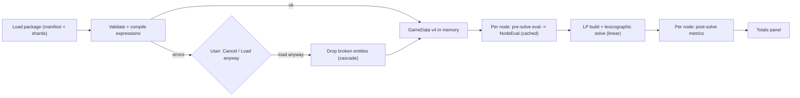

# GameData v4 — Specification

**Status:** Final specification (incorporating adversarial reviews R-01..R-18 and R2-01..R2-13, step 3c). **Roadmap:** step 3b/3c, decisions D4–D7.
**Inputs:** `docs/ROADMAP.md`, `docs/design/mechanics-matrix.md`, `docs/design/gamedata-v4-review.md`, `docs/design/gamedata-v4-review-2.md`, the v3 code (`GameData.h`, `GameDataManager.cpp`, `FactorySolver.cpp`, `Node.h`).

This document defines the v4 game data format, its expression language, how the solver consumes it, what a project file stores per node, the validation rules, and five worked examples. It contains no C++; steps 3d–3h implement it.

---

## 0. Decisions recorded in the design conversation

| # | Topic | Decision |
|---|---|---|
| Q1 | Where formulas live | **Profiles**: shared formula sets attached to machines. Recipes are pure data. A recipe or a single port may override a formula. |
| Q2 | Conditional ports | **Stable superset**: a node owns every port its recipe and profile can declare. Inactive ports: excluded from LP topology and fixed to 0, wires kept but marked inactive, port IDs never change. |
| Q3 | Parameter-driven port resources | **In v4**: an extra port or long-form recipe port can take its resource from a `resource_choice` parameter (`resource_param`) or a `resource_expr` expression. Wires that no longer match become *invalid* (shown as an error), never silently deleted. |
| Q4 | Post-solve metrics | **Linear form** (`per_machine` / `per_craft` constant × solved machines or crafts) **or** a display-only free-form `value`, with an optional `enabled` condition. |
| Q5 | GTNH voltage tiers | **One machine per family** with a `voltage_tier` node parameter; allowed tiers are filtered by machine and recipe attributes. |
| Q6 | Factorio modules | **List-valued `slots` parameter type**; expressions aggregate over the slots with `sum` / `count` / `min` / `max`. |
| R1 | `"nothing"` | **Removed.** A node is a **raw source** in a component when it has at least one active output port, zero active recipe input ports (`in:*`), and zero active extra input ports (`xin:*`) with an `OK` incoming wire; it is a **sink** when it has at least one active input port and zero active output ports of any kind (`out:*` or `xout:*`) (§7.4). |
| R2 | Units | Game data declares the recipe time unit and a **default rate unit**. The **project** chooses its own rate unit (it starts as the default, and the user can change it). Internally everything is **per second**. |
| R3 | Large datasets | A manifest plus included shard files, loaded eagerly, compact tuple ports, formulas only in profiles, **no binary cache in v4**. |
| R4 | Loading errors | **Strict**: any error stops the load and shows a report. The user may choose **"Load anyway"**, which drops the broken entities and everything that depends on them. Fatal errors cannot be bypassed. |
| R5 | Project parameters | The project stores **every** parameter that applies to a node, not just values that differ from the default. |
| R6 | JSON | **Strict JSON**, no comments; any entity may carry a `"notes"` string. |

---

## 1. Concepts and pipeline

| Term | Meaning |
|---|---|
| **Package** | One loadable game data set: a directory containing `game.json` (the manifest) and optional shard files. |
| **Resource** | An item, fluid or other flowable thing. Has a `kind` that controls how it is displayed. |
| **Machine** | A building. Has a `profile`, `categories` it can craft, a built-in `speed`, and typed attributes. |
| **Recipe** | Pure data: time, input and output ports (amount, chance, catalyst amount, port attributes), recipe attributes, and either a category or an explicit list of machines. |
| **Profile** | A named, inheritable set of formulas: which parameters a node shows, named intermediate values (`let`), requirements, craft time, port amounts and conditions, extra ports, and metrics. |
| **Parameter** | A per-node user setting (clock speed, tier, modules, …). Defined once in the game data; a profile opts in to it. |
| **Global** | A per-project setting (research levels, global upgrades), read as `global.x`. |
| **Option set** | A list of named options with typed attributes, used by `enum` and `slots` parameters. |
| **Metric** | A displayed quantity (power, EU/t, workers, …) with display locations and an aggregation rule for totals. |
| **NodeEval** | The result of evaluating a node's pre-solve formulas: status, active ports with per-craft amounts, craft time, and linear metric coefficients. |



---

## 2. Package and file structure

### 2.1 Directory layout

```
data/game_data/<game>/<package>/
    game.json                     manifest (small games put everything here)
    recipes/*.json                optional shards, split any way the author likes
    icons/resources/<id>.png
    icons/machines/<id>.png
    icons/options/<set>/<key>.png
```

- A game directory may hold several packages (e.g. different game versions). `GameDataScanner` looks for `data/game_data/*/*/game.json`.
- `"icon_root"` in the manifest (default `"icons"`) may point to a shared directory such as `"../icons"`. It must resolve to a path inside `<game>/`.
- Icons are optional and **loaded lazily** (on first display). The v3 loader loads every texture eagerly, which does not scale to 50k entries.

### 2.2 Manifest (`game.json`) top level

| Key | Required | Type | Meaning |
|---|---|---|---|
| `schema_version` | yes | `4` | Any other value is fatal (F3). |
| `game` | yes | object | `{ "id", "name", "data_version", "attrs" }`. `id` identifies the game in project files; `data_version` is free text (e.g. `"1.1.0.4"`, `"2.7.2"`); `attrs` are game-wide constants readable as `game.<attr>`. |
| `units` | yes | object | §2.3. |
| `resource_kinds` | no | object | §2.4. The default is a single kind `item`. |
| `attributes` | no | object | Typed attribute declarations per entity type (§2.5). |
| `tables` | no | object | Named lookup tables (§3.4). |
| `option_sets` | no | object | §3.3. |
| `parameters` | no | object | Node parameter definitions (§3.1). |
| `globals` | no | object | Project-wide parameter definitions (§3.2). |
| `metrics` | no | object | Metric registry (§6). |
| `profiles` | no | object | §4. |
| `resources`, `machines`, `recipes` | no | arrays | §2.6–§2.8. |
| `include` | no | array of strings | Shard files or directories (§2.9). |
| `icon_root` | no | string | See §2.1. |
| `notes` | no | string | Ignored by the loader. |

Any other key is an error (E-STRUCT-1). Unknown fields are rejected so that typos never fail silently. The only free-text escape hatch is `notes`.

### 2.3 Units and time base (R2)

```json
"units": {
  "recipe_time": "tick",
  "ticks_per_second": 20,
  "default_rate": "s"
}
```

| Field | Values | Meaning |
|---|---|---|
| `recipe_time` | `"s"`, `"tick"` | Unit of `recipe.time` in the files. The loader converts to seconds; `recipe.time_raw` keeps the file value. |
| `ticks_per_second` | number > 0 | Required if `recipe_time` is `"tick"` or if `"tick"` should be offered as a rate unit. Readable as `game.ticks_per_second`. |
| `default_rate` | `"tick"`, `"s"`, `"min"`, `"h"` | The rate unit a **new project** starts with. |

**Per-project rate unit.** The project file stores `"rate_unit"` (one of the four values; `"tick"` only if the package defines `ticks_per_second`). Changing it is an undoable project setting that **only changes display and input**:
- The solver, `Port::rate`, `Connection::rate`, user constraints and the project file all use the **canonical unit: per second**.
- The UI multiplies by 1 / 20 / 60 / 3600… when displaying, and divides when the user types a rate.
- Consequence for the solver (step 3e): the time-unit factor `U` disappears from `w_n` (§7.3). Golden tests keep their expected numbers by stating them in the project's rate unit and converting them (e.g. `/ 60`) once in the test helper.

Rate units affect *rates* only. Metrics that are rates (`is_rate: true`, §6) are converted as well; metrics such as MW or EU/t are not.

### 2.4 Resource kinds and display units

```json
"resource_kinds": {
  "item":  { "label": "Item",  "display_unit": "",   "display_scale": 1 },
  "fluid": { "label": "Fluid", "display_unit": "m³", "display_scale": 1 }
}
```

Amounts in recipes use the game's native unit for that kind (Satisfactory fluids: m³; GTNH fluids: L). `display_scale` multiplies values for display (e.g. GTNH could store L and display kL with `0.001`). The rate unit is appended after the display unit: `"m³/min"`.

### 2.5 Attribute declarations

Attributes are typed key–value data on entities. They must be declared once, so typos are caught and defaults apply.

```json
"attributes": {
  "machine":  { "power": { "type": "number", "default": 0 },
                "somersloop_slots": { "type": "number", "default": 0 } },
  "recipe":   { "eut": { "type": "number", "default": 0 },
                "allows_productivity": { "type": "bool", "default": false } },
  "port":     { "min_tier": { "type": "number", "default": 0 } },
  "resource": { "fuel_value": { "type": "number", "default": 0 } }
}
```

- Types: `number`, `bool`, `string`. A `default` is required.
- Attribute names match `[a-z_][a-z0-9_]*` and must not shadow a built-in field (§5.5, including `id` on resources and `key` on options), a reserved root identifier (`game`, `global`, `machine`, `recipe`, `param`, `port`, `node`, `option`, `craft_time`, `true`, `false`), or any built-in function name (§5.6).
- Game-level constants go in `game.attrs` and need no declaration (their type comes from the JSON value, which must be a finite number, bool, or string; keys must match `[a-z_][a-z0-9_]*` and not shadow `ticks_per_second`, V-ATTR-2).

### 2.6 Resources

```json
{ "id": "iron-ore", "name": "Iron Ore", "kind": "item", "tags": ["ore"], "attrs": {} }
```

`id` (required), `name` (default: `id`), `kind` (default `"item"`), `tags` (used by `resource_choice`), `attrs`, `notes`.

### 2.7 Machines

```json
{ "id": "constructor", "name": "Constructor", "profile": "sf_production",
  "categories": ["constructor"], "speed": 1.0,
  "attrs": { "power": 4, "somersloop_slots": 1 } }
```

`id`, `name`, `profile` (default `"default"`), `categories` (array of strings), `speed` (built-in, default 1, must be > 0), `attrs`, `notes`.

### 2.8 Recipes

```json
{ "id": "iron-plate", "name": "Iron Plate", "category": "constructor", "time": 6,
  "in":  [["iron-ingot", 3]],
  "out": [["iron-plate", 2]] }
```

| Field | Meaning |
|---|---|
| `id`, `name` | As usual. |
| `category` **or** `machines` | `category`: every machine whose `categories` contains it can run the recipe (needed for GTNH recipe maps and Factorio crafting categories). `machines`: an explicit list of machine ids. Exactly one of the two. |
| `time` | Craft time per craft at machine speed 1, in `units.recipe_time`. Must be > 0. |
| `in`, `out` | Port lists (below). Either may be empty or missing, but not both (V-NUM-4). Whether a node acts as a **raw source** or **sink** in the solver depends on active recipe ports and wired extra ports at evaluation time (R1, §7.4). |
| `setup` | Optional list of `[resource, amount]` tuples for items needed to *build or configure* the machine but not consumed per craft (GT programmed circuits, molds, lenses). Each entry must reference a valid resource id (V-REF-1) with a finite `amount` > 0 (V-NUM-2). Shown on the node, not part of the LP. |
| `attrs` | Recipe attributes. |
| `overrides` | Optional formula overrides (§4.4). |

**Port forms.** Short (tuple) form: `[resource, amount]` or `[resource, amount, chance]`. Long form, needed for anything else:

```json
{ "res": "dust_gold", "amount": 1, "chance": 0.1, "catalyst": 0,
  "attrs": { "min_tier": 3 }, "enabled": "...", "amount_expr": "..." }
```

| Field | Default | Meaning |
|---|---|---|
| `res`, `resource_param`, `resource_expr` | — | A port specifies a fixed `res` (resource id), a `resource_param` (naming a `resource_choice` parameter of every compatible machine's profile), or a `resource_expr` (pre-solve expression returning a `string` resource id—or `""` to mark the port inactive—or `resource`). `resource_param` and `resource_expr` are mutually exclusive, and at most one port per recipe may reference a given `resource_param` (V-PROF-4). An optional `"res"` may be given alongside `resource_param` or `resource_expr` as the port's static base resource (`port.base_resource`) and as the fallback resource when an `allow_none` `resource_param` is unset (`null`). |
| `amount` | — | Base amount per craft, > 0. |
| `chance` | 1 | Probability in (0, 1]. Applied by the profile's amount formula (the default profile multiplies by it). |
| `catalyst` | 0 | Part of `amount` that productivity bonuses do not apply to, in [0, amount] (Factorio `ignored_by_productivity`, M10). |
| `attrs` | {} | Port attributes (declared under `attributes.port`). Can be read in `visible_if` / `allowed_if` (of a port-bound `resource_choice`) and in port formulas as `port.<attr>` (e.g. a recipe-slot tag filter with `has_tag(option, port.slot_tag)`). |
| `enabled`, `amount_expr` | — | Per-port formula overrides (§4.4). `enabled` accepts a bool literal or expression string. |

Port **slot keys**: `in:<index>` and `out:<index>` (0-based, in file order). They identify ports in project files (§8).

### 2.9 Splitting large datasets (R3)

```json
"include": ["resources.json", "machines.json", "recipes/"]
```

- Each entry is a file or a directory (detected via `std::filesystem::is_directory`, with or without a trailing `/`). A directory contributes every `*.json` file under it, recursively, **sorted by relative path in byte order**, so the order is the same on every platform. Canonical shard paths are deduplicated (and `game.json` is skipped if a directory includes the package root) so overlapping `include` entries never load a shard twice.
- A shard is a JSON object that may contain the same keys as the manifest **except** `schema_version`, `game`, `units`, `include` and `icon_root`. Shards cannot include other shards.
- Entity ids are global across all files. Maps (`profiles`, `parameters`, …) are merged by key (and `/attributes` is merged at the second level `/attributes/<entity_kind>/<attr>`); a key defined twice (either across shards or within a single JSON object) is an error (V-ID-2).
- Paths must stay inside the package directory (V-INC-3).

**Why this scales to GTNH (50k+ recipes):**
- Formulas live in about 20–50 profiles that are parsed once. A typical GTNH recipe in short form is pure numbers, roughly 150–250 bytes, so 50k recipes come to about 10 MB of JSON.
- Everything loads eagerly. **Budget: under 2 s for 50k recipes in a Release build**, measured in step 4 with the real import. Implementation requirements for step 3d:
  1. Intern ids and store entities in contiguous vectors with hash indices (not `std::map<std::string, …>`).
  2. **Intern and cache compiled expressions** by `(profile_id, context, expr_string)` and pre-index `category -> unique_profile_ids` so identical port `enabled` / `amount_expr` / `resource_expr` and recipe `overrides` expressions across 50k recipes are parsed, type-checked, and validated (`V-OVR-2`, `V-PROF-4`) once per unique compatible profile rather than per machine.
  3. **Construct JSON pointers lazily**: maintain a lightweight stack of string/index path frames during traversal and format `/recipes/49999/out/2` strings only when pushing an error or warning to `LoadReport`.
  4. **Cap fuzzy "did you mean" Levenshtein searches** to at most the first 25 errors per load, pre-filtering candidates by `abs(len(a) - len(b)) <= 2`.
  5. Compute unused-entity warnings (`V-W-2`) in a single linear $O(N + R + M)$ marking pass using bitsets/hashsets, and load icons lazily.
- No binary cache in v4. A cache only gets designed (in step 4) if the budget is missed.
- Importers may split shards however they like (e.g. one per GT recipe map). The split has no meaning to the loader.

---

## 3. Parameters, globals, option sets, tables

### 3.1 Node parameter definitions

```json
"parameters": {
  "clock": {
    "label": "Clock speed", "type": "number", "default": 100,
    "min": "1", "max": "250", "step": 0.0001, "unit": "%",
    "ui": { "widget": "drag", "format": "%.4g%%", "placement": "body" }
  }
}
```

| Field | Applies to | Meaning |
|---|---|---|
| `label`, `tooltip` | all | Display text. |
| `type` | all | `number`, `int`, `bool`, `enum`, `resource_choice`, `slots`. |
| `default` | all | Literal. Required for `number`/`int`/`bool`. Optional for `enum` (first allowed option), `resource_choice` (first allowed resource, or none if `allow_none`) and `slots` (all empty). |
| `min`, `max` | number, int | JSON number literal **or** expression string in the **static context** (§5.4), e.g. `1`, `250`, or `"machine.somersloop_slots"`. |
| `step` | number, int | UI step; `int` requires an integer step (default 1). |
| `unit` | number, int | Display suffix only. |
| `option_set` | enum, slots | The option set name (§3.3). Must contain at least one option (V-PAR-3). |
| `allowed_if` | enum, slots, resource_choice | JSON bool literal **or** static-context bool expression evaluated per option (`option.*` bound), or per resource (`option` bound to the resource). Options for which it is false are not offered. |
| `resources` / `tag` | resource_choice | Candidate resources: exactly one of an explicit non-empty `resources` list or a `tag` string matching at least one resource (V-REF-5). |
| `allow_none` | enum, resource_choice | Adds a "none" (`null`) choice; test it with `is_set(param.x)`. |
| `count` | slots | JSON number literal **or** static expression giving the number of slots, e.g. `2` or `"machine.module_slots"`. Must evaluate to an integer in `[0, 64]` at runtime (otherwise runtime `ERROR`). |
| `allow_empty` | slots | Default `true`. |
| `visible_if` | all | JSON bool literal **or** static-context bool. **Evaluated first in §4.5 step 1: when `false` (or when a port-bound `resource_choice` parameter is unused by the current recipe), the parameter is hidden and bound directly to its declared `default`—or, if no literal `default` is declared, to the first option in `option_set` / first candidate resource in declaration order when `allow_none: false`, or `null` / empty slots when `allow_none: true` / `slots`—without evaluating `min`, `max`, `count`, or `allowed_if` and without emitting range warnings.** Its stored value in `node.params` is preserved, so un-hiding restores it. |
| `ui` | all | `widget` (`slider`, `drag`, `input`, `stepper`, `checkbox`, `combo`, `slot_row`), `format` (printf-style), `group` (UI section label), `placement` (`body` = on the node card, `panel` = properties panel only; default `panel`). |

**Value rules.**
- `int` values must be integral. Dynamic `min` and `max` on `number` clamp to `[min, max]`, and on `int` clamp to `[ceil(min - 1e-9), floor(max + 1e-9)]` (if the resulting `min > max` or bounds are non-finite at runtime, status is `ERROR`). A stored value outside the bounds is **clamped during evaluation**, and the node shows a `WARNING` status; the stored value is not rewritten.
- **Port-bound `resource_choice` parameters:** any `resource_choice` parameter referenced by a recipe port's `resource_param` (or whose `visible_if` / `allowed_if` references `port.*`) is **port-bound** (V-PROF-4). When resolving a port-bound parameter in §4.5 step 1 (and for UI rendering), look up the unique recipe port on the node's recipe with `"resource_param": "<id>"`. If no port on the current recipe references it, the parameter is automatically treated as hidden (`visible_if = false`). Otherwise, `port.*` (excluding `port.resource`) is bound to that recipe port during `visible_if` and `allowed_if` evaluation.
- **Fallback chain for `enum` and `resource_choice`:** if a stored value fails `allowed_if` (or if no explicit `default` was declared), try the parameter's declared `default` (if present and passing `allowed_if`), then the **first option/resource in declaration order passing `allowed_if`**, or `null` (`none`) if `allow_none: true`. If a stored value had to fall back, the node receives a `WARNING`. If **zero** options/resources pass `allowed_if` and `allow_none` is `false`, evaluation stops immediately in §4.5 step 1 with status `BLOCKED` and message `"No allowed value for parameter '<label>'"`.
- **`slots` sizing and per-slot fallback:** at runtime, `count` must evaluate to an integer in `[0, 64]` (otherwise runtime `ERROR`). Evaluation considers only the first `count` slots (padding with `null` if the stored array is shorter, and keeping any extra stored elements past `count` untouched in `node.params`, with a `WARNING` if any ignored slot beyond `count` is non-empty). `allowed_if` is checked **per individual slot** in `0 .. count - 1`: any slot whose option fails `allowed_if` evaluates as `null` (empty) with a `WARNING`, while keeping valid options in the remaining slots. If `allow_empty: false` and any active slot in `0 .. count - 1` is `null` after fallback, evaluation stops in §4.5 step 1 with status `BLOCKED`.
- Parameter ids match `[a-z_][a-z0-9_]*` and must not match a reserved root identifier or built-in function name (§5.1).

### 3.2 Globals

Same definition format as parameters, under `"globals"`. They are stored once per project, edited in a project settings panel, and read as `global.<id>`. `visible_if`, `allowed_if`, `min`, `max` and `count` may only reference `game.*` and other globals (and cannot be port-bound). Globals are resolved once per project in topological dependency order of their static expressions before node evaluation; dependency cycles among globals are rejected at load time (V-EXPR-6). A global's `WARNING`, `BLOCKED`, or `ERROR` status propagates only to nodes whose evaluated expressions actually reference that global.

Example (Factorio mining productivity research, M9):

```json
"globals": {
  "mining_prod_level": { "label": "Mining productivity research", "type": "int",
                         "default": 0, "min": "0", "max": "1000" }
}
```

A mining-drill profile can then use `"let": { "prod": "1 + 0.1 * global.mining_prod_level" }`.

### 3.3 Option sets

```json
"option_sets": {
  "gt_tiers": {
    "attrs": { "t": { "type": "number", "default": 0 },
               "v": { "type": "number", "default": 0 } },
    "options": [
      { "key": "ulv", "label": "ULV", "attrs": { "t": 0, "v": 8 } },
      { "key": "lv",  "label": "LV",  "attrs": { "t": 1, "v": 32 } }
    ]
  }
}
```

An option set must contain at least one option, and option keys must be unique within the set (V-PAR-3). Option attributes must be declared in the set's `attrs` with a default, and option attribute names follow the same naming and non-shadowing rules as §2.5 (cannot be `key` or `id`, V-ATTR-1, V-ATTR-2). Expressions read an option's attributes with `.attr` (or its key with `.key`) and compare options by key (`param.mode == "extra"` or `'extra'`; a string literal is checked at load time).

### 3.4 Tables

```json
"tables": {
  "gt_voltage": [8, 32, 128, 512, 2048, 8192, 32768, 131072, 524288],
  "coil_heat":  { "cupronickel": 1801, "kanthal": 2701, "nichrome": 3601 }
}
```

An array table is a non-empty JSON array indexed by an integral number (0-based); an object table is a non-empty JSON object indexed by a string key. All table values must be finite numbers (V-TBL-1). Expressions use `lookup("gt_voltage", t)` (§5.6).

---

## 4. Profiles

### 4.1 Shape

```json
"profiles": {
  "<id>": {
    "extends": "<id>",
    "params": ["clock", "somersloops"],
    "let": { "c": "param.clock / 100" },
    "requires": [ { "expr": "...", "message": "..." } ],
    "craft_time": "recipe.time / (machine.speed * c)",
    "input_amount": "port.amount",
    "output_amount": "port.amount * port.chance",
    "port_enabled": "true",
    "extra_ports": [ { "id": "spray", "dir": "in", "resource_param": "prolif",
                       "amount": "...", "enabled": "..." } ],
    "metrics": { "power": { "per_machine": "..." } }
  }
}
```

| Key | Type | Context | Meaning |
|---|---|---|---|
| `extends` | id | — | Single inheritance. Every profile implicitly extends `default`. |
| `params` | array of ids | — | Parameters shown on nodes of this profile, in UI order. Only listed parameters may be referenced as `param.*`. |
| `let` | map name → expr | pre-solve | Named intermediate values. Evaluated in dependency order (topological sort, ties by name); cycles are an error (V-EXPR-6). `let` names must not shadow reserved root identifiers or built-in functions (§5.1). Later formulas use them by bare name. |
| `requires` | array | pre-solve, bool | If any condition is false, the node becomes `BLOCKED` with the given message (e.g. "Recipe needs MV or higher"). |
| `craft_time` | expr | pre-solve, number | Seconds per craft per machine, > 0. |
| `input_amount`, `output_amount` | expr | pre-solve + `port.*`, number | Effective amount per craft for each recipe port, ≥ 0. |
| `port_enabled`, `input_enabled`, `output_enabled` | expr / bool | pre-solve + `port.*`, bool | Whether a recipe port is active. A port uses `input_enabled` (for `"in"` ports) or `output_enabled` (for `"out"` ports) when defined, falling back to `port_enabled` (default `true`). `port.dir` (`"in"` or `"out"`) is also available in `port_enabled`. |
| `extra_ports` | array | — | Ports added by the machine or profile (fuel, booster, spray, ash, maintenance). §4.3. |
| `metrics` | map metric id → form | — | §6. |

**The built-in `default` profile** (used when a machine names no profile):

```json
"default": {
  "params": [],
  "let": {},
  "requires": [],
  "craft_time": "recipe.time / machine.speed",
  "input_amount": "port.amount * port.chance",
  "output_amount": "port.amount * port.chance",
  "port_enabled": "true",
  "extra_ports": [],
  "metrics": {}
}
```

### 4.2 Inheritance rules

- `params` is **appended** in UI order: the child inherits the parent's `params` list first, followed by any new parameter ids listed by the child (deduplicating any parameter id already present in the parent, keeping its first position).
- `let`, `metrics` and `extra_ports` merge **by key / id**: the child replaces entries with the same name/id (preserving the parent's position in `extra_ports`) and appends new ones after them.
- `requires` is **appended** (the parent's requirements still apply).
- Every other key (`craft_time`, `input_amount`, `output_amount`, `port_enabled`, `input_enabled`, `output_enabled`) is **replaced** when the child defines it.
- `extends` cycles are an error (V-PROF-2).

### 4.3 Extra ports

```json
{ "id": "water", "dir": "in", "resource": "water",
  "amount": "machine.water_per_s * craft_time", "enabled": "param.hydrated" }
```

| Field | Meaning |
|---|---|
| `id` | Unique within the (merged) profile. Slot key **`xin:<id>`** (when `dir == "in"`) or **`xout:<id>`** (when `dir == "out"`). |
| `dir` | `"in"` or `"out"`. |
| `resource` **or** `resource_param` **or** `resource_expr` | Exactly one of the three (V-PROF-4): `resource` is a fixed resource id; `resource_param` is the id of a `resource_choice` parameter of this profile (Q3; if unset via `allow_none`, the port is inactive); `resource_expr` is a pre-solve expression returning a `string` (resource id, or `""` to mark the port inactive) or `resource` (e.g. `"param.fuel.burnt_result"` or `"machine.booster_res"`). |
| `amount` | Pre-solve expression, amount per craft ≥ 0. `craft_time` is available, so time-proportional consumption is `rate_per_s * craft_time`. |
| `enabled` | Pre-solve bool literal or expression, default `true`. |

Whether an extra port affects raw-source or sink classification depends on whether it is active and (for extra inputs) wired (R1, §7.4): an unwired active extra input (such as a water booster on a drill or crop manager) is treated as an unwired import and leaves the node a raw source, whereas wiring an upstream producer into that extra input makes the node an intermediate consumer so its outputs resolve to `TARGET` in `AUTO` mode. A sink node must have zero active output ports of any kind (`out:*` or `xout:*`).

### 4.4 Overrides (recipe and port level)

Recipe level:

```json
"overrides": {
  "craft_time": "recipe.time / machine.speed",
  "let": { "prod": "1" },
  "requires": [ { "expr": "global.turd_moss == 2", "message": "Needs T.U.R.D. branch 2" } ],
  "metrics": { "power": { "per_machine": "machine.power * 2" } }
}
```

- Overridable: `craft_time`, `input_amount`, `output_amount`, `port_enabled`, `input_enabled`, `output_enabled`, `let` entries (by name; the name must already exist in the profile and preserve the profile variable's result type), `metrics` entries (by id; may reference any metric declared in the top-level `"metrics"` registry, replacing the profile's entry if present or adding it for that recipe if absent), and `requires` (appended).
- Not overridable: `params` and `extra_ports`, because they define the parameter and extra-port superset of the machine.
- An override applies to **every** machine that can run the recipe. It is type-checked against each unique profile of those machines, and `let` cycle detection (`V-EXPR-6`) is re-run for each `(recipe, profile)` pair that overrides `let`. An override that fails to compile, changes a `let` variable's type, or introduces a `let` cycle for any compatible machine profile drops the recipe (V-OVR-2).

Port level: `enabled` and `amount_expr` on a long-form port replace `input_enabled`/`output_enabled`/`port_enabled` and `input_amount`/`output_amount` for that port only.

### 4.5 Evaluation order (pre-solve)

Project `global.*` values are resolved once per project in topological dependency order of their static expressions before evaluating nodes (a global's `WARNING`, `BLOCKED`, or `ERROR` status affects only nodes whose evaluated formulas reference that global). Then, for a node with recipe R, machine M and profile P (with recipe overrides applied):

1. Resolve `param.*` sequentially in `P.params` order:
   - If the parameter is a port-bound `resource_choice` (§3.1), look up the unique recipe port on R with `"resource_param": "<id>"`: if none exists, treat `visible_if` as `false` without evaluating `visible_if` or `allowed_if`; otherwise bind `port.*` (excluding `port.resource`) to that recipe port during `visible_if` and `allowed_if` evaluation.
   - Evaluate `visible_if` first. If `false`, bind the parameter directly to its declared `default`—or, if no literal `default` is declared, to the first option in `option_set` / first candidate resource in declaration order when `allow_none: false`, or `null` / empty slots when `allow_none: true` / `slots`—**without** evaluating `min`, `max`, `count`, or `allowed_if` and without emitting range warnings.
   - Otherwise, validate and clamp (`number` to `[min, max]`, `int` to `[ceil(min - 1e-9), floor(max + 1e-9)]`; `ERROR` if `min > max` or non-finite), or evaluate `count` (must be an integer in `[0, 64]`) and `allowed_if` (`enum`, `resource_choice`, `slots`). Apply the fallback rules of §3.1. If an `enum`/`resource_choice` with `allow_none: false` has zero allowed options, or a `slots` parameter with `allow_empty: false` has an empty active slot, set status `BLOCKED` (`"No allowed value for parameter '<label>'"`), lock every port to 0, and stop.
2. Evaluate `let` values in topological dependency order.
3. Evaluate `requires` in order. If any condition is false: status `BLOCKED` with that requirement's message, every port locked to 0, stop.
4. Evaluate `craft_time`. If it is ≤ 0 or not finite: status `ERROR`, stop.
5. For each recipe port in slot order (`port.base_resource` bound if `res` was declared; `port.resource` is not in scope inside `resource_expr`): if `enabled` (port `enabled` override → `input_enabled`/`output_enabled` → `port_enabled`) does not reference `port.resource`, evaluate `enabled` first and if `false`, mark `active = false` and `amount_per_craft = 0` without evaluating `resource_expr` or `amount`. Otherwise resolve the resource (`res`, `resource_param` falling back to `res` if `null`, or `resource_expr`); if unset (`null`) or `""`, mark `active = false` and `amount_per_craft = 0`; else evaluate `enabled` (if not already evaluated), and if `true`, evaluate `amount` (port `amount_expr` override → `input_amount`/`output_amount`). If `amount < -1e-9` or not finite: status `ERROR`; if `amount` is in `[-1e-9, 1e-9]`, clamp to `0.0` and mark `active = false`.
6. For each extra port in declaration order: evaluate `enabled` first; if `false`, mark `active = false` and `amount_per_craft = 0` without evaluating `resource_expr` or `amount`. Otherwise resolve the resource (`resource`, `resource_param`, or `resource_expr`); if unset (`null`) or `""`, mark `active = false` and `amount_per_craft = 0`; else evaluate `amount` with the same `-1e-9` / `1e-9` epsilon rules as step 5.
7. For each metric in `P.metrics` (with recipe `overrides.metrics` applied): evaluate `enabled` (default `true`); if `true` and the metric uses a linear form (`per_machine` or `per_craft`), evaluate its coefficient.

The result is a **NodeEval** (§7.1).

---

## 5. Expression language (D7)

A small, pure, statically typed expression language implemented in C++ (lexer → parser → AST → type-check → tree-walking evaluator) under `src/core/expr/`, with no ImGui dependency.

### 5.1 Lexical rules

- **Numbers:** `12`, `1.5`, `0.25`, `1e-9`, `2.5E3`. No leading `.`, no hex, no suffixes. A leading `-` is the unary operator.
- **Strings:** double-quoted (`"extra"`) or single-quoted (`'extra'`), no escapes except `\"`, `\'`, and `\\`. Single-quoted strings avoid `\"` escaping inside JSON strings. Strings are used for option keys, resource ids (including `""` for an inactive `resource_expr` port), port directions (`"in"`, `"out"`), and table names.
- **Identifiers:** `[A-Za-z_][A-Za-z0-9_]*`. **Keywords:** `true`, `false`.
- **Reserved names:** `let` variable names, parameter ids, global ids, and attribute names must not match any reserved root identifier (`game`, `global`, `machine`, `recipe`, `param`, `port`, `node`, `option`, `craft_time`, `true`, `false`) or any built-in function name (§5.6).
- Whitespace is insignificant. There are no comments (expressions are JSON strings; use `notes`).

### 5.2 Grammar (EBNF)

```
expr     = or ;
or       = and   { "||" and } ;
and      = not   { "&&" not } ;
not      = "!" not | cmp ;
cmp      = sum   [ ( "==" | "!=" | "<" | "<=" | ">" | ">=" ) sum ] ;
sum      = term  { ( "+" | "-" ) term } ;
term     = unary { ( "*" | "/" | "%" ) unary } ;
unary    = "-" unary | power ;
power    = postfix [ "^" unary ] ;
postfix  = primary { "." IDENT } ;
primary  = NUMBER | STRING | "true" | "false" | call | IDENT | "(" expr ")" ;
call     = IDENT "(" [ expr { "," expr } ] ")" ;
```

Notes:
- `^` is right-associative and binds tighter than unary minus: `-2^2 = -4`, `2^3^2 = 512`, `2^-1 = 0.5`.
- `a % b` is floating-point remainder `std::fmod(a, b)` (modulo by 0 is a runtime error).
- Comparisons do not chain: `a < b < c` is a syntax error.
- `!` binds looser than comparisons, so `!a == b` means `!(a == b)`. Since there are no implicit conversions, the C-style reading would be a type error anyway.
- `&&` and `||` short-circuit, and `if()` evaluates only the chosen branch. Runtime errors in branches that are not taken (e.g. reading an unset `resource_choice`) therefore don't fire.
- There is no ternary `?:`; `if(c, a, b)` is the only conditional.

### 5.3 Types

| Type | Produced by | Operations |
|---|---|---|
| `number` | literals, numeric attributes, `number`/`int` params, built-ins | arithmetic, comparisons, numeric built-ins |
| `bool` | `true`/`false`, comparisons, `!`, `&&`, `||`, bool attributes and params | `&&`, `||`, `!`, `==`, `!=`, `if` condition |
| `string` | string literals, string attributes | `==` / `!=` with string, option or resource |
| `option<S>` | `enum` params, `option` in `allowed_if` | `.attr` (attribute of set S), `.key` (string), `==` / `!=` with another `option<S>`, a string literal (checked against S's keys at load), or a non-literal `string` expression (compared by key at runtime) |
| `resource` | `resource_choice` params, `port.resource`, `port.base_resource` | `.attr` (resource attributes), `.id` (string), `==` / `!=` with another `resource`, a string literal (checked against resource ids at load), or a non-literal `string` expression (compared by id at runtime); argument of `has_tag()` |
| `slots<S>` | `slots` params | `.attr` → `list<number>`; argument of `count()` |
| `list<number>` | `slots<S>.attr` | argument of `sum`, `min`, `max` |

**Unset (`allow_none`) semantics:** when an `enum` or `resource_choice` parameter with `allow_none: true` is unset (`null` / `none`), comparing `param.x == "key"` evaluates to `false` and `param.x != "key"` evaluates to `true` (never a runtime error). Accessing `.attr`, `.id`, `.key`, `has_tag()`, or passing an unset `param.x` as the key to `lookup()` is a runtime `ERROR` and must be guarded by `is_set(param.x)` (relying on `&&`, `||`, and `if()` short-circuiting).

There are no implicit conversions (`bool` is not a number; write `if(b, 1, 0)`). Each expression has a **required result type**: `number` for amounts, times, bounds and metrics; `bool` for `enabled`, `requires`, `visible_if` and `allowed_if`; `string` or `resource` for `resource_expr`.

### 5.4 Contexts and available variables

| Context | Used for | Available names |
|---|---|---|
| **static** | `min`, `max`, `count`, `visible_if`, `allowed_if` | `game.*`, `global.*`, `machine.*`, `recipe.*`, `param.*` of parameters listed **earlier** in the profile's `params`, `option` (only in `allowed_if`), `port.*` (excluding `port.resource`; only in `visible_if` and `allowed_if` of a port-bound `resource_choice` parameter) |
| **pre-solve** | `let`, `requires`, `craft_time`, port formulas (`enabled`, `amount_expr`, `resource_expr`), extra ports, metric `enabled`, `per_machine`, `per_craft` | static names + all `param.*` of the profile + `let` names + `craft_time` (after step 4 of §4.5) + `port.*` (only in recipe port formulas; `port.resource` only in `enabled` and `amount_expr`) |
| **post-solve** | `value` metrics | pre-solve names (except `port.*`) + `node.machines` (solved machine count) + `node.crafts` (crafts per second, all machines) |

A name used outside its context is a load-time error (V-EXPR-3). For example, `node.machines` in `craft_time` is rejected. This is what keeps the LP linear (§7.2).

**Globals in static context of globals** may only reference `game.*` and other globals (§3.2).

### 5.5 Built-in fields

| Name | Type | Meaning |
|---|---|---|
| `game.ticks_per_second` | number | From `units`. |
| `game.<attr>` | per JSON | From `game.attrs`. |
| `machine.id` | string | |
| `machine.speed` | number | Built-in machine speed. |
| `machine.<attr>` | declared | Machine attributes. |
| `recipe.id` | string | |
| `recipe.time` | number | Seconds (converted). |
| `recipe.time_raw` | number | As written in the file (e.g. ticks). |
| `recipe.input_items_total`, `recipe.input_fluids_total`, `recipe.output_items_total`, `recipe.output_fluids_total` | number | Sums of base `amount` over recipe ports with static `"res"` of kind `item` / `fluid` (precomputed). If the game defines no `fluid` kind, the fluid totals are 0. |
| `recipe.<attr>` | declared | Recipe attributes. |
| `option.key` | string | Key of an `option<S>` value. |
| `option.<attr>` | declared | Option set attributes. |
| `resource.id` | string | Resource id of a `resource` value (e.g. `param.fuel.id`, `port.resource.id`). |
| `resource.<attr>` | declared | Resource attributes. |
| `port.dir` | string | `"in"` or `"out"`. |
| `port.amount`, `port.chance`, `port.catalyst` | number | Base port data. |
| `port.index` | number | 0-based index within `in` or `out`. |
| `port.base_resource` | resource | Static `"res"` resource declared on the recipe port (available only when the port declares `"res"`). |
| `port.resource` | resource | Resolved port resource (available in `enabled` and `amount_expr` after resource resolution, not in `resource_expr` or static contexts). |
| `port.<attr>` | declared | Port attributes. |
| `craft_time` | number | Result of the profile's `craft_time` (port, extra-port and metric formulas only). |
| `node.machines`, `node.crafts` | number | Post-solve only. |

### 5.6 Built-in functions

| Function | Signature | Notes |
|---|---|---|
| `min`, `max` | `(number, number, …)` or `(list)` or `(list, default)` | Scalar form takes ≥ 1 number argument. List form aggregates over non-empty active slots in `0 .. count - 1`: if all active slots are empty, returns `default` (if provided) or `0` (matching `sum(list)`). |
| `clamp` | `(x, lo, hi)` | Error if `lo > hi`. |
| `abs`, `floor`, `ceil`, `round`, `sqrt` | `(number)` | `round` rounds half away from zero. `sqrt(x < 0)` → runtime error. |
| `pow` | `(a, b)` | Same as `a ^ b`. Error if the result is not finite. |
| `exp`, `ln` | `(number)` | `ln(x ≤ 0)` → runtime error. |
| `log` | `(x, base)` | `ln(x) / ln(base)`, with the same domain checks. |
| `if` | `(bool, T, T)` | Lazy; both branches must have the same type. |
| `lookup` | `(table, key)` or `(table, key, default)` | `table` must be a **string literal** naming a table (checked at load). The key must be a number for array tables (`abs(key - round(key)) <= 1e-9`, indexed via `std::llround(key)`; otherwise runtime error) or a string, option or resource for object tables (an option uses its key, a resource its id; passing an unset `allow_none` parameter is a runtime error). A miss without a default → runtime error. |
| `has_tag` | `(resource, string)` | `true` iff the resource's `tags` list contains the string (`option` in `allowed_if` of a `resource_choice`, `param.x`, or `port.resource`). Passing an unset `allow_none` parameter is a runtime error. |
| `sum` | `(list)` | Over non-empty active slots in `0 .. count - 1`; `0` if all are empty. |
| `count` | `(slots)` or `(slots, "key")` | Number of non-empty active slots in `0 .. count - 1`, or of active slots holding that option key (checked at load). |
| `is_set` | `(param_or_global)` | For `enum` / `resource_choice` (returns `true` if non-null, or always `true` when `allow_none: false`), and for `slots` (`true` if any active slot in `0 .. count - 1` is non-empty). The argument must be a bare `param.x` or `global.x`. |

The function set is closed. There are no user-defined functions, loops, variables or indexing (§11).

### 5.7 Error reporting

**Load-time (compile) errors** carry the file, the JSON pointer to the string, and the line:column *inside the expression*, followed by the expression with a caret:

```
recipes/gt.json: /profiles/gt_single/let/oc: 1:38: expected ')' but found end of expression
    min(oc_v, floor(log(recipe.time_raw, 2) + 1e-9)
                                         ^
```

```
game.json: /profiles/sf_production/craft_time: 1:30: unknown identifier 'param.clok' (did you mean 'param.clock'?)
```

Compile-time checks: syntax; unknown identifier (with a "did you mean" suggestion from edit distance ≤ 2, capped at the first 25 errors per load and pre-filtered by `abs(len(a) - len(b)) <= 2`; also specifically detects `machine.attrs.x` / `recipe.attrs.x` / `port.attrs.x` and suggests `machine.x` / `recipe.x` / `port.x`); a name that shadows a reserved identifier or is not allowed in this context; operand and argument types; arity; unknown function; unknown table; unknown option key (in a string literal compared against an `option<S>` or passed to `count()`) or unknown resource id (in a string literal compared against a `resource` or in a non-empty `!= ""` string literal in result position of `resource_expr`, i.e. the root or the 2nd/3rd arguments of `if()` recursively); a `param.*` that is not listed in the profile's `params`; result type; `let` or `globals` cycles.

**Runtime (evaluation) errors** put the node into `ERROR`: all of its ports are locked to 0, the message is shown on the node, and other nodes still solve. No exception escapes the evaluator or the solver. Messages name the formula's source:

```
Node "Macerator #3": division by zero in profiles/gt_single/let/oc (recipe 'macerate-crushed-copper')
Node "Assembler #1": craft_time evaluated to 0 s (must be > 0) in profiles/fa_crafter/craft_time
Node "Constructor #2": lookup("gt_voltage", 9.5): index must be an integer
```

Runtime checks: division or modulo by zero; NaN or ±Inf produced by any operation; domain errors (`sqrt`, `ln`, `log`, `pow`); lookup miss or non-integral index; accessing `.attr`, `.id`, `.key`, `has_tag()`, or `lookup()` on an unset (`null`) `allow_none` parameter; `slots.count` outside integers in `[0, 64]`; `clamp` with `lo > hi` or dynamic parameter bounds with `min > max`; negative port amount (`< -1e-9`; values in `[-1e-9, 1e-9]` are clamped to `0`); `craft_time ≤ 0`; a `resource_choice` or non-empty `resource_expr` that resolves to a resource missing from the loaded data.

### 5.8 Determinism

- Expressions are pure: no state, no randomness, no clock, no I/O. Evaluation order is fixed (§4.5; left to right within an expression; short-circuit as specified).
- All numbers are IEEE-754 double. `-0` is normalised to `0` in results.
- **Platform caveat:** `std::pow`, `std::log` and `std::exp` may differ in the last bit between MSVC and glibc. Results feed the LP as coefficients, so these tiny differences are harmless, **except** when the result goes into `floor`/`ceil`/`round` and lands exactly on an integer. Data authors and importers should (a) precompute integral attributes where possible (e.g. a recipe's tier), and (b) otherwise add a guard epsilon (`floor(log(x, 4) + 1e-9)`), as the GTNH example does. Tests compare with tolerances.
- Performance: each formula is compiled once per (profile, override) at load; evaluating one node takes microseconds. A NodeEval is recomputed only when its inputs change (§7.1).

---

## 6. Metrics and totals

### 6.1 Registry

```json
"metrics": {
  "power": { "label": "Power", "unit": "MW", "display": ["body", "tooltip", "totals"],
             "aggregate": "sum", "split_sign": true, "is_rate": false, "format": "%.2f" }
}
```

| Field | Default | Meaning |
|---|---|---|
| `label`, `unit`, `format` | — / `""` / `"%.3g"` | Display. |
| `display` | `["tooltip"]` | Any subset of `body` (node card), `tooltip` (node hover) and `totals` (graph totals panel). |
| `aggregate` | `"sum"` | How totals combine nodes: `sum`, `max`, `min`, or `none` (not shown in totals). |
| `split_sign` | `false` | Only with `sum`: totals show the positive subtotal, the negative subtotal and the net (e.g. consumption vs generation). Convention: consumption is positive, generation negative. |
| `is_rate` | `false` | If true, the value is per second and gets converted to the project's rate unit for display. |

### 6.2 Forms in a profile

Each `profiles.<id>.metrics.<metric>` entry has an optional `"enabled"` bool literal or pre-solve expression (default `true`; when `false`, the metric is hidden on that node and excluded from totals) and **exactly one** of:

| Form | Context | Node value | Canonical unit when `is_rate: true` | LP-usable |
|---|---|---|---|---|
| `per_machine` | pre-solve | `coeff × node.machines` | `coeff` is in units per second per machine | yes: `machines` is linear in the reference flow |
| `per_craft` | pre-solve | `coeff × node.crafts` | `coeff` is in units per craft (`node.crafts` is already crafts/s) | yes |
| `value` | post-solve | the expression's result | result is in units per second | no (display only; may use `ceil`, `max`, …) |

Linear forms are what a later "minimize power" objective (step 7) or a power constraint can use without becoming non-linear. A metric with `aggregate` other than `none` is aggregated over **every node in `OK` or `WARNING` status whose profile (or recipe override) defines it, where `enabled` evaluates to `true`, and whose metric value evaluated without error**. Nodes in `ERROR`/`BLOCKED`, nodes where the metric's `enabled` is `false`, or nodes where a post-solve `value` metric encounters a runtime error are **excluded** from aggregation (so they do not inject `0` into `min` or `max`; if zero nodes contribute to a metric, `sum` displays `0` and `min`/`max` are omitted).

The machine count is not a metric: it is always shown.

---

## 7. How the solver consumes v4

### 7.1 NodeEval

Before every solve, each node has an up-to-date **NodeEval**:

```
NodeEval {
  status: OK | WARNING | BLOCKED | ERROR
  messages: [ { severity, text, source } ]
  craft_time_s: number
  ports: [ { slot_key, port_id, dir, resource, active, amount_per_craft } ]
  metric_coeffs: [ { metric, enabled, form: per_machine|per_craft|value, coeff } ]
}
```

- A NodeEval is computed by a pure function `evaluateNode(gameData, node, globals) → NodeEval`. It lives in core and has no solver or UI dependency.
- **It is recomputed when** the node's recipe, machine or parameters change, when a global changes (all nodes), or when the data is reloaded. It is cached at runtime and **not serialized**.
- The LP builder reads **only NodeEvals** and the graph topology. It never reads `Recipe` or `Machine` directly. This replaces the v3 code paths in `addRecipeConstraints`, `buildMachineActivityTerms` and `updateComponentGraph` that read `clock_speed`, `production_multiplier`, `base_crafting_speed`, `time_seconds` and `time_unit`.

### 7.2 LP mapping and why it stays linear

For node n with NodeEval E:
- **Active ports and `OK` wires only:** All solver graph-topology and LP steps (`partitionComponents`, `analyzeComponent`, `addConnectionConstraints`, `addBalance`) operate **exclusively** on active ports (`E.status ∈ {OK, WARNING}`, `active == true`, and `amount_per_craft > 1e-9`) and `OK` wires (§7.4). Inactive ports (including all ports on `BLOCKED` or `ERROR` nodes, or ports whose evaluated `amount_per_craft` was in `[-1e-9, 1e-9]` and clamped to `0.0`) and non-`OK` wires (`INACTIVE` or `INVALID`) are excluded from $W^+(p)$, $W^-(p)$, $\mathcal{B}^{\text{imp}}_K$, $\mathcal{X}_K$, $\mathcal{S}^+_K$, and component BFS, so they never trigger No-Overflow rules on upstream nodes, never clamp downstream nodes to 0, never merge independent components, and never skew splitter fairness. Their solved `rate` and `excess_rate` are written directly as `0.0`.
- Among the node's active ports (`amount_per_craft > 1e-9`), pick the **reference port**: the first active input with $a > 10^{-9}$ in slot order (recipe inputs, then extra inputs), or, if there is none, the first active output with $a > 10^{-9}$. Nodes in `BLOCKED` or `ERROR` status, or nodes in `OK`/`WARNING` with no active port having $a > 10^{-9}$ (which receive a `WARNING` `"no active flow"`), are excluded from `comp.raw_ports` and `comp.sink_nodes` and have `node.machine_count = 0.0`, `node.crafts = 0.0`, and all port `rate = 0.0` / `excess_rate = 0.0` written directly.
- Stoichiometry: for every other active port p on the node, `a_ref · R_p − a_p · R_ref = 0` (the v3 ratio constraints, with coefficients taken from E).

**Linearity argument.** Every expression is evaluated before the LP is built, from inputs that do not depend on LP variables (parameters, globals, attributes). Each `a_p` and `craft_time_s` is therefore a constant during `solve()`, and every constraint is constant × variable. Post-solve names (`node.machines`, `node.crafts`) are rejected at compile time in every pre-solve formula (V-EXPR-3), so no formula can feed a solved value back into a coefficient. Linear metrics are constant × M_n, and M_n is itself constant × R_ref.

### 7.3 Machine count and crafts

With canonical per-second rates (R2):

$$\text{crafts}_n = \frac{R_{\text{ref}}}{a_{\text{ref}}}, \qquad M_n = \text{crafts}_n \cdot t'_n, \qquad w_n = \frac{t'_n}{a_{\text{ref}}}$$

where $t'_n$ = `craft_time_s`. Compared with v3 ($w_n = t_0 / (a_{\text{ref}} \cdot B \cdot U \cdot C)$), the factors $B$ (machine speed) and $C$ (clock) are now inside $t'_n$, $P$ (production multiplier) is inside the amounts, and $U$ disappears because rates are per second. The lexicographic stages, their objectives and their tolerances do **not** change; step 3e only changes where the coefficients come from and must prove this with the golden tests (Hard Rule 3).

> [!NOTE]
> Step 3e may replace the ratio constraints with one activity variable per node ($R_p = a_p \cdot X_n$) if that simplifies the code, but only if every golden test passes with unchanged numbers. This spec does not require it.

### 7.4 Ports, wires and node changes (Q2, Q3)

- **Port superset.** A node's ports are: one per recipe port (`in:i`, `out:i`) plus one per extra port of its machine's profile (`xin:id` for `"in"`, `xout:id` for `"out"`). Every slot key prefix (`in:`/`xin:` vs. `out:`/`xout:`) self-describes its direction. Ports exist even when inactive.
- **Wire state** (computed after evaluation, not serialized; mutually exclusive):
  - `OK`: both ends are active (`active == true && amount_per_craft > 1e-9`) and their resolved resources match.
  - `INVALID`: both ends are active and their resolved resources differ (a `resource_choice` or `resource_expr` changed). Drawn as an error; excluded from LP topology; flow 0; never deleted automatically.
  - `INACTIVE`: at least one end is inactive. Drawn dimmed; excluded from LP topology; flow 0.
- **Interactive wiring vs. project deserialization:** interactive wiring (`addConnection`) requires both ports to be active with matching non-empty resolved resources; project deserialization (`deserializeConnection`) accepts any saved connection between an existing output port and an existing input port regardless of `resource_key`, running `evaluateNode()` on all nodes during load before computing wire `OK`/`INACTIVE`/`INVALID` states so `INVALID` and unresolved wires are preserved.
- **Node creation (`addNode`)**: `node.params` is initialized to each parameter's resolved §4.5 step 1 value for the node's `(machine, recipe)`, so newly placed nodes start with valid allowed values and no fallback `WARNING`.
- **Parameter change**: never adds or removes ports. It may change activity, amounts and the resources of `resource_param` / `resource_expr` ports.
- **Machine change** (same recipe): ports are matched by slot key (`in:i`, `out:i`, `xin:id`, `xout:id`). Recipe ports are unchanged. Extra ports whose slot key (including direction) exists in both profiles keep their port ID and wires. New keys get new ports. Ports whose key disappears are deleted together with their wires, **inside the same undoable command**. `node.params` preserves entries that exist in the new profile, initializes newly added parameters to their §4.5 step 1 defaults, and removes parameters not in the new profile (storing the previous `node.params` in the Undo command).
- **Recipe change**: rebuilds all ports as v3 does and updates `node.params` using the same preserve/initialize/remove rule as machine change (undoable).
- **Raw/sink classification (R1)**:
  - A node is a **raw source** in component $K$ iff it has **at least one active output port**, **zero active recipe input ports** (`in:*` with `active == true && amount_per_craft > 1e-9`), **and zero active extra input ports (`xin:*`) that have an `OK` incoming wire**. (Thus, a recipe with no inputs or with all inputs disabled at runtime—such as an ONI Wild Plant—is a raw source; if it has an active unwired extra input such as `xin:water`, that port is an unwired import in $\mathcal{B}^{\text{imp}}_K$ and the node remains a raw source; as soon as an upstream node is wired into `xin:water` via an `OK` wire, the node ceases to be a raw source so its outputs resolve to `TARGET` in `AUTO` mode.)
  - A node is a **sink** in component $K$ iff it has **at least one active input port** and **zero active output ports of any kind** (`out:*` or `xout:*` with `active == true && amount_per_craft > 1e-9`). Requiring zero active output ports guarantees $\mathcal{S}_K \cap \{\nu(p) \mid p \in \mathcal{X}_K\} = \emptyset$ so sink nodes are never excluded from the Sink-Dedicated Subgraph $\mathcal{S}^+_K$.
  - These rules replace the `resource_key == "nothing"` predicates in `analyzeComponent` and `classifyConstraint`.

### 7.5 What replaces `Node::clock_speed` / `production_multiplier`

`Node` loses `clock_speed` and `production_multiplier` and gains:

```
params: map<param_id, ParamValue>    ParamValue = number | bool | string(option key / resource id / none) | array<string|null> (slots)
unresolved_params: raw JSON          kept verbatim (§8.2)
```

The UI generates widgets from the profile's `params` (step 3f). Each parameter edit is one undo command (old value → new value).

- **Satisfactory**: clock → parameter `clock`; the v3 production multiplier → parameter `somersloops` (Example 10.1).
- **Mindustry**: the converted data (3g) may define a profile with an `efficiency` parameter (tile attributes and overdrive, M21/M23) or simply use `default`.
- **Golden tests**: v3 tests set arbitrary multipliers (e.g. 150 %) that real Satisfactory data cannot express. Step 3e adds a **test-only package** (under `tests/data/`) with a profile that reproduces v3 exactly:

  ```json
  "v3_compat": {
    "params": ["clock", "output_mult"],
    "craft_time": "recipe.time / (machine.speed * param.clock / 100)",
    "output_amount": "port.amount * port.chance * param.output_mult / 100"
  }
  ```

  The same expected numbers then hold, stated per minute and converted once by the test helper (§2.3).

### 7.6 Post-solve

After solving, for each node: `node.machines` = M_n and `node.crafts` = crafts_n. Linear metrics = coefficient × M_n (or × crafts_n); `value` metrics are evaluated in the post-solve context. If a `value` metric expression encounters a runtime error (e.g. division by zero when `node.machines == 0`), that metric's value on the node is marked `ERROR` (excluded from totals) and a diagnostic message is added to the node without altering the already-solved LP port and wire flows. Totals are aggregated per metric id (§6). Everything is exposed through a read-only API (`getNodeMetrics(node_id)`, `getTotals()`) for the UI (step 3f).

---

## 8. Project file (per node and per project)

### 8.1 Shape

```json
{
  "game": { "id": "satisfactory", "data_version": "1.1.0.4" },
  "rate_unit": "min",
  "globals": {},
  "nodes": [
    {
      "id": 12,
      "recipe": "iron-plate",
      "machine": "constructor",
      "params": { "clock": 150, "somersloops": 1 },
      "ports": { "in:0": 40, "out:0": 41 },
      "port_constraints": { "41": 1.5 },
      "port_constraint_modes": { "41": "target" },
      "position": [320, 180]
    }
  ],
  "connections": [ { "id": 7, "from_port": 41, "to_port": 55 } ],
  "next_node_id": 13, "next_port_id": 56, "next_connection_id": 8
}
```

- `params` stores **every parameter of the node's profile** (R5), including the values of hidden parameters. Value encoding: number; bool; string (option key or resource id); `null` (an `allow_none` choice set to none); array of strings/nulls (slots).
- `ports` maps slot keys (`in:i`, `out:i`, `xin:id`, `xout:id`) to port IDs, so wires and constraints survive data updates that reorder nothing. Recipe port order **is** the identity: importers must keep `in`/`out` order stable across data versions.
- **`port_constraints` are stored per second (canonical), whatever `rate_unit` is.** In the example, 1.5/s is 90/min.
- `connections` no longer store `resource_key`, because it is derived from the port.
- The project format version and its checks belong to step 3h. Positions and other editor fields are unchanged here.

### 8.2 Loading a project against changed or degraded data

| Situation | Behaviour |
|---|---|
| `game.id` differs from the loaded package | The project does not open; the error names both ids. |
| `data_version` differs | Opens; one notification. |
| Recipe or machine missing | The node is kept as an **unresolved node**: shown in `ERROR`, ports kept from the stored slot keys (`in:`/`xin:` as inputs, `out:`/`xout:` as outputs), LP flows 0. Its JSON is saved back **verbatim**, so loading with partial ("Load anyway") data and re-saving never loses work. |
| Parameter or global unknown to the profile / package | Ignored for evaluation, kept in `unresolved_params` (on the node) or `unresolved_globals` (on the project) and saved back verbatim; one warning per project. |
| Parameter or global value invalid (type, range, option not allowed) | The fallback default (or clamped value) is used, with a `WARNING` on the node (or on nodes referencing that global); the stored value is kept and saved back unchanged until the user edits it. |
| Stored slot key missing in the current data | That port is created as an unresolved input (`in:`/`xin:`) or output (`out:`/`xout:`) port (inactive, wires `INACTIVE`) and kept. |

---

## 9. Validation rules

### 9.1 Loading policy (R4)

- The loader returns a **LoadReport**: `{ fatal: bool, errors[], warnings[], dropped: {kind → [ids]} }`. Every entry has a severity, a rule id, a location (`file: /json/pointer[: line:col]`) and a message.
- **No errors** → the package loads; warnings are logged.
- **Errors but no fatal error** → the app shows the report (error count, a scrollable list, "Copy to clipboard") with the choices **[Cancel]** and **[Load anyway (ignore errors)]**. Tests and `gamedata_tool` use an explicit `ignore_errors` option instead of the dialog.
- **Stage-ordered validation and secondary-error suppression:** validation runs in the stage order below. When an entity fails validation in an earlier stage, **secondary reference errors** (`V-REF-*`, `V-EXPR-2`, `V-EXPR-5`, `V-ATTR-1`) from downstream entities referencing that failed entity are suppressed from `LoadReport.errors` so a single broken profile or resource does not flood the error list with thousands of cascade messages; the affected downstream entities are recorded in `LoadReport.dropped`.
- **Load anyway** removes each entity that has an error, then removes everything that depends on removed entities. The cascade runs in a fixed order, so the result is deterministic:


  Within `Parameters / globals`, if parameter `p1` (or global `g1`) is dropped and another parameter `p2` (or global `g2`) references it in a static expression, `p2` is dropped too (transitive closure) before cascading to `Profiles`. Likewise, if a parent profile is dropped, all child profiles extending it are dropped. When a `Metric` is dropped, only that metric entry is removed from `profile.metrics` and `recipe.overrides.metrics` (it does not drop the profile). A profile that references a dropped parameter, option set, table, resource, or attribute is dropped; machines using a dropped profile are dropped; and recipes that no remaining machine can run (or that reference a dropped resource, parameter, or attribute) are dropped too. The package is marked **degraded**: the status bar shows "Game data loaded with N errors (M entities skipped)", and the report stays available from the menu. The choice is not remembered; the next load asks again.
- **Fatal errors** (F-*) cannot be ignored; the only choice is to close the report.

### 9.2 Rules

Severity: **F** = fatal, **E** = error (droppable), **W** = warning. "Drops" = what Load anyway removes.

| Rule | Sev | Rejects | Drops | Example message |
|---|---|---|---|---|
| F-1 | F | Manifest missing or unreadable | — | `data/game_data/gtnh/2.7/game.json: cannot open file` |
| F-2 | F | Manifest is not valid JSON | — | `game.json:812:5: JSON parse error: unexpected '}'` |
| F-3 | F | `schema_version` missing or ≠ 4 | — | `game.json: /schema_version: unsupported schema version 3 (this build reads 4)` |
| F-4 | F | `game.id` missing or invalid | — | `game.json: /game/id: required string matching [a-z0-9_-]+` |
| F-5 | F | `units` invalid (unknown `recipe_time`, `tick` without `ticks_per_second`, unknown `default_rate`) | — | `game.json: /units/default_rate: 'minute' is not one of tick, s, min, h` |
| V-INC-1 | E | Include path does not exist | that entry | `game.json: /include/2: 'recipes/gt_mixer.json' not found` |
| V-INC-2 | E | Shard is not valid JSON | the shard | `recipes/gt_mixer.json:40:1: JSON parse error: unexpected end of input` |
| V-INC-3 | E | Path escapes the package, or a shard uses a manifest-only key | the shard | `recipes/a.json: /include: shards cannot include other files` |
| V-STRUCT-1 | E | Unknown key (top level or in an entity) | the entity (or shard for top level) | `recipes/gt.json: /recipes/88/ammount: unknown field (did you mean 'amount'?)` |
| V-STRUCT-2 | E | Wrong JSON type | the entity | `game.json: /machines/3/speed: expected number, got string` |
| V-ID-1 | E | Id missing or not matching `[A-Za-z0-9_.:/-]+` (or `[a-z_][a-z0-9_]*` for parameters, globals, `let`, and attributes); or name shadows a reserved root identifier or built-in function | the entity | `game.json: /resources/12/id: invalid id 'iron ore' (spaces not allowed)` |
| V-ID-2 | E | Duplicate id or map key across all files or within a single JSON object (preserving the first definition and rejecting the duplicate) | the second definition | `recipes/b.json: /recipes/4/id: duplicate recipe id 'iron-plate' (first defined at recipes/a.json: /recipes/17)` |
| V-REF-1 | E | Port (`res`, `resource`, or non-empty result literal in `resource_expr`), `recipe.setup`, or `resource_choice` (`resources` or `default`) references an unknown resource | the recipe / profile / parameter | `recipes/gt.json: /recipes/88/in/0: unknown resource 'crushed_coper' (did you mean 'crushed_copper'?)` |
| V-REF-2 | E | Recipe has both or neither of `category` / `machines`; unknown machine in `machines` | the recipe | `game.json: /recipes/5: specify exactly one of 'category' or 'machines'` |
| V-REF-3 | E | No loaded machine can run the recipe | the recipe | `recipes/gt.json: /recipes/88: no machine has category 'gt.macerator'` |
| V-REF-4 | E | Machine references an unknown profile | the machine | `game.json: /machines/2/profile: unknown profile 'sf_prodution'` |
| V-REF-5 | E | Resource of unknown kind; parameter with unknown option set; `resource_choice` not specifying exactly one of non-empty `resources` or `tag` (matching ≥ 1 resource), or `default` not in the candidate set | the entity | `game.json: /parameters/prolif/tag: no resource has tag 'proliferator'` |
| V-ATTR-1 | E | Attribute not declared for this entity type or option set (message includes a ready-to-paste declaration snippet) | the entity / option | `game.json: /machines/4/attrs/powr: undeclared machine attribute 'powr' (did you mean 'power'? Or declare it under /attributes/machine)` |
| V-ATTR-2 | E | Attribute value of the wrong type (including `game.attrs`); declaration without a default; name shadows a built-in field (including `id` / `key`) or reserved name | the entity / the declaration | `game.json: /attributes/machine/speed: 'speed' is a built-in machine field` |
| V-TBL-1 | E | Table is empty, or contains a non-number or non-finite value | the table | `game.json: /tables/gt_voltage/2: table values must be finite numbers, got string` |
| V-NUM-1 | E | `time` ≤ 0 or not finite; machine `speed` ≤ 0 | the entity | `recipes/gt.json: /recipes/88/time: must be > 0, got 0` |
| V-NUM-2 | E | Port or `recipe.setup` `amount` ≤ 0 or not finite | the recipe | `game.json: /recipes/9/in/1: amount must be > 0 (use 'setup' for items that are not consumed)` |
| V-NUM-3 | E | `chance` ∉ (0, 1]; `catalyst` ∉ [0, amount] | the recipe | `recipes/gt.json: /recipes/88/out/1: chance 1.5 outside (0, 1]` |
| V-NUM-4 | E | Recipe with neither inputs nor outputs | the recipe | `game.json: /recipes/40: recipe has no inputs and no outputs` |
| V-PAR-1 | E | Unknown `type`; required `default` missing; `default: null` when `allow_none` is `false`; `default` of the wrong type | the parameter | `game.json: /parameters/clock/default: required for type 'number'` |
| V-PAR-2 | E | Literal default outside literal `min`/`max`; literal `min` > `max`; non-integral `int` default or step; literal `slots.count` outside integers in `[0, 64]` | the parameter | `game.json: /parameters/somersloops/default: 5 outside [0, 4]` |
| V-PAR-3 | E | `option_set` has empty `options` array; `enum` or `slots` default contains an unknown option key (or `null` slot when `allow_empty: false`); option keys duplicated in a set | the parameter / set | `game.json: /parameters/prolif_mode/default: 'extras' is not an option of 'prolif_modes' (extra, speed)` |
| V-PAR-4 | E | Field not valid for the type (e.g. `count` on `number`, `option_set` on `bool`) | the parameter | `game.json: /parameters/clock/count: 'count' only applies to type 'slots'` |
| V-PAR-5 | W | `ui.widget` unsuitable for the type (falls back to the type's default widget) | — | `game.json: /parameters/boosted/ui/widget: 'slider' unsuitable for bool, using 'checkbox'` |
| V-EXPR-1 | E | Syntax error | the owner (profile / parameter / global / recipe) | see §5.7 |
| V-EXPR-2 | E | Unknown identifier, function, table, option key or resource id (detects `.attrs.x` and suggests `.x`) | the owner | `game.json: /profiles/dsp/let/extra: 1:33: 'extras' is not an option of 'prolif_modes'` |
| V-EXPR-3 | E | Name not allowed in this context | the owner | `game.json: /profiles/sf/craft_time: 1:22: 'node.machines' is only available in post-solve 'value' metrics` |
| V-EXPR-4 | E | Type error, arity error, wrong result type | the owner | `game.json: /profiles/gt/port_enabled: result must be bool, got number` |
| V-EXPR-5 | E | Unknown `param.x` in a parameter's static expression (drops the parameter); or a profile formula / parameter static expression referencing a `param.x` not listed in (or listed later in) that profile's `params` (drops the profile) | the parameter / the profile | `game.json: /profiles/sf/let/c: 'param.clok' is not a parameter of profile 'sf_production'` |
| V-EXPR-6 | E | Dependency cycle in a profile's `let` (drops the profile), in `globals` static expressions (drops all globals in the cycle), or introduced by a recipe's `overrides.let` (drops the recipe) | the profile / globals / recipe | `game.json: /profiles/gt/let: cycle oc -> t -> oc` |
| V-PROF-1 | E | `extends` unknown | the profile | `game.json: /profiles/gt_ebf/extends: unknown profile 'gt_singel'` |
| V-PROF-2 | E | `extends` cycle | all profiles in the cycle | `game.json: /profiles/a/extends: inheritance cycle a -> b -> a` |
| V-PROF-3 | E | Metric entry with zero or several forms; metric id not in the registry | the profile / the recipe | `game.json: /profiles/sf/metrics/power: give exactly one of per_machine, per_craft, value` |
| V-PROF-4 | E | Extra port or long-form recipe port: duplicate id, bad `dir`, invalid resource specification (§2.8, §4.3), more than one recipe port using the same `resource_param`, a port-bound parameter (`port.*` in `visible_if`/`allowed_if`) used outside a recipe port's `resource_param`, or `resource_param` that is not a `resource_choice` parameter of the profile (or of every compatible machine profile for recipe ports) | the profile / the recipe | `game.json: /profiles/dsp/extra_ports/0/resource_param: 'prolif_mode' is not a resource_choice parameter` |
| V-OVR-1 | E | Override key not overridable; override `let` name not defined in the profile | the recipe | `recipes/py.json: /recipes/3/overrides/params: 'params' cannot be overridden per recipe` |
| V-OVR-2 | E | Override or recipe port formula/parameter fails to compile, changes the result type of an overridden `let` variable, or introduces a `let` cycle for any compatible machine profile | the recipe | `recipes/py.json: /recipes/3/overrides/craft_time: 'param.clock' unknown in profile 'py_furnace' (machine 'stone-furnace')` |
| V-MET-1 | E | Bad `aggregate`/`display`; `split_sign` with `aggregate` ≠ `sum` | the metric (removed from profiles/overrides) | `game.json: /metrics/power/split_sign: requires aggregate 'sum'` |
| V-W-1 | W | Icon file missing | — | `icons/machines/foundry.png not found` |
| V-W-2 | W | Unused parameter, option set, table or metric; machine that no recipe can use; resource not referenced by any recipe (`in`, `out`, `setup`), profile (`extra_ports`), or parameter (`resource_choice`) | — | `game.json: /parameters/old_clock: defined but not used by any profile` |
| V-W-3 | W | Same static resource twice in one recipe's `in` (or `out`) with identical `chance`, `catalyst`, `attrs`, `enabled`, and `amount_expr` | — | `recipes/gt.json: /recipes/88/out: resource 'stone_dust' listed twice` |

---

## 10. Worked examples

Every example below is valid as written: each referenced identifier is declared in the example or by the built-ins. Numbers are computed by hand. GTNH crop constants are **illustrative**; the importer provides the real ones.

### 10.1 Satisfactory: Constructor with clock speed, somersloops and power

```json
{
  "attributes": {
    "machine": { "power": { "type": "number", "default": 0 },
                 "somersloop_slots": { "type": "number", "default": 0 } }
  },
  "parameters": {
    "clock": { "label": "Clock speed", "type": "number", "default": 100,
               "min": "1", "max": "250", "step": 0.0001, "unit": "%",
               "ui": { "widget": "drag", "format": "%.4g%%", "placement": "body" } },
    "somersloops": { "label": "Somersloops", "type": "int", "default": 0,
                     "min": "0", "max": "machine.somersloop_slots",
                     "visible_if": "machine.somersloop_slots > 0",
                     "ui": { "widget": "stepper", "placement": "body" } }
  },
  "metrics": {
    "power":  { "label": "Power", "unit": "MW", "display": ["body", "tooltip", "totals"],
                "aggregate": "sum", "split_sign": true, "format": "%.2f" },
    "shards": { "label": "Power shards", "unit": "", "display": ["tooltip", "totals"],
                "aggregate": "sum", "format": "%.0f" },
    "sloops": { "label": "Somersloops", "unit": "", "display": ["tooltip", "totals"],
                "aggregate": "sum", "format": "%.0f" }
  },
  "profiles": {
    "sf_production": {
      "params": ["clock", "somersloops"],
      "let": {
        "c": "param.clock / 100",
        "amp": "if(machine.somersloop_slots > 0, 1 + param.somersloops / machine.somersloop_slots, 1)",
        "shards_per_machine": "clamp(ceil((param.clock - 100) / 50), 0, 3)"
      },
      "craft_time": "recipe.time / (machine.speed * c)",
      "output_amount": "port.amount * port.chance * amp",
      "metrics": {
        "power":  { "per_machine": "machine.power * amp ^ 2 * c ^ 1.321928" },
        "shards": { "value": "ceil(node.machines) * shards_per_machine" },
        "sloops": { "value": "ceil(node.machines) * param.somersloops" }
      }
    },
    "sf_generator": {
      "params": ["clock"],
      "let": { "c": "param.clock / 100" },
      "craft_time": "recipe.time / (machine.speed * c)",
      "metrics": { "power": { "per_machine": "-machine.power * c" } }
    }
  },
  "machines": [
    { "id": "constructor", "name": "Constructor", "profile": "sf_production",
      "categories": ["constructor"], "speed": 1, "attrs": { "power": 4, "somersloop_slots": 1 } }
  ],
  "recipes": [
    { "id": "iron-plate", "name": "Iron Plate", "category": "constructor", "time": 6,
      "in": [["iron-ingot", 3]], "out": [["iron-plate", 2]] }
  ]
}
```

(`units`: `{"recipe_time": "s", "default_rate": "min"}`. The resources `iron-ingot` and `iron-plate` are declared elsewhere.)

**NodeEval** for clock = 150, somersloops = 1:
- c = 1.5, amp = 1 + 1/1 = 2, shards_per_machine = clamp(ceil(50/50), 0, 3) = 1.
- craft_time = 6 / (1 · 1.5) = **4 s**.
- in:0 iron-ingot: 3 per craft (inputs are not amplified). out:0 iron-plate: 2 · 1 · 2 = **4** per craft.
- Power coefficient: 4 · 2² · 1.5^1.321928 = 16 · 1.709149 = **27.35 MW per machine**.

**Solved** with a target of 90 plates/min (= 1.5/s canonical):
- crafts = 1.5 / 4 = 0.375/s; M = 0.375 · 4 = **1.5 machines**; iron ingot = 0.375 · 3 = 1.125/s = **67.5/min**.
- Power = 1.5 · 27.35 = **41.02 MW**. Shards = ceil(1.5) · 1 = **2**. Somersloops = ceil(1.5) · 1 = **2**.

### 10.2 GTNH: Macerator with byproducts only at HV+

```json
{
  "units": { "recipe_time": "tick", "ticks_per_second": 20, "default_rate": "s" },
  "attributes": {
    "machine": { "min_tier": { "type": "number", "default": 0 },
                 "max_tier": { "type": "number", "default": 14 } },
    "recipe":  { "eut": { "type": "number", "default": 0 } },
    "port":    { "min_tier": { "type": "number", "default": 0 },
                 "chance_boost": { "type": "number", "default": 0 } }
  },
  "option_sets": {
    "gt_tiers": {
      "attrs": { "t": { "type": "number", "default": 0 }, "v": { "type": "number", "default": 0 } },
      "options": [
        { "key": "ulv", "label": "ULV", "attrs": { "t": 0, "v": 8 } },
        { "key": "lv",  "label": "LV",  "attrs": { "t": 1, "v": 32 } },
        { "key": "mv",  "label": "MV",  "attrs": { "t": 2, "v": 128 } },
        { "key": "hv",  "label": "HV",  "attrs": { "t": 3, "v": 512 } },
        { "key": "ev",  "label": "EV",  "attrs": { "t": 4, "v": 2048 } },
        { "key": "iv",  "label": "IV",  "attrs": { "t": 5, "v": 8192 } },
        { "key": "luv", "label": "LuV", "attrs": { "t": 6, "v": 32768 } },
        { "key": "zpm", "label": "ZPM", "attrs": { "t": 7, "v": 131072 } },
        { "key": "uv",  "label": "UV",  "attrs": { "t": 8, "v": 524288 } }
      ]
    }
  },
  "parameters": {
    "voltage_tier": { "label": "Tier", "type": "enum", "option_set": "gt_tiers",
                      "allowed_if": "option.t >= machine.min_tier && option.t <= machine.max_tier",
                      "ui": { "widget": "combo", "placement": "body" } }
  },
  "metrics": {
    "eut": { "label": "Energy", "unit": "EU/t", "display": ["body", "totals"],
             "aggregate": "sum", "split_sign": true, "format": "%.0f" }
  },
  "profiles": {
    "gt_single": {
      "params": ["voltage_tier"],
      "let": {
        "t": "param.voltage_tier.t",
        "v": "param.voltage_tier.v",
        "oc_v": "max(0, floor(log(v / max(8, recipe.eut), 4) + 1e-9))",
        "oc": "min(oc_v, max(0, floor(log(recipe.time_raw, 2) + 1e-9)))"
      },
      "requires": [ { "expr": "v >= recipe.eut", "message": "Machine tier too low for this recipe" } ],
      "craft_time": "max(1, floor(recipe.time_raw / 2 ^ oc)) / game.ticks_per_second",
      "port_enabled": "port.min_tier <= t",
      "output_amount": "port.amount * min(1, port.chance + port.chance_boost * oc)",
      "metrics": { "eut": { "per_machine": "recipe.eut * 4 ^ oc" } }
    }
  },
  "machines": [
    { "id": "macerator", "name": "Macerator", "profile": "gt_single",
      "categories": ["gt.macerator"], "attrs": { "min_tier": 1, "max_tier": 8 } }
  ],
  "recipes": [
    { "id": "macerate-crushed-copper", "category": "gt.macerator", "time": 400,
      "attrs": { "eut": 2 },
      "in":  [["crushed_copper", 1]],
      "out": [["impure_dust_copper", 1],
              { "res": "dust_gold", "amount": 1, "chance": 0.1, "attrs": { "min_tier": 3 } }] }
  ]
}
```

Notes:
- `allowed_if` filters options to the machine's valid tiers (`machine.min_tier .. machine.max_tier`), so ULV is hidden (the machine's minimum is LV) while `voltage_tier` always has a valid allowed option regardless of the recipe. `requires` then checks `v >= recipe.eut`, putting the node into `BLOCKED` with `"Machine tier too low for this recipe"` when the chosen tier is below the recipe's voltage.
- `oc_v` counts how many times EU/t can be multiplied by 4 above the ULV baseline (`max(8, recipe.eut)`) while staying within the tier voltage (standard GT5u/GTNH overclocking, 2× speed and 4× EU/t per tier above ULV). `oc` additionally stops overclocking before the duration drops below one tick. The `+ 1e-9` guards are explained in §5.8.
- Port amounts are illustrative of the GT5u pattern; the importer provides real values, `chance_boost` included.

**NodeEval at MV** (t = 2, v = 128):
- oc_v = floor(log₄(128 / 8) + ε) = floor(2) = 2; time cap = floor(log₂ 400) = 8; oc = 2.
- craft_time = floor(400 / 4) / 20 = 100 / 20 = **5.0 s**.
- out:1 dust_gold has min_tier 3 > 2, so it is **inactive** (excluded from LP topology, pin greyed out, wires stay attached).
- EU/t coefficient = 2 · 4² = **32 per machine**.

**NodeEval at HV** (t = 3, v = 512):
- oc_v = floor(log₄(512 / 8) + ε) = 3; oc = min(3, 8) = 3.
- craft_time = floor(400 / 8) / 20 = 50 / 20 = **2.5 s**.
- in:0 = 1; out:0 = 1; out:1 dust_gold **active**, amount 1 · min(1, 0.1 + 0 · 3) = **0.1**.
- EU/t coefficient = 2 · 4³ = **128 per machine**.

**Solved at HV**, target 2 impure dust/s: crafts = 2/s; M = 2 · 2.5 = **5.0 machines**; crushed copper 2/s; gold dust **0.2/s**; energy 5.0 · 128 = **640 EU/t**.

### 10.3 GTNH: Crop Manager driven by parameters (constants illustrative)

```json
{
  "game": { "id": "gtnh", "name": "GregTech: New Horizons", "data_version": "2.9.0",
            "attrs": { "crop_tick_s": 12.8 } },
  "attributes": {
    "machine": { "min_tier": { "type": "number", "default": 0 },
                 "max_tier": { "type": "number", "default": 14 },
                 "water_per_s": { "type": "number", "default": 0 },
                 "fertilizer_per_s": { "type": "number", "default": 0 } },
    "recipe":  { "crop_tier": { "type": "number", "default": 1 },
                 "growth_points": { "type": "number", "default": 0 } }
  },
  "tables": { "crop_tier_cap": [0, 4, 7, 10, 13, 16], "crop_manager_eut": [0, 32, 128, 512, 2048, 8192] },
  "parameters": {
    "growth":     { "label": "Growth",     "type": "int", "default": 1, "min": "1", "max": "31", "ui": { "widget": "slider", "group": "Crop stats" } },
    "gain":       { "label": "Gain",       "type": "int", "default": 1, "min": "1", "max": "31", "ui": { "widget": "slider", "group": "Crop stats" } },
    "resistance": { "label": "Resistance", "type": "int", "default": 1, "min": "1", "max": "31", "ui": { "widget": "slider", "group": "Crop stats" } },
    "hydrated":   { "label": "Hydrated",   "type": "bool", "default": false, "ui": { "widget": "checkbox", "placement": "body" } },
    "fertilized": { "label": "Fertilized", "type": "bool", "default": false, "ui": { "widget": "checkbox", "placement": "body" } }
  },
  "profiles": {
    "gt_crop_manager": {
      "params": ["voltage_tier", "growth", "gain", "resistance", "hydrated", "fertilized"],
      "let": {
        "t": "param.voltage_tier.t",
        "points_per_tick": "3 + param.growth + if(param.hydrated, 2, 0) + if(param.fertilized, 2, 0)",
        "yield": "1.03 ^ param.gain"
      },
      "requires": [ { "expr": "recipe.crop_tier <= lookup(\"crop_tier_cap\", t)",
                      "message": "Crop tier too high for this Crop Manager tier" } ],
      "craft_time": "recipe.growth_points / points_per_tick * game.crop_tick_s",
      "output_amount": "port.amount * port.chance * yield",
      "extra_ports": [
        { "id": "water", "dir": "in", "resource": "water",
          "amount": "machine.water_per_s * craft_time", "enabled": "param.hydrated" },
        { "id": "fertilizer", "dir": "in", "resource": "fertilizer",
          "amount": "machine.fertilizer_per_s * craft_time", "enabled": "param.fertilized" }
      ],
      "metrics": { "eut": { "per_machine": "lookup(\"crop_manager_eut\", t)" } }
    }
  },
  "machines": [
    { "id": "crop_manager", "name": "Crop Manager", "profile": "gt_crop_manager",
      "categories": ["crops"],
      "attrs": { "min_tier": 1, "max_tier": 5, "water_per_s": 0.5, "fertilizer_per_s": 0.01 } }
  ],
  "recipes": [
    { "id": "crop-stickreed", "name": "Stickreed", "category": "crops", "time": 1,
      "attrs": { "crop_tier": 4, "growth_points": 3200 },
      "out": [["sugar_cane", 4], ["sticky_resin", 1, 0.5]] }
  ]
}
```

(It reuses `voltage_tier`, `gt_tiers` and the `eut` metric from 10.2. `recipe.time` is unused here because this profile computes time from growth points. Because the recipe has no `in`, the node acts as a raw source when `xin:water` and `xin:fertilizer` are unwired (making them unwired imports), and switches to an intermediate consumer whose outputs resolve to `TARGET` in `AUTO` mode as soon as an upstream producer is wired into `xin:water` or `xin:fertilizer` per R1 / §7.4.)

**NodeEval** for an LV manager (t = 1), growth 31, gain 31, hydrated and fertilized:
- requires: crop_tier 4 ≤ crop_tier_cap[1] = 4 ✓.
- points_per_tick = 3 + 31 + 2 + 2 = 38; craft_time = 3200 / 38 · 12.8 = **1077.89 s**.
- yield = 1.03³¹ = **2.50008**; out:0 sugar cane = 4 · 1 · 2.50008 = **10.0003**; out:1 sticky resin = 1 · 0.5 · 2.50008 = **1.25004**.
- xin:water = 0.5 · 1077.89 = **538.95 L** per craft (active); xin:fertilizer = 0.01 · 1077.89 = **10.779** per craft (active).
- EU/t coefficient = 32 per machine.
- Unchecking *hydrated* sets xin:water inactive (wires stay attached) and lowers points_per_tick to 36, so craft_time = 1137.78 s.

### 10.4 DSP: Proliferator (extra products vs. speedup)

```json
{
  "attributes": {
    "machine":  { "power": { "type": "number", "default": 0 } },
    "recipe":   { "allows_extra": { "type": "bool", "default": false } },
    "resource": { "extra": { "type": "number", "default": 0 },
                  "speedup": { "type": "number", "default": 0 },
                  "power_mult": { "type": "number", "default": 1 },
                  "charges": { "type": "number", "default": 1 } }
  },
  "resources": [
    { "id": "proliferator-mk1", "name": "Proliferator Mk.I",   "tags": ["proliferator"],
      "attrs": { "extra": 0.125, "speedup": 0.25, "power_mult": 1.3, "charges": 12 } },
    { "id": "proliferator-mk2", "name": "Proliferator Mk.II",  "tags": ["proliferator"],
      "attrs": { "extra": 0.2,   "speedup": 0.5,  "power_mult": 1.7, "charges": 24 } },
    { "id": "proliferator-mk3", "name": "Proliferator Mk.III", "tags": ["proliferator"],
      "attrs": { "extra": 0.25,  "speedup": 1.0,  "power_mult": 2.5, "charges": 60 } }
  ],
  "option_sets": {
    "prolif_modes": { "attrs": {}, "options": [ { "key": "extra", "label": "Extra products" },
                                                { "key": "speed", "label": "Production speedup" } ] }
  },
  "parameters": {
    "prolif":      { "label": "Proliferator", "type": "resource_choice", "tag": "proliferator",
                     "allow_none": true, "default": null, "ui": { "widget": "combo", "placement": "body" } },
    "prolif_mode": { "label": "Mode", "type": "enum", "option_set": "prolif_modes", "default": "speed",
                     "allowed_if": "option != \"extra\" || recipe.allows_extra",
                     "visible_if": "is_set(param.prolif)", "ui": { "widget": "combo", "placement": "body" } }
  },
  "metrics": {
    "power": { "label": "Power", "unit": "MW", "display": ["body", "totals"], "aggregate": "sum", "format": "%.2f" }
  },
  "profiles": {
    "dsp_crafter": {
      "params": ["prolif", "prolif_mode"],
      "let": {
        "on": "is_set(param.prolif)",
        "extra": "if(on && param.prolif_mode == \"extra\", param.prolif.extra, 0)",
        "spd": "if(on && param.prolif_mode == \"speed\", param.prolif.speedup, 0)"
      },
      "craft_time": "recipe.time / (machine.speed * (1 + spd))",
      "output_amount": "port.amount * port.chance * (1 + extra)",
      "extra_ports": [
        { "id": "spray", "dir": "in", "resource_param": "prolif",
          "amount": "recipe.input_items_total / param.prolif.charges", "enabled": "on" }
      ],
      "metrics": { "power": { "per_machine": "machine.power * if(on, param.prolif.power_mult, 1)" } }
    }
  },
  "machines": [
    { "id": "assembler-mk3", "name": "Assembling Machine Mk.III", "profile": "dsp_crafter",
      "categories": ["assembler"], "speed": 1.5, "attrs": { "power": 0.78 } }
  ],
  "recipes": [
    { "id": "circuit-board", "name": "Circuit Board", "category": "assembler", "time": 1,
      "attrs": { "allows_extra": true },
      "in": [["iron-ingot", 2], ["copper-ingot", 1]], "out": [["circuit-board", 2]] }
  ]
}
```

Notes:
- In `allowed_if`, `option != "extra"` compares the candidate option with a key (§5.3).
- `param.prolif.charges` is only evaluated when `on` is true: the extra port's `amount` is skipped while `enabled` is false (§4.5 step 6). The self-sprayed Mk.III value (75 charges) can be modelled as a fourth resource choice or a bool parameter; it is left out here for brevity.
- The spray port's resource *is* the chosen proliferator. Switching Mk.II to Mk.III makes the existing wire on `xin:spray` **INVALID** until the user rewires it (Q3).

**NodeEval with Mk.III, mode = extra:**
- extra = 0.25, spd = 0; craft_time = 1 / (1.5 · 1) = **0.6667 s**.
- out:0 = 2 · 1.25 = **2.5** per craft; xin:spray = 3 / 60 = **0.05** Mk.III per craft.
- Power = 0.78 · 2.5 = **1.95 MW per machine**.
- Per machine: 1.5 crafts/s → 3.75 boards/s, 0.075 proliferator/s.

**NodeEval with Mk.III, mode = speed:**
- extra = 0, spd = 1.0; craft_time = 1 / (1.5 · 2) = **0.3333 s**; out:0 = **2**; xin:spray = **0.05**.
- Power is the same, 1.95 MW. Per machine: 3 crafts/s → 6 boards/s, 0.15 proliferator/s.

### 10.5 Factorio 2.0: Assembling machine 3 with modules and beacons

```json
{
  "game": { "id": "factorio", "name": "Factorio", "data_version": "2.0",
            "attrs": { "beacon_efficiency": 1.5 } },
  "attributes": {
    "machine": { "power": { "type": "number", "default": 0 },
                 "module_slots": { "type": "number", "default": 0 },
                 "base_prod": { "type": "number", "default": 0 } },
    "recipe":  { "allows_productivity": { "type": "bool", "default": false } }
  },
  "option_sets": {
    "modules": {
      "attrs": { "speed": { "type": "number", "default": 0 },
                 "prod": { "type": "number", "default": 0 },
                 "consumption": { "type": "number", "default": 0 } },
      "options": [
        { "key": "speed-module-3", "label": "Speed module 3",
          "attrs": { "speed": 0.5, "consumption": 0.7 } },
        { "key": "productivity-module-3", "label": "Productivity module 3",
          "attrs": { "speed": -0.15, "prod": 0.1, "consumption": 0.8 } },
        { "key": "efficiency-module-3", "label": "Efficiency module 3",
          "attrs": { "consumption": -0.5 } }
      ]
    }
  },
  "parameters": {
    "modules": { "label": "Modules", "type": "slots", "option_set": "modules",
                 "count": "machine.module_slots",
                 "allowed_if": "option.prod <= 0 || recipe.allows_productivity",
                 "visible_if": "machine.module_slots > 0",
                 "ui": { "widget": "slot_row", "placement": "body" } },
    "beacon_count": { "label": "Beacons", "type": "int", "default": 0, "min": "0", "max": "16",
                      "visible_if": "machine.module_slots > 0",
                      "ui": { "widget": "stepper", "group": "Beacons" } },
    "beacon_modules": { "label": "Beacon modules", "type": "slots", "option_set": "modules",
                        "count": "2", "allowed_if": "option.prod <= 0",
                        "visible_if": "param.beacon_count > 0",
                        "ui": { "widget": "slot_row", "group": "Beacons" } }
  },
  "metrics": {
    "power": { "label": "Power", "unit": "MW", "display": ["body", "totals"], "aggregate": "sum", "format": "%.2f" }
  },
  "profiles": {
    "fa_crafter": {
      "params": ["modules", "beacon_count", "beacon_modules"],
      "let": {
        "n": "param.beacon_count",
        "bmul": "if(n > 0, game.beacon_efficiency * sqrt(n), 0)",
        "s": "sum(param.modules.speed) + bmul * sum(param.beacon_modules.speed)",
        "p": "machine.base_prod + sum(param.modules.prod)",
        "e": "sum(param.modules.consumption) + bmul * sum(param.beacon_modules.consumption)",
        "speed": "max(0.2, 1 + s)",
        "prod": "1 + clamp(p, 0, 3)",
        "energy": "max(0.2, 1 + e)"
      },
      "craft_time": "recipe.time / (machine.speed * speed)",
      "output_amount": "(port.catalyst + (port.amount - port.catalyst) * prod) * port.chance",
      "metrics": { "power": { "per_machine": "machine.power * energy" } }
    }
  },
  "machines": [
    { "id": "assembling-machine-3", "name": "Assembling machine 3", "profile": "fa_crafter",
      "categories": ["crafting"], "speed": 1.25,
      "attrs": { "power": 0.375, "module_slots": 4 } }
  ],
  "recipes": [
    { "id": "electronic-circuit", "name": "Electronic circuit", "category": "crafting", "time": 0.5,
      "attrs": { "allows_productivity": true },
      "in": [["iron-plate", 1], ["copper-cable", 3]], "out": [["electronic-circuit", 1]] }
  ]
}
```

Notes:
- Beacons follow the 2.0 rule: each of n beacons transmits with efficiency × Σmodules / √n, so n beacons give efficiency · √n · Σmodules.
- Beacons may not hold productivity modules (`allowed_if`). Productivity is capped at +300 %, and speed and consumption have a floor of 20 %.
- The beacons' own power draw is **not** attributed to the node, because beacons are shared between machines depending on the layout. A data author can add it as a display-only metric if wanted.
- Module quality and the quality cascade are non-goals (§11). Higher-quality modules can still be extra options with scaled attributes.

**NodeEval** for modules = 4 × productivity-module-3, beacon_count = 8, beacon_modules = 2 × speed-module-3:
- bmul = 1.5 · √8 = 4.242641.
- s = 4 · (−0.15) + 4.242641 · (2 · 0.5) = −0.6 + 4.242641 = 3.642641 → speed = **4.642641**.
- p = 0 + 0.4 → prod = **1.4**.
- e = 4 · 0.8 + 4.242641 · 1.4 = 3.2 + 5.939697 = 9.139697 → energy = **10.139697**.
- craft_time = 0.5 / (1.25 · 4.642641) = 0.5 / 5.803301 = **0.086158 s**.
- out:0 electronic circuit = (0 + 1 · 1.4) · 1 = **1.4** per craft; in:0 = 1 iron plate; in:1 = 3 copper cable.
- Power coefficient = 0.375 · 10.139697 = **3.8024 MW per machine**.

**Solved**, target 30 circuits/s: crafts = 30 / 1.4 = 21.4286/s; M = 21.4286 · 0.086158 = **1.8462 machines**; iron plate 21.43/s; copper cable 64.29/s; power 1.8462 · 3.8024 = **7.020 MW**.

---

## 11. Non-goals for v4

- **Integer machine counts and MIP.** The LP stays continuous; `ceil(node.machines)` only appears in display metrics.
- **Optimizing parameters.** The solver never chooses a clock speed, tier or modules. Parameters are inputs.
- **Several configurations inside one node** (e.g. part of the machines at a different clock). Use two nodes.
- **Thermodynamics:** temperature or enthalpy mixing (ONI, Stationeers gas laws, Py arbitrary steam mixing). Discrete temperatures are modelled as separate resources.
- **Spoilage in transit** (Factorio Gleba) and other time-dependent or buffer simulation (geyser dormancy is only time-averaged).
- **The Factorio quality cascade** (M11): it would need up to 5 output ports per port, and it depends on the quality of the inputs. Deferred.
- **Feeding metrics back into the graph**, e.g. sizing generators automatically from total power. Metrics are linear, so a later step may add this as an LP feature.
- **Language features:** user-defined functions, loops, assignment, indexing by computed names (e.g. a per-recipe research level `global[recipe.research_id]`, a known limitation: use a recipe attribute plus a fixed set of globals), string operations, and list literals.
- **Localization** of names and labels.
- **Binary cache** of parsed data, icon atlases (only revisited if the R3 budget is missed).
- **In-app data editing** (D2) and **v3 data or project compatibility** (D4). v3 files are converted once in 3g.
- **Per-project display units for resource kinds.** Only the rate unit is per project.

---

## 12. Known limitations and resolved review items

1. **Per-recipe research levels** (Factorio Space Age per-recipe productivity research, Pyanodons T.U.R.D. per line) need one global per research and a recipe attribute naming which applies. With no dynamic global indexing, profiles branch with `if(recipe.research == 'steel', global.steel_prod, …)` or use one profile per research group.
2. **Port order is identity.** Importers must keep `in`/`out` order stable across data versions, or saved wires attach to the wrong ports. Extra ports use directional slot keys (`xin:<id>`, `xout:<id>`) so unresolved ports retain their direction.
3. **Override type-checking against every compatible profile** (V-OVR-2) verifies that recipe overrides and recipe port formulas/parameters compile, preserve `let` variable types, and introduce no `let` cycles for each unique compatible machine profile, naming both the profile and machine in the error message.
4. **Sub-tick parallels** (GTNH multiblocks, M26/M32) are expressed via a `let` parallel count multiplying `input_amount` and `output_amount`.
5. **Hidden parameters short-circuit to their default** (§4.5 step 1): `visible_if` is evaluated first (with port-bound `resource_choice` parameters auto-hidden when unused by the recipe), and when `false`, the parameter binds directly to its declared default (or first candidate when `allow_none: false`, or `null`/empty when `allow_none: true`/`slots`) without evaluating `min`, `max`, `count`, or `allowed_if`.
6. **The load-time budget** (50k recipes in under 2 s) is guarded by AST interning, `category -> unique_profile_ids` pre-indexing, lazy JSON pointer formatting, capped Levenshtein suggestions (≤ 25 per load), secondary cascade error suppression, and single-pass `V-W-2` validation (§2.9, §9.1), and will be measured in step 4.
7. **Reference port selection and `AUTO` resolution** (§7.2, §7.4): only active ports (`amount_per_craft > 1e-9`) and `OK` wires participate in solver topology and LP constraints; raw-source and sink classification (R1) requires at least one active output (raw source) or input (sink), accounts for active recipe ports and wired active extra inputs, and requires zero active outputs of any kind on sinks so $\mathcal{S}^+_K$ is preserved.
