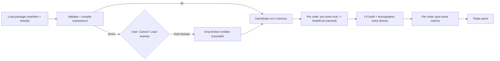

# GameData v4 — Specification

**Status:** Draft for adversarial review (step 3c). **Roadmap:** step 3b, decisions D4–D7.
**Inputs:** `docs/ROADMAP.md`, `docs/design/mechanics-matrix.md`, the v3 code (`GameData.h`, `GameDataManager.cpp`, `FactorySolver.cpp`, `Node.h`).

This document defines the v4 game data format, its expression language, how the solver consumes it, what a project file stores per node, the validation rules, and five worked examples. It contains no C++; steps 3d–3h implement it.

---

## 0. Decisions recorded in the design conversation

| # | Topic | Decision |
|---|---|---|
| Q1 | Where formulas live | **Profiles**: shared formula sets attached to machines. Recipes are pure data. A recipe or a single port may override a formula. |
| Q2 | Conditional ports | **Stable superset**: a node owns every port its recipe and profile can declare. Inactive ports: rate locked to 0, wires kept but marked inactive, port IDs never change. |
| Q3 | Parameter-driven port resources | **In v4, limited**: a port can take its resource from a `resource_choice` parameter. Wires that no longer match become *invalid* (shown as an error), never silently deleted. |
| Q4 | Post-solve metrics | **Linear form** (`per_machine` / `per_craft` constant × solved machines or crafts) **or** a display-only free-form `value`. |
| Q5 | GTNH voltage tiers | **One machine per family** with a `voltage_tier` node parameter; allowed tiers are filtered by machine and recipe attributes. |
| Q6 | Factorio modules | **List-valued `slots` parameter type**; expressions aggregate over the slots with `sum` / `count` / `min` / `max`. |
| R1 | `"nothing"` | **Removed.** A node is a raw source when its *recipe declares no inputs* and a sink when its *recipe declares no outputs*. |
| R2 | Units | Game data declares the recipe time unit and a **default rate unit**. The **project** chooses its own rate unit (it starts as the default, and the user can change it). Internally everything is **per second**. |
| R3 | Large datasets | A manifest plus included shard files, loaded eagerly, compact tuple ports, formulas only in profiles, **no binary cache in v4**. |
| R4 | Loading errors | **Strict**: any error stops the load and shows a report. The user may choose **"Load anyway"**, which drops the broken entities and everything that depends on them. Fatal errors cannot be bypassed. |
| R5 | Project parameters | The project stores **every** parameter that applies to a node, not just values that differ from the default. |
| R6 | JSON | **Strict JSON**, no comments; any entity may carry a `"notes"` string. |

---

## 1. Concepts and pipeline

| Term | Meaning |
|---|---|
| **Package** | One loadable game data set: a directory containing `game.json` (the manifest) and optional shard files. |
| **Resource** | An item, fluid or other flowable thing. Has a `kind` that controls how it is displayed. |
| **Machine** | A building. Has a `profile`, `categories` it can craft, a built-in `speed`, and typed attributes. |
| **Recipe** | Pure data: time, input and output ports (amount, chance, catalyst amount, port attributes), recipe attributes, and either a category or an explicit list of machines. |
| **Profile** | A named, inheritable set of formulas: which parameters a node shows, named intermediate values (`let`), requirements, craft time, port amounts and conditions, extra ports, and metrics. |
| **Parameter** | A per-node user setting (clock speed, tier, modules, …). Defined once in the game data; a profile opts in to it. |
| **Global** | A per-project setting (research levels, global upgrades), read as `global.x`. |
| **Option set** | A list of named options with typed attributes, used by `enum` and `slots` parameters. |
| **Metric** | A displayed quantity (power, EU/t, workers, …) with display locations and an aggregation rule for totals. |
| **NodeEval** | The result of evaluating a node's pre-solve formulas: status, active ports with per-craft amounts, craft time, and linear metric coefficients. |



---

## 2. Package and file structure

### 2.1 Directory layout

```
data/game_data/<game>/<package>/
    game.json                     manifest (small games put everything here)
    recipes/*.json                optional shards, split any way the author likes
    icons/resources/<id>.png
    icons/machines/<id>.png
    icons/options/<set>/<key>.png
```

- A game directory may hold several packages (e.g. different game versions). `GameDataScanner` looks for `data/game_data/*/*/game.json`.
- `"icon_root"` in the manifest (default `"icons"`) may point to a shared directory such as `"../icons"`. It must resolve to a path inside `<game>/`.
- Icons are optional and **loaded lazily** (on first display). The v3 loader loads every texture eagerly, which does not scale to 50k entries.

### 2.2 Manifest (`game.json`) top level

| Key | Required | Type | Meaning |
|---|---|---|---|
| `schema_version` | yes | `4` | Any other value is fatal (F3). |
| `game` | yes | object | `{ "id", "name", "data_version", "attrs" }`. `id` identifies the game in project files; `data_version` is free text (e.g. `"1.1.0.4"`, `"2.7.2"`); `attrs` are game-wide constants readable as `game.<attr>`. |
| `units` | yes | object | §2.3. |
| `resource_kinds` | no | object | §2.4. The default is a single kind `item`. |
| `attributes` | no | object | Typed attribute declarations per entity type (§2.5). |
| `tables` | no | object | Named lookup tables (§3.4). |
| `option_sets` | no | object | §3.3. |
| `parameters` | no | object | Node parameter definitions (§3.1). |
| `globals` | no | object | Project-wide parameter definitions (§3.2). |
| `metrics` | no | object | Metric registry (§6). |
| `profiles` | no | object | §4. |
| `resources`, `machines`, `recipes` | no | arrays | §2.6–§2.8. |
| `include` | no | array of strings | Shard files or directories (§2.9). |
| `icon_root` | no | string | See §2.1. |
| `notes` | no | string | Ignored by the loader. |

Any other key is an error (E-STRUCT-1). Unknown fields are rejected so that typos never fail silently. The only free-text escape hatch is `notes`.

### 2.3 Units and time base (R2)

```json
"units": {
  "recipe_time": "tick",
  "ticks_per_second": 20,
  "default_rate": "s"
}
```

| Field | Values | Meaning |
|---|---|---|
| `recipe_time` | `"s"`, `"tick"` | Unit of `recipe.time` in the files. The loader converts to seconds; `recipe.time_raw` keeps the file value. |
| `ticks_per_second` | number > 0 | Required if `recipe_time` is `"tick"` or if `"tick"` should be offered as a rate unit. Readable as `game.ticks_per_second`. |
| `default_rate` | `"tick"`, `"s"`, `"min"`, `"h"` | The rate unit a **new project** starts with. |

**Per-project rate unit.** The project file stores `"rate_unit"` (one of the four values; `"tick"` only if the package defines `ticks_per_second`). Changing it is an undoable project setting that **only changes display and input**:
- The solver, `Port::rate`, `Connection::rate`, user constraints and the project file all use the **canonical unit: per second**.
- The UI multiplies by 1 / 20 / 60 / 3600… when displaying, and divides when the user types a rate.
- Consequence for the solver (step 3e): the time-unit factor `U` disappears from `w_n` (§7.3). Golden tests keep their expected numbers by stating them in the project's rate unit and converting them (e.g. `/ 60`) once in the test helper.

Rate units affect *rates* only. Metrics that are rates (`is_rate: true`, §6) are converted as well; metrics such as MW or EU/t are not.

### 2.4 Resource kinds and display units

```json
"resource_kinds": {
  "item":  { "label": "Item",  "display_unit": "",   "display_scale": 1 },
  "fluid": { "label": "Fluid", "display_unit": "m³", "display_scale": 1 }
}
```

Amounts in recipes use the game's native unit for that kind (Satisfactory fluids: m³; GTNH fluids: L). `display_scale` multiplies values for display (e.g. GTNH could store L and display kL with `0.001`). The rate unit is appended after the display unit: `"m³/min"`.

### 2.5 Attribute declarations

Attributes are typed key–value data on entities. They must be declared once, so typos are caught and defaults apply.

```json
"attributes": {
  "machine":  { "power": { "type": "number", "default": 0 },
                "somersloop_slots": { "type": "number", "default": 0 } },
  "recipe":   { "eut": { "type": "number", "default": 0 },
                "allows_productivity": { "type": "bool", "default": false } },
  "port":     { "min_tier": { "type": "number", "default": 0 } },
  "resource": { "fuel_value": { "type": "number", "default": 0 } }
}
```

- Types: `number`, `bool`, `string`. A `default` is required.
- Attribute names match `[a-z_][a-z0-9_]*` and must not shadow a built-in field (§5.5).
- Game-level constants go in `game.attrs` and need no declaration (their type comes from the JSON value).

### 2.6 Resources

```json
{ "id": "iron-ore", "name": "Iron Ore", "kind": "item", "tags": ["ore"], "attrs": {} }
```

`id` (required), `name` (default: `id`), `kind` (default `"item"`), `tags` (used by `resource_choice`), `attrs`, `notes`.

### 2.7 Machines

```json
{ "id": "constructor", "name": "Constructor", "profile": "sf_production",
  "categories": ["constructor"], "speed": 1.0,
  "attrs": { "power": 4, "somersloop_slots": 1 } }
```

`id`, `name`, `profile` (default `"default"`), `categories` (array of strings), `speed` (built-in, default 1, must be > 0), `attrs`, `notes`.

### 2.8 Recipes

```json
{ "id": "iron-plate", "name": "Iron Plate", "category": "constructor", "time": 6,
  "in":  [["iron-ingot", 3]],
  "out": [["iron-plate", 2]] }
```

| Field | Meaning |
|---|---|
| `id`, `name` | As usual. |
| `category` **or** `machines` | `category`: every machine whose `categories` contains it can run the recipe (needed for GTNH recipe maps and Factorio crafting categories). `machines`: an explicit list of machine ids. Exactly one of the two. |
| `time` | Craft time per craft at machine speed 1, in `units.recipe_time`. Must be > 0. |
| `in`, `out` | Port lists (below). Either may be empty or missing, but not both (V-NUM-4). An empty `in` makes the recipe a **raw source**; an empty `out` makes it a **sink** (R1). |
| `setup` | Optional list of `[resource, amount]` items needed to *build or configure* the machine but not consumed per craft (GT programmed circuits, molds, lenses). Shown on the node, not part of the LP. |
| `attrs` | Recipe attributes. |
| `overrides` | Optional formula overrides (§4.4). |

**Port forms.** Short (tuple) form: `[resource, amount]` or `[resource, amount, chance]`. Long form, needed for anything else:

```json
{ "res": "dust_gold", "amount": 1, "chance": 0.1, "catalyst": 0,
  "attrs": { "min_tier": 3 }, "enabled": "...", "amount_expr": "..." }
```

| Field | Default | Meaning |
|---|---|---|
| `res` | — | Resource id. |
| `amount` | — | Base amount per craft, > 0. |
| `chance` | 1 | Probability in (0, 1]. Applied by the profile's amount formula (the default profile multiplies by it). |
| `catalyst` | 0 | Part of `amount` that productivity bonuses do not apply to, in [0, amount] (Factorio `ignored_by_productivity`, M10). |
| `attrs` | {} | Port attributes (declared under `attributes.port`). |
| `enabled`, `amount_expr` | — | Per-port formula overrides (§4.4). |

Port **slot keys**: `in:<index>` and `out:<index>` (0-based, in file order). They identify ports in project files (§8).

### 2.9 Splitting large datasets (R3)

```json
"include": ["resources.json", "machines.json", "recipes/"]
```

- Each entry is a file or a directory (trailing `/`). A directory contributes every `*.json` file under it, recursively, **sorted by relative path in byte order**, so the order is the same on every platform.
- A shard is a JSON object that may contain the same keys as the manifest **except** `schema_version`, `game`, `units`, `include` and `icon_root`. Shards cannot include other shards.
- Entity ids are global across all files. Maps (`profiles`, `parameters`, …) are merged by key, and a key defined twice is an error (V-ID-2).
- Paths must stay inside the package directory (V-INC-3).

**Why this scales to GTNH (50k+ recipes):**
- Formulas live in about 20–50 profiles that are parsed once. A typical GTNH recipe in short form is pure numbers, roughly 150–250 bytes, so 50k recipes come to about 10 MB of JSON.
- Everything loads eagerly. **Budget: under 2 s for 50k recipes in a Release build**, measured in step 4 with the real import. Implementation guidance for 3d: intern ids, store entities in vectors with hash indices (not `std::map<std::string, …>`), load icons lazily, validate in one pass.
- No binary cache in v4. A cache only gets designed (in step 4) if the budget is missed.
- Importers may split shards however they like (e.g. one per GT recipe map). The split has no meaning to the loader.

---

## 3. Parameters, globals, option sets, tables

### 3.1 Node parameter definitions

```json
"parameters": {
  "clock": {
    "label": "Clock speed", "type": "number", "default": 100,
    "min": "1", "max": "250", "step": 0.0001, "unit": "%",
    "ui": { "widget": "drag", "format": "%.4g%%", "placement": "body" }
  }
}
```

| Field | Applies to | Meaning |
|---|---|---|
| `label`, `tooltip` | all | Display text. |
| `type` | all | `number`, `int`, `bool`, `enum`, `resource_choice`, `slots`. |
| `default` | all | Literal. Required for `number`/`int`/`bool`. Optional for `enum` (first allowed option), `resource_choice` (first allowed resource, or none if `allow_none`) and `slots` (all empty). |
| `min`, `max` | number, int | Expressions in the **static context** (§5.4), e.g. `"machine.somersloop_slots"`. |
| `step` | number, int | UI step; `int` requires an integer step (default 1). |
| `unit` | number, int | Display suffix only. |
| `option_set` | enum, slots | The option set name (§3.3). |
| `allowed_if` | enum, slots, resource_choice | Static-context bool expression evaluated per option (`option.*` bound), or per resource (`option` bound to the resource). Options for which it is false are not offered. |
| `resources` / `tag` | resource_choice | Candidate resources: an explicit list or every resource carrying the tag. |
| `allow_none` | enum, resource_choice | Adds a "none" choice; test it with `is_set(param.x)`. |
| `count` | slots | Static expression giving the number of slots, e.g. `"machine.module_slots"`. |
| `allow_empty` | slots | Default `true`. |
| `visible_if` | all | Static-context bool. **A hidden parameter evaluates as its default.** Its stored value is kept, so un-hiding restores it. |
| `ui` | all | `widget` (`slider`, `drag`, `input`, `stepper`, `checkbox`, `combo`, `slot_row`), `format` (printf-style), `group` (UI section label), `placement` (`body` = on the node card, `panel` = properties panel only; default `panel`). |

**Value rules.**
- `int` values must be integral. A stored value outside `[min, max]` is **clamped during evaluation**, and the node shows a `WARNING` status; the stored value is not rewritten.
- An `enum` / `resource_choice` / slot value that is no longer allowed (e.g. the recipe changed) falls back to the default, with a `WARNING`.
- Parameter ids match `[a-z_][a-z0-9_]*`.

### 3.2 Globals

Same definition format as parameters, under `"globals"`. They are stored once per project, edited in a project settings panel, and read as `global.<id>`. `visible_if`, `allowed_if`, `min`, `max` and `count` may only reference `game.*` and other globals.

Example (Factorio mining productivity research, M9):

```json
"globals": {
  "mining_prod_level": { "label": "Mining productivity research", "type": "int",
                         "default": 0, "min": "0", "max": "1000" }
}
```

A mining-drill profile can then use `"let": { "prod": "1 + 0.1 * global.mining_prod_level" }`.

### 3.3 Option sets

```json
"option_sets": {
  "gt_tiers": {
    "attrs": { "t": { "type": "number", "default": 0 },
               "v": { "type": "number", "default": 0 } },
    "options": [
      { "key": "ulv", "label": "ULV", "attrs": { "t": 0, "v": 8 } },
      { "key": "lv",  "label": "LV",  "attrs": { "t": 1, "v": 32 } }
    ]
  }
}
```

Option keys are unique within a set. Expressions read an option's attributes with `.attr` and compare options by key (`param.mode == "extra"`; the key is checked at load time).

### 3.4 Tables

```json
"tables": {
  "gt_voltage": [8, 32, 128, 512, 2048, 8192, 32768, 131072, 524288],
  "coil_heat":  { "cupronickel": 1801, "kanthal": 2701, "nichrome": 3601 }
}
```

An array table is indexed by an integral number (0-based); an object table is indexed by a string key. Values are numbers. Expressions use `lookup("gt_voltage", t)` (§5.6).

---

## 4. Profiles

### 4.1 Shape

```json
"profiles": {
  "<id>": {
    "extends": "<id>",
    "params": ["clock", "somersloops"],
    "let": { "c": "param.clock / 100" },
    "requires": [ { "expr": "...", "message": "..." } ],
    "craft_time": "recipe.time / (machine.speed * c)",
    "input_amount": "port.amount",
    "output_amount": "port.amount * port.chance",
    "port_enabled": "true",
    "extra_ports": [ { "id": "spray", "dir": "in", "resource_param": "prolif",
                       "amount": "...", "enabled": "..." } ],
    "metrics": { "power": { "per_machine": "..." } }
  }
}
```

| Key | Type | Context | Meaning |
|---|---|---|---|
| `extends` | id | — | Single inheritance. Every profile implicitly extends `default`. |
| `params` | array of ids | — | Parameters shown on nodes of this profile, in UI order. Only listed parameters may be referenced as `param.*`. |
| `let` | map name → expr | pre-solve | Named intermediate values. Evaluated in dependency order (topological sort, ties by name); cycles are an error. Later formulas use them by bare name. |
| `requires` | array | pre-solve, bool | If any condition is false, the node becomes `BLOCKED` with the given message (e.g. "Recipe needs MV or higher"). |
| `craft_time` | expr | pre-solve, number | Seconds per craft per machine, > 0. |
| `input_amount`, `output_amount` | expr | pre-solve + `port.*`, number | Effective amount per craft for each recipe port, ≥ 0. |
| `port_enabled` | expr | pre-solve + `port.*`, bool | Whether a recipe port is active. |
| `extra_ports` | array | — | Ports added by the machine or profile (fuel, booster, spray, ash, maintenance). §4.3. |
| `metrics` | map metric id → form | — | §6. |

**The built-in `default` profile** (used when a machine names no profile):

```json
"default": {
  "params": [],
  "let": {},
  "requires": [],
  "craft_time": "recipe.time / machine.speed",
  "input_amount": "port.amount",
  "output_amount": "port.amount * port.chance",
  "port_enabled": "true",
  "extra_ports": [],
  "metrics": {}
}
```

### 4.2 Inheritance rules

- `let`, `metrics` and `extra_ports` merge **by key / id**: the child replaces entries with the same name and adds new ones.
- `requires` is **appended** (the parent's requirements still apply).
- Every other key is **replaced** when the child defines it.
- `extends` cycles are an error (V-PROF-2).

### 4.3 Extra ports

```json
{ "id": "water", "dir": "in", "resource": "water",
  "amount": "machine.water_per_s * craft_time", "enabled": "param.hydrated" }
```

| Field | Meaning |
|---|---|
| `id` | Unique within the (merged) profile. Slot key `x:<id>`. |
| `dir` | `"in"` or `"out"`. |
| `resource` **or** `resource_param` | A fixed resource id, or the id of a `resource_choice` parameter of this profile (Q3). If the parameter is unset (`allow_none`), the port is inactive. |
| `amount` | Pre-solve expression, amount per craft ≥ 0. `craft_time` is available, so time-proportional consumption is `rate_per_s * craft_time`. |
| `enabled` | Pre-solve bool, default `true`. |

Extra ports **do not change** whether a node is a raw source or a sink (R1): a drill with a water booster port is still a raw source.

### 4.4 Overrides (recipe and port level)

Recipe level:

```json
"overrides": {
  "craft_time": "recipe.time / machine.speed",
  "let": { "prod": "1" },
  "requires": [ { "expr": "global.turd_moss == 2", "message": "Needs T.U.R.D. branch 2" } ],
  "metrics": { "power": { "per_machine": "machine.power * 2" } }
}
```

- Overridable: `craft_time`, `input_amount`, `output_amount`, `port_enabled`, `let` entries (by name; the name must already exist in the profile), `metrics` entries (by id), and `requires` (appended).
- Not overridable: `params` and `extra_ports`, because they define the port and UI superset of the machine.
- An override applies to **every** machine that can run the recipe. It is type-checked against the profile of each of those machines, and an override that does not compile for one of them is an error (V-OVR-2).

Port level: `enabled` and `amount_expr` on a long-form port replace `port_enabled` and `input_amount`/`output_amount` for that port only.

### 4.5 Evaluation order (pre-solve)

For a node with recipe R, machine M and profile P (with recipe overrides applied):

1. Resolve `global.*` and `param.*` values: stored value → validation and clamping → default if hidden or invalid.
2. Evaluate `let` values in dependency order.
3. Evaluate `requires`. If any is false: status `BLOCKED`, every port locked to 0, stop.
4. Evaluate `craft_time`. If it is ≤ 0 or not finite: status `ERROR`.
5. For each recipe port in slot order: `enabled`, then (if enabled) `amount`.
6. For each extra port in declaration order: resolve the resource, then `enabled`, then `amount`.
7. Evaluate the linear metric coefficients (`per_machine`, `per_craft`).

The result is a **NodeEval** (§7.1).

---

## 5. Expression language (D7)

A small, pure, statically typed expression language implemented in C++ (lexer → parser → AST → type-check → tree-walking evaluator) under `src/core/expr/`, with no ImGui dependency.

### 5.1 Lexical rules

- **Numbers:** `12`, `1.5`, `0.25`, `1e-9`, `2.5E3`. No leading `.`, no hex, no suffixes. A leading `-` is the unary operator.
- **Strings:** double-quoted, no escapes except `\"` and `\\`. They are only used for option and resource keys and as table names.
- **Identifiers:** `[A-Za-z_][A-Za-z0-9_]*`. **Keywords:** `true`, `false`.
- Whitespace is insignificant. There are no comments (expressions are JSON strings; use `notes`).

### 5.2 Grammar (EBNF)

```
expr     = or ;
or       = and   { "||" and } ;
and      = not   { "&&" not } ;
not      = "!" not | cmp ;
cmp      = sum   [ ( "==" | "!=" | "<" | "<=" | ">" | ">=" ) sum ] ;
sum      = term  { ( "+" | "-" ) term } ;
term     = unary { ( "*" | "/" | "%" ) unary } ;
unary    = "-" unary | power ;
power    = postfix [ "^" unary ] ;
postfix  = primary { "." IDENT } ;
primary  = NUMBER | STRING | "true" | "false" | call | IDENT | "(" expr ")" ;
call     = IDENT "(" [ expr { "," expr } ] ")" ;
```

Notes:
- `^` is right-associative and binds tighter than unary minus: `-2^2 = -4`, `2^3^2 = 512`, `2^-1 = 0.5`.
- Comparisons do not chain: `a < b < c` is a syntax error.
- `!` binds looser than comparisons, so `!a == b` means `!(a == b)`. Since there are no implicit conversions, the C-style reading would be a type error anyway.
- `&&` and `||` short-circuit, and `if()` evaluates only the chosen branch. Runtime errors in branches that are not taken (e.g. reading an unset `resource_choice`) therefore don't fire.
- There is no ternary `?:`; `if(c, a, b)` is the only conditional.

### 5.3 Types

| Type | Produced by | Operations |
|---|---|---|
| `number` | literals, numeric attributes, `number`/`int` params, built-ins | arithmetic, comparisons, numeric built-ins |
| `bool` | `true`/`false`, comparisons, `!`, `&&`, `||`, bool attributes and params | `&&`, `||`, `!`, `==`, `!=`, `if` condition |
| `string` | string literals, string attributes | `==` / `!=` with string, option or resource |
| `option<S>` | `enum` params, `option` in `allowed_if` | `.attr` (attribute of set S), `==` / `!=` with a string literal (a key of S, checked at load) or another `option<S>` |
| `resource` | `resource_choice` params, `port.resource` | `.attr` (resource attributes), `.id` (string), `==` / `!=` with a string literal (a resource id, checked at load) |
| `slots<S>` | `slots` params | `.attr` → `list<number>`; argument of `count()` |
| `list<number>` | `slots<S>.attr` | only as the sole argument of `sum`, `min`, `max` |

There are no implicit conversions (`bool` is not a number; write `if(b, 1, 0)`). Each expression has a **required result type**: `number` for amounts, times, bounds and metrics; `bool` for `enabled`, `requires`, `visible_if` and `allowed_if`.

### 5.4 Contexts and available variables

| Context | Used for | Available names |
|---|---|---|
| **static** | `min`, `max`, `count`, `visible_if`, `allowed_if` | `game.*`, `global.*`, `machine.*`, `recipe.*`, `param.*` of parameters listed **earlier** in the profile's `params`, `option` (only in `allowed_if`) |
| **pre-solve** | `let`, `requires`, `craft_time`, port formulas, extra ports, `per_machine`, `per_craft` | static names + all `param.*` of the profile + `let` names + `craft_time` (after step 4 of §4.5) + `port.*` (only in port formulas) |
| **post-solve** | `value` metrics | pre-solve names (except `port.*`) + `node.machines` (solved machine count) + `node.crafts` (crafts per second, all machines) |

A name used outside its context is a load-time error (V-EXPR-3). For example, `node.machines` in `craft_time` is rejected. This is what keeps the LP linear (§7.2).

**Globals in static context of globals** may only reference `game.*` and other globals (§3.2).

### 5.5 Built-in fields

| Name | Type | Meaning |
|---|---|---|
| `game.ticks_per_second` | number | From `units`. |
| `game.<attr>` | per JSON | From `game.attrs`. |
| `machine.id` | string | |
| `machine.speed` | number | Built-in machine speed. |
| `machine.<attr>` | declared | Machine attributes. |
| `recipe.id` | string | |
| `recipe.time` | number | Seconds (converted). |
| `recipe.time_raw` | number | As written in the file (e.g. ticks). |
| `recipe.input_items_total`, `recipe.input_fluids_total`, `recipe.output_items_total`, `recipe.output_fluids_total` | number | Sums of base `amount` over recipe ports of resources with kind `item` / `fluid` (precomputed). If the game defines no `fluid` kind, the fluid totals are 0. |
| `recipe.<attr>` | declared | Recipe attributes. |
| `port.amount`, `port.chance`, `port.catalyst` | number | Base port data. |
| `port.index` | number | 0-based index within `in` or `out`. |
| `port.resource` | resource | |
| `port.<attr>` | declared | Port attributes. |
| `craft_time` | number | Result of the profile's `craft_time` (port, extra-port and metric formulas only). |
| `node.machines`, `node.crafts` | number | Post-solve only. |

### 5.6 Built-in functions

| Function | Signature | Notes |
|---|---|---|
| `min`, `max` | `(number, number, …)` or `(list)` | At least 1 argument. An empty list → runtime error. |
| `clamp` | `(x, lo, hi)` | Error if `lo > hi`. |
| `abs`, `floor`, `ceil`, `round`, `sqrt` | `(number)` | `round` rounds half away from zero. `sqrt(x < 0)` → runtime error. |
| `pow` | `(a, b)` | Same as `a ^ b`. Error if the result is not finite. |
| `exp`, `ln` | `(number)` | `ln(x ≤ 0)` → runtime error. |
| `log` | `(x, base)` | `ln(x) / ln(base)`, with the same domain checks. |
| `if` | `(bool, T, T)` | Lazy; both branches must have the same type. |
| `lookup` | `(table, key)` or `(table, key, default)` | `table` must be a **string literal** naming a table (checked at load). The key must be a number for array tables (integral within 1e-9; otherwise runtime error) or a string, option or resource for object tables (an option uses its key, a resource its id). A miss without a default → runtime error. |
| `sum` | `(list)` | Over non-empty slots; 0 if all are empty. |
| `count` | `(slots)` or `(slots, "key")` | Number of non-empty slots, or of slots holding that option key (checked at load). |
| `is_set` | `(param)` | For `allow_none` enum / `resource_choice`, and for `slots` (true if any slot is non-empty). The argument must be a bare `param.x`. |

The function set is closed. There are no user-defined functions, loops, variables or indexing (§11).

### 5.7 Error reporting

**Load-time (compile) errors** carry the file, the JSON pointer to the string, and the line:column *inside the expression*, followed by the expression with a caret:

```
recipes/gt.json: /profiles/gt_single/let/oc: 1:38: expected ')' but found end of expression
    min(oc_v, floor(log(recipe.time_raw, 2) + 1e-9)
                                         ^
```

```
game.json: /profiles/sf_production/craft_time: 1:30: unknown identifier 'param.clok' (did you mean 'param.clock'?)
```

Compile-time checks: syntax; unknown identifier (with a "did you mean" suggestion from edit distance ≤ 2); a name that is not allowed in this context; operand and argument types; arity; unknown function; unknown table; unknown option key or resource id in a comparison; a `param.*` that is not listed in the profile's `params`; result type; `let` cycles.

**Runtime (evaluation) errors** put the node into `ERROR`: all of its ports are locked to 0, the message is shown on the node, and other nodes still solve. No exception escapes the evaluator or the solver. Messages name the formula's source:

```
Node "Macerator #3": division by zero in profiles/gt_single/let/oc (recipe 'macerate-crushed-copper')
Node "Assembler #1": craft_time evaluated to 0 s (must be > 0) in profiles/fa_crafter/craft_time
Node "Constructor #2": lookup("gt_voltage", 9.5): index must be an integer
```

Runtime checks: division or modulo by zero; NaN or ±Inf produced by any operation; domain errors (`sqrt`, `ln`, `log`, `pow`); lookup miss or non-integral index; `min`/`max` of an empty list; `clamp` with `lo > hi`; negative port amount; `craft_time ≤ 0`; a `resource_choice` that resolves to a resource missing from the loaded data.

### 5.8 Determinism

- Expressions are pure: no state, no randomness, no clock, no I/O. Evaluation order is fixed (§4.5; left to right within an expression; short-circuit as specified).
- All numbers are IEEE-754 double. `-0` is normalised to `0` in results.
- **Platform caveat:** `std::pow`, `std::log` and `std::exp` may differ in the last bit between MSVC and glibc. Results feed the LP as coefficients, so these tiny differences are harmless, **except** when the result goes into `floor`/`ceil`/`round` and lands exactly on an integer. Data authors and importers should (a) precompute integral attributes where possible (e.g. a recipe's tier), and (b) otherwise add a guard epsilon (`floor(log(x, 4) + 1e-9)`), as the GTNH example does. Tests compare with tolerances.
- Performance: each formula is compiled once per (profile, override) at load; evaluating one node takes microseconds. A NodeEval is recomputed only when its inputs change (§7.1).

---

## 6. Metrics and totals

### 6.1 Registry

```json
"metrics": {
  "power": { "label": "Power", "unit": "MW", "display": ["body", "tooltip", "totals"],
             "aggregate": "sum", "split_sign": true, "is_rate": false, "format": "%.2f" }
}
```

| Field | Default | Meaning |
|---|---|---|
| `label`, `unit`, `format` | — / `""` / `"%.3g"` | Display. |
| `display` | `["tooltip"]` | Any subset of `body` (node card), `tooltip` (node hover) and `totals` (graph totals panel). |
| `aggregate` | `"sum"` | How totals combine nodes: `sum`, `max`, `min`, or `none` (not shown in totals). |
| `split_sign` | `false` | Only with `sum`: totals show the positive subtotal, the negative subtotal and the net (e.g. consumption vs generation). Convention: consumption is positive, generation negative. |
| `is_rate` | `false` | If true, the value is per second and gets converted to the project's rate unit for display. |

### 6.2 Forms in a profile

Each `profiles.<id>.metrics.<metric>` entry has **exactly one** of:

| Form | Context | Node value | LP-usable |
|---|---|---|---|
| `per_machine` | pre-solve | `coeff × node.machines` | yes: `machines` is linear in the reference flow |
| `per_craft` | pre-solve | `coeff × node.crafts` | yes |
| `value` | post-solve | the expression's result | no (display only; may use `ceil`, `max`, …) |

Linear forms are what a later "minimize power" objective (step 7) or a power constraint can use without becoming non-linear. A metric with `aggregate` other than `none` is aggregated over **every node whose profile defines it**. Nodes in `ERROR`/`BLOCKED` contribute 0.

The machine count is not a metric: it is always shown.

---

## 7. How the solver consumes v4

### 7.1 NodeEval

Before every solve, each node has an up-to-date **NodeEval**:

```
NodeEval {
  status: OK | WARNING | BLOCKED | ERROR
  messages: [ { severity, text, source } ]
  craft_time_s: number
  ports: [ { slot_key, port_id, dir, resource, active, amount_per_craft } ]
  metric_coeffs: [ { metric, form: per_machine|per_craft, coeff } ]
}
```

- A NodeEval is computed by a pure function `evaluateNode(gameData, node, globals) → NodeEval`. It lives in core and has no solver or UI dependency.
- **It is recomputed when** the node's recipe, machine or parameters change, when a global changes (all nodes), or when the data is reloaded. It is cached at runtime and **not serialized**.
- The LP builder reads **only NodeEvals** and the graph topology. It never reads `Recipe` or `Machine` directly. This replaces the v3 code paths in `addRecipeConstraints`, `buildMachineActivityTerms` and `updateComponentGraph` that read `clock_speed`, `production_multiplier`, `base_crafting_speed`, `time_seconds` and `time_unit`.

### 7.2 LP mapping and why it stays linear

For node n with NodeEval E:
- If `E.status ∈ {BLOCKED, ERROR}`, every port of n is fixed to 0 (as v3 does for `clock_speed ≤ 0`).
- Ports with `active = false` or `amount_per_craft = 0` are fixed to 0.
- Among the remaining ports, pick the **reference port**: the first active input with a > 0 in slot order (recipe inputs, then extra inputs), or, if there is none, the first active output with a > 0. If there is no reference, every port is fixed to 0 and the node gets a `WARNING` ("no active flow").
- Stoichiometry: for every other remaining port p, `a_ref · R_p − a_p · R_ref = 0` (the v3 ratio constraints, with coefficients taken from E).
- Wires whose state is not OK (§7.4) have their flow variable fixed to 0.

**Linearity argument.** Every expression is evaluated before the LP is built, from inputs that do not depend on LP variables (parameters, globals, attributes). Each `a_p` and `craft_time_s` is therefore a constant during `solve()`, and every constraint is constant × variable. Post-solve names (`node.machines`, `node.crafts`) are rejected at compile time in every pre-solve formula (V-EXPR-3), so no formula can feed a solved value back into a coefficient. Linear metrics are constant × M_n, and M_n is itself constant × R_ref.

### 7.3 Machine count and crafts

With canonical per-second rates (R2):

$$\text{crafts}_n = \frac{R_{\text{ref}}}{a_{\text{ref}}}, \qquad M_n = \text{crafts}_n \cdot t'_n, \qquad w_n = \frac{t'_n}{a_{\text{ref}}}$$

where $t'_n$ = `craft_time_s`. Compared with v3 ($w_n = t_0 / (a_{\text{ref}} \cdot B \cdot U \cdot C)$), the factors $B$ (machine speed) and $C$ (clock) are now inside $t'_n$, $P$ (production multiplier) is inside the amounts, and $U$ disappears because rates are per second. The lexicographic stages, their objectives and their tolerances do **not** change; step 3e only changes where the coefficients come from and must prove this with the golden tests (Hard Rule 3).

> [!NOTE]
> Step 3e may replace the ratio constraints with one activity variable per node ($R_p = a_p \cdot X_n$) if that simplifies the code, but only if every golden test passes with unchanged numbers. This spec does not require it.

### 7.4 Ports, wires and node changes (Q2, Q3)

- **Port superset.** A node's ports are: one per recipe port (`in:i`, `out:i`) plus one per extra port of its machine's profile (`x:id`). They exist even when inactive.
- **Wire state** (computed after evaluation, not serialized):
  - `OK`: both ends active and the resources match.
  - `INACTIVE`: at least one end is inactive. Drawn dimmed; flow 0.
  - `INVALID`: the resources differ (a `resource_choice` changed). Drawn as an error; flow 0; never deleted automatically.
- **Parameter change**: never adds or removes ports. It may change activity, amounts and the resources of `resource_param` ports.
- **Machine change** (same recipe): ports are matched by slot key. Recipe ports are unchanged. Extra ports whose key exists in both profiles keep their port ID and wires. New keys get new ports. Ports whose key disappears are deleted together with their wires, **inside the same undoable command**.
- **Recipe change**: rebuilds all ports, as v3 does (undoable).
- **Raw/sink classification (R1)**: raw source ⇔ the recipe's `in` is empty; sink ⇔ the recipe's `out` is empty. These replace the `resource_key == "nothing"` predicates in `analyzeComponent` and `classifyConstraint`. Extra ports do not affect classification.

### 7.5 What replaces `Node::clock_speed` / `production_multiplier`

`Node` loses `clock_speed` and `production_multiplier` and gains:

```
params: map<param_id, ParamValue>    ParamValue = number | bool | string(option key / resource id / none) | array<string|null> (slots)
unresolved_params: raw JSON          kept verbatim (§8.2)
```

The UI generates widgets from the profile's `params` (step 3f). Each parameter edit is one undo command (old value → new value).

- **Satisfactory**: clock → parameter `clock`; the v3 production multiplier → parameter `somersloops` (Example 10.1).
- **Mindustry**: the converted data (3g) may define a profile with an `efficiency` parameter (tile attributes and overdrive, M21/M23) or simply use `default`.
- **Golden tests**: v3 tests set arbitrary multipliers (e.g. 150 %) that real Satisfactory data cannot express. Step 3e adds a **test-only package** (under `tests/data/`) with a profile that reproduces v3 exactly:

  ```json
  "v3_compat": {
    "params": ["clock", "output_mult"],
    "craft_time": "recipe.time / (machine.speed * param.clock / 100)",
    "output_amount": "port.amount * port.chance * param.output_mult / 100"
  }
  ```

  The same expected numbers then hold, stated per minute and converted once by the test helper (§2.3).

### 7.6 Post-solve

After solving, for each node: `node.machines` = M_n and `node.crafts` = crafts_n. Linear metrics = coefficient × M_n (or × crafts_n); `value` metrics are evaluated in the post-solve context. Totals are aggregated per metric id (§6). Everything is exposed through a read-only API (`getNodeMetrics(node_id)`, `getTotals()`) for the UI (step 3f).

---

## 8. Project file (per node and per project)

### 8.1 Shape

```json
{
  "game": { "id": "satisfactory", "data_version": "1.1.0.4" },
  "rate_unit": "min",
  "globals": {},
  "nodes": [
    {
      "id": 12,
      "recipe": "iron-plate",
      "machine": "constructor",
      "params": { "clock": 150, "somersloops": 1 },
      "ports": { "in:0": 40, "out:0": 41 },
      "port_constraints": { "41": 1.5 },
      "port_constraint_modes": { "41": "target" },
      "position": [320, 180]
    }
  ],
  "connections": [ { "id": 7, "from_port": 41, "to_port": 55 } ],
  "next_node_id": 13, "next_port_id": 56, "next_connection_id": 8
}
```

- `params` stores **every parameter of the node's profile** (R5), including the values of hidden parameters. Value encoding: number; bool; string (option key or resource id); `null` (an `allow_none` choice set to none); array of strings/nulls (slots).
- `ports` maps slot keys to port IDs, so wires and constraints survive data updates that reorder nothing. Recipe port order **is** the identity: importers must keep `in`/`out` order stable across data versions.
- **`port_constraints` are stored per second (canonical), whatever `rate_unit` is.** In the example, 1.5/s is 90/min.
- `connections` no longer store `resource_key`, because it is derived from the port.
- The project format version and its checks belong to step 3h. Positions and other editor fields are unchanged here.

### 8.2 Loading a project against changed or degraded data

| Situation | Behaviour |
|---|---|
| `game.id` differs from the loaded package | The project does not open; the error names both ids. |
| `data_version` differs | Opens; one notification. |
| Recipe or machine missing | The node is kept as an **unresolved node**: shown in `ERROR`, ports kept from the stored slot keys, LP flows 0. Its JSON is saved back **verbatim**, so loading with partial ("Load anyway") data and re-saving never loses work. |
| Parameter unknown to the profile | Ignored for evaluation, kept in `unresolved_params` and saved back verbatim; one warning per project. |
| Parameter value invalid (type, range, option not allowed) | The default (or clamped value) is used, with a node `WARNING`; the stored value is kept and saved back unchanged until the user edits it. |
| Stored slot key missing in the current data | That port is created as an unresolved port (inactive, wires `INACTIVE`) and kept. |

---

## 9. Validation rules

### 9.1 Loading policy (R4)

- The loader returns a **LoadReport**: `{ fatal: bool, errors[], warnings[], dropped: {kind → [ids]} }`. Every entry has a severity, a rule id, a location (`file: /json/pointer[: line:col]`) and a message.
- **No errors** → the package loads; warnings are logged.
- **Errors but no fatal error** → the app shows the report (error count, a scrollable list, "Copy to clipboard") with the choices **[Cancel]** and **[Load anyway (ignore errors)]**. Tests and `gamedata_tool` use an explicit `ignore_errors` option instead of the dialog.
- **Load anyway** removes each entity that has an error, then removes everything that depends on removed entities. The cascade runs in a fixed order, so the result is deterministic:


  For example, a profile that references a dropped parameter is dropped. Machines using it are then dropped, and recipes no machine can run any more are dropped too. The package is marked **degraded**: the status bar shows "Game data loaded with N errors (M entities skipped)", and the report stays available from the menu. The choice is not remembered; the next load asks again.
- **Fatal errors** (F-*) cannot be ignored; the only choice is to close the report.

### 9.2 Rules

Severity: **F** = fatal, **E** = error (droppable), **W** = warning. "Drops" = what Load anyway removes.

| Rule | Sev | Rejects | Drops | Example message |
|---|---|---|---|---|
| F-1 | F | Manifest missing or unreadable | — | `data/game_data/gtnh/2.7/game.json: cannot open file` |
| F-2 | F | Manifest is not valid JSON | — | `game.json:812:5: JSON parse error: unexpected '}'` |
| F-3 | F | `schema_version` missing or ≠ 4 | — | `game.json: /schema_version: unsupported schema version 3 (this build reads 4)` |
| F-4 | F | `game.id` missing or invalid | — | `game.json: /game/id: required string matching [a-z0-9_-]+` |
| F-5 | F | `units` invalid (unknown `recipe_time`, `tick` without `ticks_per_second`, unknown `default_rate`) | — | `game.json: /units/default_rate: 'minute' is not one of tick, s, min, h` |
| V-INC-1 | E | Include path does not exist | that entry | `game.json: /include/2: 'recipes/gt_mixer.json' not found` |
| V-INC-2 | E | Shard is not valid JSON | the shard | `recipes/gt_mixer.json:40:1: JSON parse error: unexpected end of input` |
| V-INC-3 | E | Path escapes the package, or a shard uses a manifest-only key | the shard | `recipes/a.json: /include: shards cannot include other files` |
| V-STRUCT-1 | E | Unknown key (top level or in an entity) | the entity (or shard for top level) | `recipes/gt.json: /recipes/88/ammount: unknown field (did you mean 'amount'?)` |
| V-STRUCT-2 | E | Wrong JSON type | the entity | `game.json: /machines/3/speed: expected number, got string` |
| V-ID-1 | E | Id missing or not matching `[A-Za-z0-9_.:/-]+` | the entity | `game.json: /resources/12/id: invalid id 'iron ore' (spaces not allowed)` |
| V-ID-2 | E | Duplicate id or map key across all files | the second definition | `recipes/b.json: /recipes/4/id: duplicate recipe id 'iron-plate' (first defined at recipes/a.json: /recipes/17)` |
| V-REF-1 | E | Port references an unknown resource | the recipe | `recipes/gt.json: /recipes/88/in/0: unknown resource 'crushed_coper' (did you mean 'crushed_copper'?)` |
| V-REF-2 | E | Recipe has both or neither of `category` / `machines`; unknown machine in `machines` | the recipe | `game.json: /recipes/5: specify exactly one of 'category' or 'machines'` |
| V-REF-3 | E | No loaded machine can run the recipe | the recipe | `recipes/gt.json: /recipes/88: no machine has category 'gt.macerator'` |
| V-REF-4 | E | Machine references an unknown profile | the machine | `game.json: /machines/2/profile: unknown profile 'sf_prodution'` |
| V-REF-5 | E | Resource of unknown kind; parameter with unknown option set; `resource_choice` tag matching no resource | the entity | `game.json: /parameters/prolif/tag: no resource has tag 'proliferator'` |
| V-ATTR-1 | E | Attribute not declared for this entity type | the entity | `game.json: /machines/4/attrs/powr: undeclared machine attribute 'powr' (did you mean 'power'?)` |
| V-ATTR-2 | E | Attribute value of the wrong type; declaration without a default; name shadows a built-in | the entity / the declaration | `game.json: /attributes/machine/speed: 'speed' is a built-in machine field` |
| V-NUM-1 | E | `time` ≤ 0 or not finite; machine `speed` ≤ 0 | the entity | `recipes/gt.json: /recipes/88/time: must be > 0, got 0` |
| V-NUM-2 | E | Port `amount` ≤ 0 or not finite | the recipe | `game.json: /recipes/9/in/1: amount must be > 0 (use 'setup' for items that are not consumed)` |
| V-NUM-3 | E | `chance` ∉ (0, 1]; `catalyst` ∉ [0, amount] | the recipe | `recipes/gt.json: /recipes/88/out/1: chance 1.5 outside (0, 1]` |
| V-NUM-4 | E | Recipe with neither inputs nor outputs | the recipe | `game.json: /recipes/40: recipe has no inputs and no outputs` |
| V-PAR-1 | E | Unknown `type`; required `default` missing; default of the wrong type | the parameter | `game.json: /parameters/clock/default: required for type 'number'` |
| V-PAR-2 | E | Literal default outside literal `min`/`max`; literal `min` > `max`; non-integral `int` default or step | the parameter | `game.json: /parameters/somersloops/default: 5 outside [0, 4]` |
| V-PAR-3 | E | `enum` default not an option key; option keys duplicated in a set | the parameter / set | `game.json: /parameters/prolif_mode/default: 'extras' is not an option of 'prolif_modes' (extra, speed)` |
| V-PAR-4 | E | Field not valid for the type (e.g. `count` on `number`, `option_set` on `bool`) | the parameter | `game.json: /parameters/clock/count: 'count' only applies to type 'slots'` |
| V-PAR-5 | W | `ui.widget` unsuitable for the type (falls back to the type's default widget) | — | `game.json: /parameters/boosted/ui/widget: 'slider' unsuitable for bool, using 'checkbox'` |
| V-EXPR-1 | E | Syntax error | the owner (profile / parameter / recipe) | see §5.7 |
| V-EXPR-2 | E | Unknown identifier, function, table, option key or resource id | the owner | `game.json: /profiles/dsp/let/extra: 1:33: 'extras' is not an option of 'prolif_modes'` |
| V-EXPR-3 | E | Name not allowed in this context | the owner | `game.json: /profiles/sf/craft_time: 1:22: 'node.machines' is only available in post-solve 'value' metrics` |
| V-EXPR-4 | E | Type error, arity error, wrong result type | the owner | `game.json: /profiles/gt/port_enabled: result must be bool, got number` |
| V-EXPR-5 | E | `param.x` not listed in the profile's `params`; a static expression using a later parameter | the owner | `game.json: /profiles/sf/let/c: 'param.clok' is not a parameter of profile 'sf_production'` |
| V-EXPR-6 | E | `let` dependency cycle | the profile | `game.json: /profiles/gt/let: cycle oc -> t -> oc` |
| V-PROF-1 | E | `extends` unknown | the profile | `game.json: /profiles/gt_ebf/extends: unknown profile 'gt_singel'` |
| V-PROF-2 | E | `extends` cycle | all profiles in the cycle | `game.json: /profiles/a/extends: inheritance cycle a -> b -> a` |
| V-PROF-3 | E | Metric entry with zero or several forms; metric id not in the registry | the profile | `game.json: /profiles/sf/metrics/power: give exactly one of per_machine, per_craft, value` |
| V-PROF-4 | E | Extra port: duplicate id, bad `dir`, both or neither of `resource` / `resource_param`, `resource_param` that is not a `resource_choice` parameter of this profile | the profile | `game.json: /profiles/dsp/extra_ports/0/resource_param: 'prolif_mode' is not a resource_choice parameter` |
| V-OVR-1 | E | Override key not overridable; override `let` name not defined in the profile | the recipe | `recipes/py.json: /recipes/3/overrides/params: 'params' cannot be overridden per recipe` |
| V-OVR-2 | E | Override fails to compile for one of the machines that can run the recipe | the recipe | `recipes/py.json: /recipes/3/overrides/craft_time: 'param.clock' unknown in profile 'py_furnace' (machine 'stone-furnace')` |
| V-MET-1 | E | Bad `aggregate`/`display`; `split_sign` with `aggregate` ≠ `sum` | the metric | `game.json: /metrics/power/split_sign: requires aggregate 'sum'` |
| V-W-1 | W | Icon file missing | — | `icons/machines/foundry.png not found` |
| V-W-2 | W | Unused parameter, option set, table or metric; machine that no recipe can use; resource used by no recipe | — | `game.json: /parameters/old_clock: defined but not used by any profile` |
| V-W-3 | W | Same resource twice in one recipe's `in` (or `out`) | — | `recipes/gt.json: /recipes/88/out: resource 'stone_dust' listed twice` |

---

## 10. Worked examples

Every example below is valid as written: each referenced identifier is declared in the example or by the built-ins. Numbers are computed by hand. GTNH crop constants are **illustrative**; the importer provides the real ones.

### 10.1 Satisfactory: Constructor with clock speed, somersloops and power

```json
{
  "attributes": {
    "machine": { "power": { "type": "number", "default": 0 },
                 "somersloop_slots": { "type": "number", "default": 0 } }
  },
  "parameters": {
    "clock": { "label": "Clock speed", "type": "number", "default": 100,
               "min": "1", "max": "250", "step": 0.0001, "unit": "%",
               "ui": { "widget": "drag", "format": "%.4g%%", "placement": "body" } },
    "somersloops": { "label": "Somersloops", "type": "int", "default": 0,
                     "min": "0", "max": "machine.somersloop_slots",
                     "visible_if": "machine.somersloop_slots > 0",
                     "ui": { "widget": "stepper", "placement": "body" } }
  },
  "metrics": {
    "power":  { "label": "Power", "unit": "MW", "display": ["body", "tooltip", "totals"],
                "aggregate": "sum", "split_sign": true, "format": "%.2f" },
    "shards": { "label": "Power shards", "unit": "", "display": ["tooltip", "totals"],
                "aggregate": "sum", "format": "%.0f" },
    "sloops": { "label": "Somersloops", "unit": "", "display": ["tooltip", "totals"],
                "aggregate": "sum", "format": "%.0f" }
  },
  "profiles": {
    "sf_production": {
      "params": ["clock", "somersloops"],
      "let": {
        "c": "param.clock / 100",
        "amp": "if(machine.somersloop_slots > 0, 1 + param.somersloops / machine.somersloop_slots, 1)",
        "shards_per_machine": "clamp(ceil((param.clock - 100) / 50), 0, 3)"
      },
      "craft_time": "recipe.time / (machine.speed * c)",
      "output_amount": "port.amount * port.chance * amp",
      "metrics": {
        "power":  { "per_machine": "machine.power * amp ^ 2 * c ^ 1.321928" },
        "shards": { "value": "ceil(node.machines) * shards_per_machine" },
        "sloops": { "value": "ceil(node.machines) * param.somersloops" }
      }
    },
    "sf_generator": {
      "params": ["clock"],
      "let": { "c": "param.clock / 100" },
      "craft_time": "recipe.time / (machine.speed * c)",
      "metrics": { "power": { "per_machine": "-machine.power * c" } }
    }
  },
  "machines": [
    { "id": "constructor", "name": "Constructor", "profile": "sf_production",
      "categories": ["constructor"], "speed": 1, "attrs": { "power": 4, "somersloop_slots": 1 } }
  ],
  "recipes": [
    { "id": "iron-plate", "name": "Iron Plate", "category": "constructor", "time": 6,
      "in": [["iron-ingot", 3]], "out": [["iron-plate", 2]] }
  ]
}
```

(`units`: `{"recipe_time": "s", "default_rate": "min"}`. The resources `iron-ingot` and `iron-plate` are declared elsewhere.)

**NodeEval** for clock = 150, somersloops = 1:
- c = 1.5, amp = 1 + 1/1 = 2, shards_per_machine = clamp(ceil(50/50), 0, 3) = 1.
- craft_time = 6 / (1 · 1.5) = **4 s**.
- in:0 iron-ingot: 3 per craft (inputs are not amplified). out:0 iron-plate: 2 · 1 · 2 = **4** per craft.
- Power coefficient: 4 · 2² · 1.5^1.321928 = 16 · 1.709149 = **27.35 MW per machine**.

**Solved** with a target of 90 plates/min (= 1.5/s canonical):
- crafts = 1.5 / 4 = 0.375/s; M = 0.375 · 4 = **1.5 machines**; iron ingot = 0.375 · 3 = 1.125/s = **67.5/min**.
- Power = 1.5 · 27.35 = **41.02 MW**. Shards = ceil(1.5) · 1 = **2**. Somersloops = ceil(1.5) · 1 = **2**.

### 10.2 GTNH: Macerator with byproducts only at HV+

```json
{
  "units": { "recipe_time": "tick", "ticks_per_second": 20, "default_rate": "s" },
  "attributes": {
    "machine": { "min_tier": { "type": "number", "default": 0 },
                 "max_tier": { "type": "number", "default": 14 } },
    "recipe":  { "eut": { "type": "number", "default": 0 } },
    "port":    { "min_tier": { "type": "number", "default": 0 },
                 "chance_boost": { "type": "number", "default": 0 } }
  },
  "option_sets": {
    "gt_tiers": {
      "attrs": { "t": { "type": "number", "default": 0 }, "v": { "type": "number", "default": 0 } },
      "options": [
        { "key": "ulv", "label": "ULV", "attrs": { "t": 0, "v": 8 } },
        { "key": "lv",  "label": "LV",  "attrs": { "t": 1, "v": 32 } },
        { "key": "mv",  "label": "MV",  "attrs": { "t": 2, "v": 128 } },
        { "key": "hv",  "label": "HV",  "attrs": { "t": 3, "v": 512 } },
        { "key": "ev",  "label": "EV",  "attrs": { "t": 4, "v": 2048 } },
        { "key": "iv",  "label": "IV",  "attrs": { "t": 5, "v": 8192 } },
        { "key": "luv", "label": "LuV", "attrs": { "t": 6, "v": 32768 } },
        { "key": "zpm", "label": "ZPM", "attrs": { "t": 7, "v": 131072 } },
        { "key": "uv",  "label": "UV",  "attrs": { "t": 8, "v": 524288 } }
      ]
    }
  },
  "parameters": {
    "voltage_tier": { "label": "Tier", "type": "enum", "option_set": "gt_tiers",
                      "allowed_if": "option.t >= machine.min_tier && option.t <= machine.max_tier && option.v >= recipe.eut",
                      "ui": { "widget": "combo", "placement": "body" } }
  },
  "metrics": {
    "eut": { "label": "Energy", "unit": "EU/t", "display": ["body", "totals"],
             "aggregate": "sum", "split_sign": true, "format": "%.0f" }
  },
  "profiles": {
    "gt_single": {
      "params": ["voltage_tier"],
      "let": {
        "t": "param.voltage_tier.t",
        "v": "param.voltage_tier.v",
        "oc_v": "max(0, floor(log(v / recipe.eut, 4) + 1e-9))",
        "oc": "min(oc_v, floor(log(recipe.time_raw, 2) + 1e-9))"
      },
      "requires": [ { "expr": "v >= recipe.eut", "message": "Machine tier too low for this recipe" } ],
      "craft_time": "max(1, floor(recipe.time_raw / 2 ^ oc)) / game.ticks_per_second",
      "port_enabled": "port.min_tier <= t",
      "output_amount": "port.amount * min(1, port.chance + port.chance_boost * oc)",
      "metrics": { "eut": { "per_machine": "recipe.eut * 4 ^ oc" } }
    }
  },
  "machines": [
    { "id": "macerator", "name": "Macerator", "profile": "gt_single",
      "categories": ["gt.macerator"], "attrs": { "min_tier": 1, "max_tier": 8 } }
  ],
  "recipes": [
    { "id": "macerate-crushed-copper", "category": "gt.macerator", "time": 400,
      "attrs": { "eut": 2 },
      "in":  [["crushed_copper", 1]],
      "out": [["impure_dust_copper", 1],
              { "res": "dust_gold", "amount": 1, "chance": 0.1, "attrs": { "min_tier": 3 } }] }
  ]
}
```

Notes:
- `allowed_if` hides ULV (the machine's minimum is LV) and any tier below the recipe's EU/t. `requires` repeats the check, so a stored tier that is no longer allowed falls back to the first allowed tier and never silently runs.
- `oc_v` counts how many times EU/t can be multiplied by 4 while staying within the tier voltage (standard GT overclocking, 2× speed and 4× EU/t). `oc` additionally stops overclocking before the duration drops below one tick. The `+ 1e-9` guards are explained in §5.8.
- Port amounts are illustrative of the GT5u pattern; the importer provides real values, `chance_boost` included.

**NodeEval at MV** (t = 2, v = 128):
- oc_v = floor(log₄(128 / 2) + ε) = floor(3) = 3; time cap = floor(log₂ 400) = 8; oc = 3.
- craft_time = floor(400 / 8) / 20 = 50 / 20 = **2.5 s**.
- out:1 dust_gold has min_tier 3 > 2, so it is **inactive** (the pin is greyed out, wires stay attached).
- EU/t coefficient = 2 · 4³ = **128 per machine**.

**NodeEval at HV** (t = 3, v = 512):
- oc_v = floor(log₄ 256 + ε) = 4; oc = min(4, 8) = 4.
- craft_time = floor(400 / 16) / 20 = 25 / 20 = **1.25 s**.
- in:0 = 1; out:0 = 1; out:1 dust_gold **active**, amount 1 · min(1, 0.1 + 0 · 4) = **0.1**.
- EU/t coefficient = 2 · 4⁴ = **512 per machine**.

**Solved at HV**, target 2 impure dust/s: crafts = 2/s; M = 2 · 1.25 = **2.5 machines**; crushed copper 2/s; gold dust **0.2/s**; energy 2.5 · 512 = **1280 EU/t**.

### 10.3 GTNH: Crop Manager driven by parameters (constants illustrative)

```json
{
  "game": { "id": "gtnh", "name": "GregTech: New Horizons", "data_version": "2.9.0",
            "attrs": { "crop_tick_s": 12.8 } },
  "attributes": {
    "machine": { "min_tier": { "type": "number", "default": 0 },
                 "max_tier": { "type": "number", "default": 14 },
                 "water_per_s": { "type": "number", "default": 0 },
                 "fertilizer_per_s": { "type": "number", "default": 0 } },
    "recipe":  { "crop_tier": { "type": "number", "default": 1 },
                 "growth_points": { "type": "number", "default": 0 } }
  },
  "tables": { "crop_tier_cap": [0, 4, 7, 10, 13, 16], "crop_manager_eut": [0, 32, 128, 512, 2048, 8192] },
  "parameters": {
    "growth":     { "label": "Growth",     "type": "int", "default": 1, "min": "1", "max": "31", "ui": { "widget": "slider", "group": "Crop stats" } },
    "gain":       { "label": "Gain",       "type": "int", "default": 1, "min": "1", "max": "31", "ui": { "widget": "slider", "group": "Crop stats" } },
    "resistance": { "label": "Resistance", "type": "int", "default": 1, "min": "1", "max": "31", "ui": { "widget": "slider", "group": "Crop stats" } },
    "hydrated":   { "label": "Hydrated",   "type": "bool", "default": false, "ui": { "widget": "checkbox", "placement": "body" } },
    "fertilized": { "label": "Fertilized", "type": "bool", "default": false, "ui": { "widget": "checkbox", "placement": "body" } }
  },
  "profiles": {
    "gt_crop_manager": {
      "params": ["voltage_tier", "growth", "gain", "resistance", "hydrated", "fertilized"],
      "let": {
        "t": "param.voltage_tier.t",
        "points_per_tick": "3 + param.growth + if(param.hydrated, 2, 0) + if(param.fertilized, 2, 0)",
        "yield": "1.03 ^ param.gain"
      },
      "requires": [ { "expr": "recipe.crop_tier <= lookup(\"crop_tier_cap\", t)",
                      "message": "Crop tier too high for this Crop Manager tier" } ],
      "craft_time": "recipe.growth_points / points_per_tick * game.crop_tick_s",
      "output_amount": "port.amount * port.chance * yield",
      "extra_ports": [
        { "id": "water", "dir": "in", "resource": "water",
          "amount": "machine.water_per_s * craft_time", "enabled": "param.hydrated" },
        { "id": "fertilizer", "dir": "in", "resource": "fertilizer",
          "amount": "machine.fertilizer_per_s * craft_time", "enabled": "param.fertilized" }
      ],
      "metrics": { "eut": { "per_machine": "lookup(\"crop_manager_eut\", t)" } }
    }
  },
  "machines": [
    { "id": "crop_manager", "name": "Crop Manager", "profile": "gt_crop_manager",
      "categories": ["crops"],
      "attrs": { "min_tier": 1, "max_tier": 5, "water_per_s": 0.5, "fertilizer_per_s": 0.01 } }
  ],
  "recipes": [
    { "id": "crop-stickreed", "name": "Stickreed", "category": "crops", "time": 1,
      "attrs": { "crop_tier": 4, "growth_points": 3200 },
      "out": [["sugar_cane", 4], ["sticky_resin", 1, 0.5]] }
  ]
}
```

(It reuses `voltage_tier`, `gt_tiers` and the `eut` metric from 10.2. `recipe.time` is unused here because this profile computes time from growth points. The recipe has no `in`, so the node is a raw source (R1) even when the water and fertilizer ports are active.)

**NodeEval** for an LV manager (t = 1), growth 31, gain 31, hydrated and fertilized:
- requires: crop_tier 4 ≤ crop_tier_cap[1] = 4 ✓.
- points_per_tick = 3 + 31 + 2 + 2 = 38; craft_time = 3200 / 38 · 12.8 = **1077.89 s**.
- yield = 1.03³¹ = **2.50008**; out:0 sugar cane = 4 · 1 · 2.50008 = **10.0003**; out:1 sticky resin = 1 · 0.5 · 2.50008 = **1.25004**.
- x:water = 0.5 · 1077.89 = **538.95 L** per craft (active); x:fertilizer = 0.01 · 1077.89 = **10.779** per craft (active).
- EU/t coefficient = 32 per machine.
- Unchecking *hydrated* sets x:water inactive (wires stay attached) and lowers points_per_tick to 36, so craft_time = 1137.78 s.

### 10.4 DSP: Proliferator (extra products vs. speedup)

```json
{
  "attributes": {
    "machine":  { "power": { "type": "number", "default": 0 } },
    "recipe":   { "allows_extra": { "type": "bool", "default": false } },
    "resource": { "extra": { "type": "number", "default": 0 },
                  "speedup": { "type": "number", "default": 0 },
                  "power_mult": { "type": "number", "default": 1 },
                  "charges": { "type": "number", "default": 1 } }
  },
  "resources": [
    { "id": "proliferator-mk1", "name": "Proliferator Mk.I",   "tags": ["proliferator"],
      "attrs": { "extra": 0.125, "speedup": 0.25, "power_mult": 1.3, "charges": 12 } },
    { "id": "proliferator-mk2", "name": "Proliferator Mk.II",  "tags": ["proliferator"],
      "attrs": { "extra": 0.2,   "speedup": 0.5,  "power_mult": 1.7, "charges": 24 } },
    { "id": "proliferator-mk3", "name": "Proliferator Mk.III", "tags": ["proliferator"],
      "attrs": { "extra": 0.25,  "speedup": 1.0,  "power_mult": 2.5, "charges": 60 } }
  ],
  "option_sets": {
    "prolif_modes": { "attrs": {}, "options": [ { "key": "extra", "label": "Extra products" },
                                                { "key": "speed", "label": "Production speedup" } ] }
  },
  "parameters": {
    "prolif":      { "label": "Proliferator", "type": "resource_choice", "tag": "proliferator",
                     "allow_none": true, "default": null, "ui": { "widget": "combo", "placement": "body" } },
    "prolif_mode": { "label": "Mode", "type": "enum", "option_set": "prolif_modes", "default": "speed",
                     "allowed_if": "option != \"extra\" || recipe.allows_extra",
                     "visible_if": "is_set(param.prolif)", "ui": { "widget": "combo", "placement": "body" } }
  },
  "metrics": {
    "power": { "label": "Power", "unit": "MW", "display": ["body", "totals"], "aggregate": "sum", "format": "%.2f" }
  },
  "profiles": {
    "dsp_crafter": {
      "params": ["prolif", "prolif_mode"],
      "let": {
        "on": "is_set(param.prolif)",
        "extra": "if(on && param.prolif_mode == \"extra\", param.prolif.extra, 0)",
        "spd": "if(on && param.prolif_mode == \"speed\", param.prolif.speedup, 0)"
      },
      "craft_time": "recipe.time / (machine.speed * (1 + spd))",
      "output_amount": "port.amount * port.chance * (1 + extra)",
      "extra_ports": [
        { "id": "spray", "dir": "in", "resource_param": "prolif",
          "amount": "recipe.input_items_total / param.prolif.charges", "enabled": "on" }
      ],
      "metrics": { "power": { "per_machine": "machine.power * if(on, param.prolif.power_mult, 1)" } }
    }
  },
  "machines": [
    { "id": "assembler-mk3", "name": "Assembling Machine Mk.III", "profile": "dsp_crafter",
      "categories": ["assembler"], "speed": 1.5, "attrs": { "power": 0.78 } }
  ],
  "recipes": [
    { "id": "circuit-board", "name": "Circuit Board", "category": "assembler", "time": 1,
      "attrs": { "allows_extra": true },
      "in": [["iron-ingot", 2], ["copper-ingot", 1]], "out": [["circuit-board", 2]] }
  ]
}
```

Notes:
- In `allowed_if`, `option != "extra"` compares the candidate option with a key (§5.3).
- `param.prolif.charges` is only evaluated when `on` is true: the extra port's `amount` is skipped while `enabled` is false (§4.5 step 6). The self-sprayed Mk.III value (75 charges) can be modelled as a fourth resource choice or a bool parameter; it is left out here for brevity.
- The spray port's resource *is* the chosen proliferator. Switching Mk.II to Mk.III makes the existing wire on `x:spray` **INVALID** until the user rewires it (Q3).

**NodeEval with Mk.III, mode = extra:**
- extra = 0.25, spd = 0; craft_time = 1 / (1.5 · 1) = **0.6667 s**.
- out:0 = 2 · 1.25 = **2.5** per craft; x:spray = 3 / 60 = **0.05** Mk.III per craft.
- Power = 0.78 · 2.5 = **1.95 MW per machine**.
- Per machine: 1.5 crafts/s → 3.75 boards/s, 0.075 proliferator/s.

**NodeEval with Mk.III, mode = speed:**
- extra = 0, spd = 1.0; craft_time = 1 / (1.5 · 2) = **0.3333 s**; out:0 = **2**; x:spray = **0.05**.
- Power is the same, 1.95 MW. Per machine: 3 crafts/s → 6 boards/s, 0.15 proliferator/s.

### 10.5 Factorio 2.0: Assembling machine 3 with modules and beacons

```json
{
  "game": { "id": "factorio", "name": "Factorio", "data_version": "2.0",
            "attrs": { "beacon_efficiency": 1.5 } },
  "attributes": {
    "machine": { "power": { "type": "number", "default": 0 },
                 "module_slots": { "type": "number", "default": 0 },
                 "base_prod": { "type": "number", "default": 0 } },
    "recipe":  { "allows_productivity": { "type": "bool", "default": false } }
  },
  "option_sets": {
    "modules": {
      "attrs": { "speed": { "type": "number", "default": 0 },
                 "prod": { "type": "number", "default": 0 },
                 "consumption": { "type": "number", "default": 0 } },
      "options": [
        { "key": "speed-module-3", "label": "Speed module 3",
          "attrs": { "speed": 0.5, "consumption": 0.7 } },
        { "key": "productivity-module-3", "label": "Productivity module 3",
          "attrs": { "speed": -0.15, "prod": 0.1, "consumption": 0.8 } },
        { "key": "efficiency-module-3", "label": "Efficiency module 3",
          "attrs": { "consumption": -0.5 } }
      ]
    }
  },
  "parameters": {
    "modules": { "label": "Modules", "type": "slots", "option_set": "modules",
                 "count": "machine.module_slots",
                 "allowed_if": "option.prod <= 0 || recipe.allows_productivity",
                 "visible_if": "machine.module_slots > 0",
                 "ui": { "widget": "slot_row", "placement": "body" } },
    "beacon_count": { "label": "Beacons", "type": "int", "default": 0, "min": "0", "max": "16",
                      "visible_if": "machine.module_slots > 0",
                      "ui": { "widget": "stepper", "group": "Beacons" } },
    "beacon_modules": { "label": "Beacon modules", "type": "slots", "option_set": "modules",
                        "count": "2", "allowed_if": "option.prod <= 0",
                        "visible_if": "param.beacon_count > 0",
                        "ui": { "widget": "slot_row", "group": "Beacons" } }
  },
  "metrics": {
    "power": { "label": "Power", "unit": "MW", "display": ["body", "totals"], "aggregate": "sum", "format": "%.2f" }
  },
  "profiles": {
    "fa_crafter": {
      "params": ["modules", "beacon_count", "beacon_modules"],
      "let": {
        "n": "param.beacon_count",
        "bmul": "if(n > 0, game.beacon_efficiency * sqrt(n), 0)",
        "s": "sum(param.modules.speed) + bmul * sum(param.beacon_modules.speed)",
        "p": "machine.base_prod + sum(param.modules.prod)",
        "e": "sum(param.modules.consumption) + bmul * sum(param.beacon_modules.consumption)",
        "speed": "max(0.2, 1 + s)",
        "prod": "1 + clamp(p, 0, 3)",
        "energy": "max(0.2, 1 + e)"
      },
      "craft_time": "recipe.time / (machine.speed * speed)",
      "output_amount": "(port.catalyst + (port.amount - port.catalyst) * prod) * port.chance",
      "metrics": { "power": { "per_machine": "machine.power * energy" } }
    }
  },
  "machines": [
    { "id": "assembling-machine-3", "name": "Assembling machine 3", "profile": "fa_crafter",
      "categories": ["crafting"], "speed": 1.25,
      "attrs": { "power": 0.375, "module_slots": 4 } }
  ],
  "recipes": [
    { "id": "electronic-circuit", "name": "Electronic circuit", "category": "crafting", "time": 0.5,
      "attrs": { "allows_productivity": true },
      "in": [["iron-plate", 1], ["copper-cable", 3]], "out": [["electronic-circuit", 1]] }
  ]
}
```

Notes:
- Beacons follow the 2.0 rule: each of n beacons transmits with efficiency × Σmodules / √n, so n beacons give efficiency · √n · Σmodules.
- Beacons may not hold productivity modules (`allowed_if`). Productivity is capped at +300 %, and speed and consumption have a floor of 20 %.
- The beacons' own power draw is **not** attributed to the node, because beacons are shared between machines depending on the layout. A data author can add it as a display-only metric if wanted.
- Module quality and the quality cascade are non-goals (§11). Higher-quality modules can still be extra options with scaled attributes.

**NodeEval** for modules = 4 × productivity-module-3, beacon_count = 8, beacon_modules = 2 × speed-module-3:
- bmul = 1.5 · √8 = 4.242641.
- s = 4 · (−0.15) + 4.242641 · (2 · 0.5) = −0.6 + 4.242641 = 3.642641 → speed = **4.642641**.
- p = 0 + 0.4 → prod = **1.4**.
- e = 4 · 0.8 + 4.242641 · 1.4 = 3.2 + 5.939697 = 9.139697 → energy = **10.139697**.
- craft_time = 0.5 / (1.25 · 4.642641) = 0.5 / 5.803301 = **0.086158 s**.
- out:0 electronic circuit = (0 + 1 · 1.4) · 1 = **1.4** per craft; in:0 = 1 iron plate; in:1 = 3 copper cable.
- Power coefficient = 0.375 · 10.139697 = **3.8024 MW per machine**.

**Solved**, target 30 circuits/s: crafts = 30 / 1.4 = 21.4286/s; M = 21.4286 · 0.086158 = **1.8462 machines**; iron plate 21.43/s; copper cable 64.29/s; power 1.8462 · 3.8024 = **7.020 MW**.

---

## 11. Non-goals for v4

- **Integer machine counts and MIP.** The LP stays continuous; `ceil(node.machines)` only appears in display metrics.
- **Optimizing parameters.** The solver never chooses a clock speed, tier or modules. Parameters are inputs.
- **Several configurations inside one node** (e.g. part of the machines at a different clock). Use two nodes.
- **Thermodynamics:** temperature or enthalpy mixing (ONI, Stationeers gas laws, Py arbitrary steam mixing). Discrete temperatures are modelled as separate resources.
- **Spoilage in transit** (Factorio Gleba) and other time-dependent or buffer simulation (geyser dormancy is only time-averaged).
- **The Factorio quality cascade** (M11): it would need up to 5 output ports per port, and it depends on the quality of the inputs. Deferred.
- **Feeding metrics back into the graph**, e.g. sizing generators automatically from total power. Metrics are linear, so a later step may add this as an LP feature.
- **Language features:** user-defined functions, loops, assignment, indexing by computed names (e.g. a per-recipe research level `global[recipe.research_id]`, a known limitation: use a recipe attribute plus a fixed set of globals), string operations, and list literals.
- **Localization** of names and labels.
- **Binary cache** of parsed data, icon atlases (only revisited if the R3 budget is missed).
- **In-app data editing** (D2) and **v3 data or project compatibility** (D4). v3 files are converted once in 3g.
- **Per-project display units for resource kinds.** Only the rate unit is per project.

---

## 12. Known limitations and points for the 3c review

1. **Per-recipe research levels** (Factorio Space Age per-recipe productivity research, Pyanodons T.U.R.D. per line) need one global per research and a recipe attribute naming which applies. With no indexing, profiles must branch with `if(recipe.research == "steel", global.steel_prod, …)` or use one profile per research group. A `lookup` on globals could close this gap; for now it is deliberately left out.
2. **Port order is identity.** Importers must keep `in`/`out` order stable across data versions, or saved wires attach to the wrong ports.
3. **Override type-checking against every machine** (V-OVR-2) can make recipe overrides brittle when a new machine is added to a category. The review should check that the error message makes this obvious.
4. **Sub-tick parallels** (GTNH multiblocks, M26/M32) are expressible (a `let` parallel count multiplying amounts) but untested in the examples.
5. **Hidden parameters evaluate as their default.** Confirm this matches what users expect (e.g. hiding modules on a machine with 0 slots).
6. **The load-time budget** (50k recipes in under 2 s) is an estimate until step 4 measures it.
7. **Reference port selection** now includes extra inputs (§7.2), so a raw drill with an active booster uses the booster input as its reference. Because every ratio on the node is fixed, the choice of reference does not change any solved value or $M_n$. The review should still confirm that AUTO resolution (`docs/solver.md`) treats an unwired booster input on a raw source sensibly (it becomes an unwired import).
