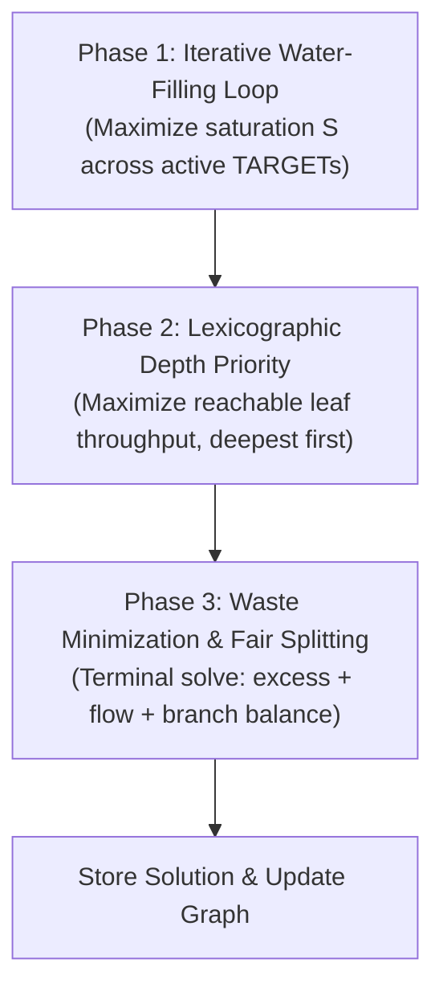

# Factory Solver Implementation & Specification

This document describes the mathematical formulation and implementation of `FactorySolver` (`src/core/graph/FactorySolver.h`, `FactorySolver.cpp`).

---

## 1. Overview

`FactorySolver` optimizes production lines modeled as directed graphs of machines, recipe transformations, connection wires, and user-defined constraints. It computes:
- Flow rates for every port ($R_p$).
- Flow rates across every connection wire ($F_c$).
- Unconsumed byproduct excess rates ($E_p$).
- Required machine counts ($M_n$) for every node in the graph.

The solver translates graph topology into a continuous Linear Program (LP) solved using Google OR-Tools' **GLOP** solver (`operations_research::MPSolver`). Optimization executes as a **3-phase lexicographic process**:
1. **Phase 1: Iterative Target Water-Filling:** Fair max-min satisfaction of user target demands.
2. **Phase 2: Lexicographic Depth Priority for Leaf Throughput:** Maximizes production of reachable leaf products layer-by-layer, deepest nodes first.
3. **Phase 3: Waste Minimization & Fair Splitting:** Terminal solve minimizing unconsumed excess, unnecessary flow, and branch imbalances.

---

## 2. Decision Variables

Variables are continuous and non-negative ($[0, \infty)$):

| Variable | Notation | Domain | Creation Point | Description |
|---|---|---|---|---|
| **Port Rate** | $R_p$ | $[0, \infty)$ | `createAllVariables` | Total resource rate flowing through port $p$. Created for all ports in the graph. |
| **Connection Flow** | $F_c$ | $[0, \infty)$ | `createAllVariables` | Flow traversing directed connection wire $c$. Created for all connections in the graph. |
| **Port Excess** | $E_p$ | $[0, \infty)$ | `addConnectionConstraints` | Unconsumed surplus production on output port $p$. Created **only** for ports with $\ge 1$ outgoing connection. |
| **Balance Bounds** | $hi_p, lo_p$ | $[0, \infty)$ | `addBalance` | Upper and lower branch bounds. Created **only** for ports with $\ge 2$ outgoing or $\ge 2$ incoming connections. |
| **Saturation** | $S$ | $[0, 1]$ | `solveLexicographic` | Progress ratio for proportional target satisfaction. Created **only** if active `TARGET` ports exist. |

> [!NOTE]
> The solver does not instantiate deficit or overshoot variables. Demand goals are handled strictly via the saturation variable $S$ and dynamic lower bounds in Phase 1.

---

## 3. Core Graph Constraints

### 3.1 Node Recipes & Crafting Ratios (`addRecipeConstraints`)

Nodes transform inputs into outputs according to recipe definitions and the production multiplier. Clock speed only acts as an on/off switch here; it scales machine counts (section 6), not flow ratios:

1. **Disabled / Non-Positive Multipliers:**
   If $\text{clock\_speed} \le 0$ or $\text{production\_multiplier} \le 0$, all port rates on the node are fixed to zero:
   $$R_p = 0 \quad \forall p \in (\text{input\_ports} \cup \text{output\_ports})$$
   $\text{clock\_speed}$ does not appear as a coefficient anywhere else in the LP.

2. **Branch 1: Output-Referenced Recipes:**
   Applies when `!recipe.output_ports.empty() && recipe.output_ports[0].amount > 0.0 && !node.output_ports.empty()`.
   The first output port ($O_0 = \text{node.output\_ports}[0]$) serves as the reference:
   - **Input Ports ($i \ge 0$):**
     $$R_{\text{in}[i]} \cdot \text{recipe.output}[0].\text{amount} \cdot \left(\frac{\text{node.production\_multiplier}}{100}\right) - R_{O_0} \cdot \text{recipe.input}[i].\text{amount} = 0$$
   - **Secondary Output Ports ($i \ge 1$):**
     $$R_{O_0} \cdot \text{recipe.output}[i].\text{amount} - R_{O_i} \cdot \text{recipe.output}[0].\text{amount} = 0$$

3. **Branch 2: Input-Referenced Recipes:**
   Applies when Branch 1 does not hold, and `!recipe.input_ports.empty() && recipe.input_ports[0].amount > 0.0 && !node.input_ports.empty()`.
   The first input port ($I_0 = \text{node.input\_ports}[0]$) serves as the reference:
   - **Secondary Input Ports ($i \ge 1$):**
     $$R_{\text{in}[i]} \cdot \text{recipe.input}[0].\text{amount} - R_{I_0} \cdot \text{recipe.input}[i].\text{amount} = 0$$
   - **Output Ports ($i \ge 0$):**
     $$R_{\text{out}[i]} \cdot \text{recipe.input}[0].\text{amount} - R_{I_0} \cdot \text{recipe.output}[i].\text{amount} \cdot \left(\frac{\text{node.production\_multiplier}}{100}\right) = 0$$

4. **Branch 3: Degenerate Recipes:**
   If neither Branch 1 nor Branch 2 applies (e.g. empty recipe amounts or missing ports), all port rates on the node are fixed to zero:
   $$R_p = 0 \quad \forall p \in (\text{input\_ports} \cup \text{output\_ports})$$

### 3.2 Connection Flow & Conservation (`addConnectionConstraints`)

Conservation constraints are added **only for connected ports**:

- **Ports with $\ge 1$ Outgoing Connection:**
  Flow leaving the port equals the sum of outgoing wire flows plus unconsumed excess:
  $$R_p = \sum_{c \in \text{out}(p)} F_c + E_p \quad (E_p \ge 0)$$
- **Ports with $\ge 1$ Incoming Connection:**
  Flow entering the port equals the sum of incoming wire flows:
  $$R_p = \sum_{c \in \text{in}(p)} F_c$$
- **Unconnected Ports:**
  No conservation constraint is generated. For unconnected output ports, no $E_p$ variable is created, and `excess_rate` is written to the graph as `0.0`.

### 3.3 Multi-Branch Bounding (`addBalance`)

For any port with $\ge 2$ outgoing or $\ge 2$ incoming connections:
$$F_c \le hi_p \quad \forall c \in \text{connections}(p)$$
$$F_c \ge lo_p \quad \forall c \in \text{connections}(p)$$
Minimizing $(hi_p - lo_p)$ in Phase 3 balances branch flow across splits and merges.

---

## 4. User Constraints: LIMIT vs. TARGET Semantics

User constraints are set on ports with `user_constraint >= 0`.

### Universal Hard Upper Bound
In `addAllConstraints`, **every port** with `user_constraint >= 0` receives a hard capacity ceiling regardless of classification:
$$R_p \le \text{user\_constraint}$$

### Constraint Classification (`classifyConstraint`)
`classifyConstraint(factory_graph, port)` classifies constrained ports into two kinds:

1. **`ConstraintKind::LIMIT`:**
   - **Assigned to:**
     - All input ports (`factory_graph.isInputPort(port.id)`).
     - Output ports of nodes whose input ports are all `"nothing"` (`resource_key == "nothing"`), **or** nodes with no input ports at all (`std::all_of` on empty `input_ports` evaluates to `true`).
   - **Semantics:**
     Represents an extraction capacity or consumption ceiling: $0 \le R_p \le \text{user\_constraint}$. The solver may pull less than this limit if downstream demand is lower.

2. **`ConstraintKind::TARGET`:**
   - **Assigned to:**
     - Orphan ports where `port.node_id` does not resolve to a node (`node == nullptr`).
     - All other output ports (manufactured goods and intermediate outputs).
   - **Semantics:**
     Represents a demand goal. In addition to the upper bound $R_p \le \text{user\_constraint}$, the port is registered for proportional satisfaction in Phase 1 ($R_p \ge S \cdot \text{user\_constraint}$).

---

## 5. Lexicographic Optimization Phases

The solver executes three sequential phases in `solveLexicographic`:

### Phase 1: Iterative Target Water-Filling Loop

If no ports have `user_constraint >= 0` with `ConstraintKind::TARGET`, Phase 1 is skipped.

When active targets exist:
1. Create continuous saturation variable $S \in [0, 1]$.
2. For each active target port $i$, add coupling constraint:
   $$R_i - S \cdot \text{target}_i \ge 0 \quad (R_i \ge S \cdot \text{target}_i)$$
3. **Iterative Resolution Loop:**
   - Maximize $S$. If status is not `OPTIMAL`, break loop.
   - If $s_{\text{val}} \ge 1.0 - \text{kZeroEpsilon}$ (where $\text{kZeroEpsilon} = 10^{-9}$):
     All active targets are fully satisfiable. For every active target $i$, set hard lower bound:
     $$\text{SetLB}(\max(0.0, \text{target}_i))$$
     Break loop.
   - If $s_{\text{val}} < 1.0 - \text{kZeroEpsilon}$ (bottleneck detected):
     1. Temporarily clamp $S$: $\text{SetLB}(s_{\text{val}})$, $\text{SetUB}(s_{\text{val}})$.
     2. **Optimistic Fast Filter (Sum Solve):** Maximize total active target flow $\sum_{i \in \text{active\_targets}} R_i$.
        - If $R_i > \text{target}_i \cdot s_{\text{val}} + 10^{-6}$, target $i$ has proven headroom; retain it directly in `next_active`.
        - Otherwise, target $i$ did not expand in the sum solve (possibly due to GLOP favoring another competing target on a degenerate facet); mark target $i$ as a suspect.
     3. **Suspect Verification (Individual Test Solves):** For each suspect target $i$, run an individual test solve maximizing $R_i$ while $S$ remains clamped to $s_{\text{val}}$:
        - If $R_i \le \text{target}_i \cdot s_{\text{val}} + 10^{-6}$: Target $i$ is a genuine bottleneck. Lock its lower bound:
          $$\text{SetLB}(\max(R_i.\text{lb}, \text{locked\_val} - \text{lockTolerance}(\text{locked\_val})))$$
          where $\text{locked\_val} = \text{target}_i \cdot s_{\text{val}}$.
          Decouple port $i$ from $S$ by resetting its coupling constraint bounds to $(-\infty, \infty)$ and clearing coefficients. Target $i$ is excluded from `next_active`.
        - Else ($R_i > \text{target}_i \cdot s_{\text{val}} + 10^{-6}$): Target $i$ was merely starved in the sum solve; retain it in `next_active`.
     4. Restore original bounds of $S$.
     5. **Loop Guard:** If $\text{next\_active.size}() == \text{active\_targets.size}()$, no target was bottlenecked; break loop to prevent cycling.
     6. Set $\text{active\_targets} = \text{next\_active}$ and repeat.

### Phase 2: Lexicographic Depth Priority for Leaf Throughput

Phase 2 maximizes production of unconsumed leaf outputs reachable from constrained ports:

1. **Reachability Analysis (`findReachablePorts`):**
   Forward BFS starting from constrained ports with `user_constraint >= 0`. When active `TARGET` demand ports exist in the graph, `LIMIT` ports (capacity ceilings on raw extractors and inputs) are excluded from seeding reachability, ensuring passive supply limits do not actively push overproduction into unconstrained downstream leaves. If no active targets exist (pure supply push mode), all constrained ports seed reachability. Traverses forward connection wires ($F_c$) and internal node connections (all input ports to all output ports).
2. **Reachable Leaf Selection (`buildThroughputTerms`):**
   - Output ports with no outgoing connections that are reachable from constrained ports, **including** constrained ones.
   - For consumer nodes without any output ports, their reachable input ports.
3. **SCC Topological Depth Condensation (`computeNodeDepths`):**
   - Condenses graph cycles using an iterative two-pass Kosaraju algorithm to construct an SCC DAG without recursion.
   - Computes topological depths for all SCCs and maps depths back to nodes.
4. **Layered Lexicographic Optimization:**
   - Groups reachable leaf terms by node depth in descending order: `std::map<int, Terms, std::greater<int>>` (**deepest node depth first**).
   - For each distinct depth $d$:
     1. Solve LP maximizing leaf throughput: $\max \sum_{p \in \text{leaves}(d)} R_p$.
     2. If `OPTIMAL`, lock the achieved value via `lockStage`:
        $$\sum_{p \in \text{leaves}(d)} R_p \ge \text{optimal} - \text{lockTolerance}(\text{optimal})$$

### Phase 3: Waste Minimization and Fair Branch Splitting

Phase 3 is a single terminal LP solve. It is **not locked** with `lockStage`.

$$\min \sum_{p} \text{kExcessWasteWeight} \cdot E_p + \sum_{p} \text{kFlowWasteWeight} \cdot R_p + \sum_{p} 10^{-4} \cdot (hi_p - lo_p)$$

- **Constants:**
  - $\text{kExcessWasteWeight} = 1.0$
  - $\text{kFlowWasteWeight} = 10^{-3}$
  - Multi-branch balance weight $= 10^{-4}$
- **Hierarchy of Objectives:**
  1. **Excess Waste ($1.0 \cdot E_p$):** Strongly penalizes unconsumed byproduct excess on connected output ports. Routing byproducts into downstream consumers or sinks is strictly preferred over dumping at the port.
  2. **Flow Waste ($10^{-3} \cdot R_p$):** Suppresses unnecessary overproduction and ghost flows.
  3. **Fair Splitting ($10^{-4} \cdot (hi_p - lo_p)$):** Equalizes flows across branches of splits and merges when downstream demand does not dictate specific proportions.

On `OPTIMAL` status, `storeSolution()` captures all variable solution values into `m_solution`.

---

## 6. Machine Count Derivation

During `updateFactoryGraph`, each node's `machine_count` ($M_n$) is derived:

### 6.1 Scaling Factors
- **Time Unit Multiplier ($U$):**
  - `"minutes"`: $U = 60$
  - `"hours"`: $U = 3600$
  - `"seconds"` (or any other value): $U = 1$
- **Base Crafting Speed ($B$):** $\text{machine.base\_crafting\_speed}$
- **Clock Speed Multiplier ($C$):** $\text{node.clock\_speed} / 100.0$
- **Production Multiplier ($P$):** $\text{node.production\_multiplier} / 100.0$

### 6.2 Zero / Missing Value Guards
$M_n = 0.0$ if:
- `node.selected_recipe_key` is not found in `game_data.recipes`.
- `node.machine_key` is not found in `game_data.machines`.
- $\text{recipe.time\_seconds} \le 0.0$.
- $\text{node.clock\_speed} \le 0.0$.
- $\text{node.production\_multiplier} \le 0.0$.

### 6.3 Formula by Recipe Branch

1. **Raw Producers (`recipe.input_ports.size() == 1 && recipe.input_ports[0].resource_key == "nothing"`):**
   Requires `!recipe.output_ports.empty() && !node.output_ports.empty()`.
   $$\text{output\_per\_machine} = \frac{\text{recipe.output}[0].\text{amount} \cdot P}{\text{recipe.time\_seconds}} \cdot B \cdot U \cdot C$$
   $$M_n = \frac{R_{\text{node.output}[0]}}{\text{output\_per\_machine}}$$

2. **Standard Crafting Nodes (`!recipe.input_ports.empty() && !node.input_ports.empty()`):**
   $$\text{input\_per\_machine} = \frac{\text{recipe.input}[0].\text{amount}}{\text{recipe.time\_seconds}} \cdot B \cdot U \cdot C$$
   $$M_n = \frac{R_{\text{node.input}[0]}}{\text{input\_per\_machine}}$$

3. **Output-Only Nodes (`!recipe.output_ports.empty() && !node.output_ports.empty()`):**
   $$\text{output\_per\_machine} = \frac{\text{recipe.output}[0].\text{amount} \cdot P}{\text{recipe.time\_seconds}} \cdot B \cdot U \cdot C$$
   $$M_n = \frac{R_{\text{node.output}[0]}}{\text{output\_per\_machine}}$$

If `output_per_machine` or `input_per_machine` $\le 0.0$, $M_n = 0.0$.

---

## 7. Deterministic Model Construction

GLOP LP constraint and variable orders must be deterministic across platforms and executions:
- `addConnectionConstraints`: uses `std::map<uint64_t, std::vector<uint64_t>>` for `port_outgoing` and `port_incoming`.
- Phase 2: uses `std::map<int, Terms, std::greater<int>>` to order depth stages deterministically.
- Phase 3: copies variables into `std::map<uint64_t, MPVariable*>` (`ordered_excess` and `ordered_ports`) before appending to objective terms.

This prevents iteration order variations of `std::unordered_map` from affecting numerical row sequences in GLOP.

---

## 8. Solver Status, Failure Handling & Edge Cases

### 8.1 Status Mapping (`convertSolverStatus`)
| `operations_research::MPSolver::ResultStatus` | `FactorySolver::SolverResultStatus` |
|---|---|
| `MPSolver::OPTIMAL` | `SolverResultStatus::SUCCESS` |
| `MPSolver::INFEASIBLE` | `SolverResultStatus::INFEASIBLE` |
| `MPSolver::UNBOUNDED` | `SolverResultStatus::UNBOUNDED` |
| Other / Aborted | `SolverResultStatus::ERROR_` |

### 8.2 Non-SUCCESS Behavior
If the solve fails (`result != SolverResultStatus::SUCCESS`):
- All port `rate` and `excess_rate` in the graph are set to `0.0`.
- All connection `rate` in the graph are set to `0.0`.
- **`node.machine_count` is not reset** (nodes retain their pre-solve values).
- An error is logged via Abseil: `LOG(ERROR) << "Solver failed with status: " << m_lastSolverStatus`.

### 8.3 Exception Handling
`solve()` encloses execution in a `try ... catch (const std::exception &e)` block:
- Stderr threshold is restored: `absl::SetStderrThreshold(absl::LogSeverityAtLeast::kInfo)`.
- Error is logged: `LOG(ERROR) << "Exception during solving: " << e.what()`.
- Dispatches a UI error notification:
  `NotificationManager::instance().addNotification("Solver Error", ..., NotificationType::Error)`.
- Returns result struct with `SolverResultStatus::ERROR_`.

### 8.4 Graph With No Constraints
If a graph contains no port constraints (`user_constraint < 0` for all ports):
- Phase 1 finds no active targets and is skipped.
- Reachability BFS starts from an empty set, resulting in no throughput terms; Phase 2 is skipped.
- Phase 3 minimizes excess, port flow, and branch imbalance without driving constraints, solving to all-zero rates ($R_p = 0$, $F_c = 0$, $E_p = 0$).

---

## 9. Numerical Stability & Tolerances

- **`kZeroEpsilon` ($10^{-9}$):** Solution values with magnitude smaller than $10^{-9}$ are cleaned to `0.0` in `cleanValue()`. Also used as the full-saturation threshold $S \ge 1.0 - \text{kZeroEpsilon}$.
- **`lockTolerance(v)`:**
  $$\text{lockTolerance}(v) = 10^{-9} \cdot \max(1.0, |v|)$$
  Relaxes locked stage bounds slightly to prevent minor floating-point fluctuations from causing subsequent stages to become infeasible.
