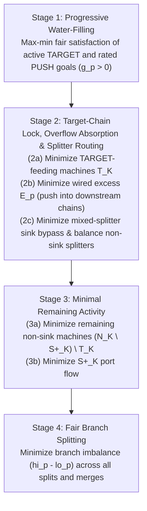

# FactorySolver Rework Plan (v3 Specification)

Status: **Approved design specification, ready for sequential implementation (`T1` → `T2` → `T3`).**
Grounded in `src/core/graph/FactorySolver.cpp` and `docs/solver.md`.

---

## 1. Problem Statement & Diagnosis of Current Solver (`HEAD`)

The current 3-phase lexicographic solver in `FactorySolver.cpp` exhibits four structural flaws:

| # | Flaw | Mechanism in Current Code (`HEAD`) | User-Visible Impact |
|---|---|---|---|
| **F1** | **Every unconnected output is maximized as a goal** | `buildThroughputTerms` (Phase 2) maximizes every reachable unwired output port, making no distinction between intended products and unwired byproducts. | Unconnected byproducts drive machines to run at maximum capacity or pull extra `LIMIT` raw inputs when reachable from a constrained port. |
| **F2** | **Waste compression on blocked downstream wires** | In `HEAD`, every wired output port—even on untargeted downstream machines—has a free excess variable $E_p \ge 0$ weighted uniformly by item count ($1.0 \cdot E_p$). When a recipe compresses multiple inputs into fewer outputs (e.g., `4 Rubber + 8 Coke -> 1 Circuit Board` in `Factory_1.fpp`, where `Circuit Board` is wired to `High-Speed Connector` and capped downstream at `1.5`), Phase 3 runs `Circuit Board` above `1.5` just to convert `4 excess Rubber` ($E_{\text{Rubber}} = 4$) into `1 excess Circuit Board` ($E_{\text{CB}} = 1$) on the blocked wire. | Surplus material on a multi-branch port propagates one node further into a blocked downstream recipe with a $>1:1$ input-to-output ratio instead of staying as `excess_rate` on the port that produced it. |
| **F3** | **Global `LIMIT` vs. `TARGET` guessing & island freeze** | `classifyConstraint` guesses whether a constraint is a `LIMIT` or `TARGET` from port direction and node inputs alone. Worse, `has_active_targets` in `findReachablePorts` is computed **globally across the entire canvas**. | Adding a single `TARGET` anywhere on the canvas disables supply-push mode across **all** disconnected subgraphs, freezing unrelated supply-driven islands to `0` (`2991c0a`). Conversely, setting a number on a consumer's input port is silently classified as `LIMIT`, leaving an island with no `TARGET` in full supply-push mode. |
| **F4** | **Phase 2 unboundedness on amplifying cycles** | Phase 2 maximizes leaf throughput without upper bounds when a reachable cycle has net gain $> 1$. | GLOP returns `UNBOUNDED` / `INFEASIBLE` on graphs with unconstrained amplifying feedback loops instead of solving to a steady state. |

---

## 2. Mathematical Model

### 2.1 Graph Partitioning & Sets

- **Nodes & Ports:**
  - $\mathcal{N}$: set of nodes in the graph.
  - $\mathcal{P}^{\text{out}}, \mathcal{P}^{\text{in}}$: output and input ports. $\nu(p) \in \mathcal{N}$ denotes the node owning port $p$.
  - $\mathcal{C}$: directed connection wires $c = (p \to q)$ with $p \in \mathcal{P}^{\text{out}}$ and $q \in \mathcal{P}^{\text{in}}$.
  - $W^+(p)$ and $W^-(q)$: outgoing wires of output port $p$ and incoming wires of input port $q$.
- **Weakly Connected Components ($\mathcal{K}$):**
  - Weakly connected components of the undirected projection of $(\mathcal{N}, \mathcal{C})$. Every isolated node forms its own component $K \in \mathcal{K}$.
  - Each component $K \in \mathcal{K}$ is solved as an **independent LP**.
- **Boundary Ports & Sinks (within component $K$):**
  - **Raw Outputs ($\mathcal{B}^{\text{raw}}_K$):** Output ports of nodes whose input ports are empty or all have `resource_key == "nothing"`.
  - **Imports ($\mathcal{B}^{\text{imp}}_K$):** Unwired input ports ($W^-(q) = \emptyset$) with `resource_key != "nothing"`.
  - **Exports ($\mathcal{X}_K$):** Unwired output ports ($W^+(p) = \emptyset$) **with `resource_key != "nothing"`** (`setNodeRecipe` creates ports for `"nothing"` outputs too; they must not count as exports, otherwise sinks never qualify for $\mathcal{S}^+_K$). Terminal products and unwired byproducts are treated identically—neither is maximized unless given a goal.
  - **Sinks ($\mathcal{S}_K \subseteq \mathcal{N}_K$):** Nodes with no output ports, or whose output ports all have `resource_key == "nothing"` (e.g., Awesome Sinks, Incinerators, Coal/Fuel Generators where power is a node property rather than an output port).
  - **Sink-Dedicated Subgraph ($\mathcal{S}^+_K \subseteq \mathcal{N}_K$):** Nodes in $K$ that can reach $\mathcal{S}_K$, cannot reach any export port $\mathcal{X}_K$ or any node outside $R_{\text{sink}}$ (such as isolated non-sink cycles), and do not lie upstream of any active `TARGET` or explicit `PUSH` port. Formally:
    1. Let $R_{\text{sink}} = \text{BackwardBFS}(\mathcal{S}_K)$ be the set of nodes in $K$ with at least one directed path to $\mathcal{S}_K$.
    2. Let $B = \{\nu(p) \mid p \in \mathcal{X}_K \cup G^{\text{pre}}_K \cup P^{\text{push,expl}}_K\} \cup (\mathcal{N}_K \setminus R_{\text{sink}})$, where $G^{\text{pre}}_K$ are Step-1/explicit `TARGET` ports with $g>0$ and $P^{\text{push,expl}}_K$ are **explicit** `PUSH` ports (rated with $c>0$ or unrated with $c<0$). `AUTO`-resolved PUSH is excluded, because it depends on $\mathcal{S}^+_K$ (no circularity). $\mathcal{S}^+_K$ is computed **once**, before Step 3 of §3.2, and never recomputed. `BackwardBFS` is reflexive (includes its seeds). Note: $\mathcal{S}^+_K$ is forward-closed, so sink-dedicated nodes can never feed the factory.
    3. Define $\mathcal{S}^+_K = R_{\text{sink}} \setminus \text{BackwardBFS}(B)$.
    This includes $\mathcal{S}_K$ itself (when not bearing an explicit goal) as well as dedicated auxiliary suppliers to Sinks (such as a `Water Extractor` wired exclusively to a `Coal Generator`), while excluding isolated non-sink cycles and goal-driven chains.

### 2.2 Decision Variables

All variables are continuous and non-negative ($[0, \infty)$):

| Variable | Symbol | Created For | Description |
|---|---|---|---|
| **Port Rate** | $R_p$ | Every port $p$ | Resource flow rate through port $p$. |
| **Wire Flow** | $F_c$ | Every connection $c$ | Flow rate across directed wire $c = (p \to q)$. |
| **Wired Overflow (Excess)** | $E_p$ | Every wired output port ($W^+(p) \neq \emptyset$) | Production on output port $p$ not consumed by outgoing wires. Unwired outputs ($W^+(p) = \emptyset$) do not have $E_p$ and report `excess_rate = 0.0`. |
| **Saturation** | $S \in [0, 1]$ | Stage 1 (when $G_K \neq \emptyset$) | Proportional water-filling progress ratio for active goals. |
| **Branch Bounds** | $hi_p, lo_p$ | Ports with $|W^+(p)| \ge 2$ or $|W^-(p)| \ge 2$ | Upper and lower bounds across split or merge branches. |

> [!NOTE]
> For clarity, the formulation writes $x_n \ge 0$ for the activity of node $n$, related to port rates by stoichiometry $R_p = \alpha_p x_n$. In `FactorySolver.cpp`, this continues to be represented directly via the node's reference port variable $R_{\text{ref}}$ (`out0_var` or `in0_var`) and pairwise linear ratio rows in `addRecipeConstraints`.

### 2.3 Hard Constraints (Invariant Across All Stages)

1. **Recipe Stoichiometry (`addRecipeConstraints`):**
   - If `clock_speed <= 0`, `production_multiplier <= 0`, or the recipe is degenerate (no positive input or output amounts), all ports on the node are fixed to zero: $R_p = 0$.
   - Otherwise, port rates on node $n$ are locked in fixed recipe proportions ($R_p = \alpha_p x_n$), where output amounts scale with `production_multiplier / 100.0`.
2. **Wire Conservation (`addConnectionConstraints`):**
   - Wired output ports ($W^+(p) \neq \emptyset$):
     $$R_p = \sum_{c \in W^+(p)} F_c + E_p$$
   - Wired input ports ($W^-(q) \neq \emptyset$):
     $$R_q = \sum_{c \in W^-(q)} F_c$$
3. **User Capacity Ceilings (`SetUB`):**
   - Every port with a numeric constraint (`user_constraint >= 0`) receives a hard upper bound regardless of mode:
     $$R_p \le \text{user\_constraint}$$
4. **Physical No-Overflow on Pushed Closure ($Z_K$) and Non-Target Nodes ($\mathcal{N}_K \setminus \mathcal{T}_K$):**
   - For every wired output port $p \in Z_K$ or with $\nu(p) \notin \mathcal{T}_K$ (defined in §3.3):
     $$E_p = 0$$
5. **Split/Merge Balance Bounds (`addBalance`):**
   - For every port $p$ with $\ge 2$ incident wires:
     $$lo_p \le F_c \le hi_p \quad \forall c \in \text{wires}(p)$$

---

## 3. User Intent: Constraint Modes & Per-Component `AUTO` Resolution

### 3.1 Port Constraint Modes

Each `Port` stores `constraint_mode ∈ {AUTO, LIMIT, TARGET, PUSH}` (defaulting to `AUTO`).

| Mode | Numeric Constraint (`c = user_constraint`) | Meaning | Mathematical Effect |
|---|---|---|---|
| **`LIMIT`** | $c \ge 0$ | "At most $c$ may flow here" | Hard ceiling $R_p \le c$ only. |
| **`TARGET`** | $c \ge 0$ | "Demand $c$ here (pull minimum upstream)" | Hard ceiling $R_p \le c$; joins Stage 1 goal set $G_K$ ($R_p \to c$) when $c > 0$. |
| **`PUSH` (Rated)** | $c \ge 0$ | "Run this port at $c$ and push all flow downstream" | Hard ceiling $R_p \le c$; joins Stage 1 goal set $G_K$ ($R_p \to c$) when $c > 0$; seeds no-overflow closure $Z_K$. |
| **`PUSH` (Unrated)** | $c < 0$ (no number) | "Push 100% of whatever flows out of this port downstream" | No ceiling and no Stage 1 goal; **seeds no-overflow closure $Z_K$ ($E_p = 0$)**. Used on wired byproduct outputs to force all byproduct into converters, generators, or recycling loops. Its forward closure traverses downstream converter nodes ($n \notin \mathcal{T}_K$) but does not propagate through `TARGET`-feeding nodes ($n \in \mathcal{T}_K$), so multi-machine converter chains run completely while recycling loops cannot throttle unrelated `TARGET` outputs. |

*(If `constraint_mode` is `AUTO`, `LIMIT`, or `TARGET` and `user_constraint < 0`, the port is unconstrained.)*

### 3.2 `AUTO` Resolution Rule (Evaluated Locally Per Component $K$)

For every port $p$ in component $K$ with `constraint_mode == AUTO` and `user_constraint >= 0`, resolution executes in three deterministic steps:

1. **Step 1 — Interior & Non-Raw Ports:**
   - Any wired input port ($p \in \mathcal{P}^{\text{in}}_K \setminus \mathcal{B}^{\text{imp}}_K$) resolves to **`LIMIT`**.
   - Any output port of a non-raw node ($p \in \mathcal{P}^{\text{out}}_K \setminus \mathcal{B}^{\text{raw}}_K$) resolves to **`TARGET`**.
2. **Step 2 — Compute Sink-Dedicated Subgraph ($\mathcal{S}^+_K$):**
   - Compute $\mathcal{S}^+_K = R_{\text{sink}} \setminus \text{BackwardBFS}(B)$ (§2.1) using $\mathcal{X}_K$, the resolved/explicit `TARGET` ports, and any explicit `PUSH` ports.
3. **Step 3 — Boundary Supply Ports ($p \in \mathcal{B}^{\text{raw}}_K \cup \mathcal{B}^{\text{imp}}_K$):**
   - Let $K$ have **effective targets** if at least one port in $K$ has resolved or explicit mode `TARGET` (with `user_constraint > 0`; a `TARGET 0` is only a cap and must not switch the island to demand mode).
   - If $K$ has at least one effective `TARGET`, boundary ports with `AUTO` resolve to **`LIMIT`** (*Demand / Pull Mode*).
   - If $K$ has **no** effective `TARGET` (*Supply / Push Mode*):
     - If $K$ contains non-sink production nodes ($\mathcal{N}_K \setminus \mathcal{S}^+_K \neq \emptyset$) and $\nu(p) \in \mathcal{S}^+_K$ (e.g., a dedicated `Water Extractor` feeding an auxiliary `Coal Generator` attached to a factory), $p$ resolves to **`LIMIT`** so the auxiliary sink supplier does not actively pull resources away from the factory. **This demotion applies only if** every sink reachable from $p$ is reached through sink input port(s) that have no directed path from $\mathcal{N}_K \setminus \mathcal{S}^+_K$ while that sink has at least one other input port that does have a directed path from $\mathcal{N}_K \setminus \mathcal{S}^+_K$ (e.g., water into a generator's water port vs. coke into its coke port). A supplier feeding the *same* input port as factory flow (e.g., a second miner into a shared Awesome Sink) stays `PUSH`, otherwise sink-for-points lines would silently idle.
     - All other boundary ports with `AUTO` resolve to **`PUSH`** (including boundary ports when the entire island is a standalone power plant / sink chain, $\mathcal{N}_K = \mathcal{S}^+_K$).

**Component Operating Regimes:**
- **Demand Mode:** Component has $\ge 1$ `TARGET` and no explicit `PUSH`. Raw miners act as `LIMIT` ceilings.
- **Supply Mode:** Component has no `TARGET` and $\ge 1$ `PUSH` (either explicit or `AUTO`-resolved on boundary inputs/miners).
- **Mixed Push/Pull Mode:** Component has both `TARGET` port(s) and explicit `PUSH` port(s) (e.g., a factory with `Target(Steel) = 10` sharing a `Coal Miner` explicitly set to `PUSH 60`, with unused coal routed to a Generator/Sink).
- **Idle Mode:** Component has no `TARGET` and no `PUSH`. Solves cleanly to `0`.

### 3.3 Physical No-Overflow Rules ($Z_K$ and $\mathcal{N}_K \setminus \mathcal{T}_K$)

Let:
- $\mathcal{T}_K = \text{BackwardBFS}(\{p \in G_K \mid \text{mode}(p) = \text{TARGET}\}) \setminus \mathcal{S}^+_K$ be the set of non-sink nodes in component $K$ that have a directed path to at least one active `TARGET` port.
- $P^{\text{push,rated}}_K$ be the set of all ports in component $K$ whose effective mode is Rated `PUSH` (explicit or `AUTO`-resolved with $c > 0$), and
- $P^{\text{push,unrated}}_K$ be the set of all ports in component $K$ with explicit Unrated `PUSH` ($c < 0$).

Define forward reachability:
- $\mathrm{Cl}(P^{\text{push,rated}}_K)$: ports reachable from $P^{\text{push,rated}}_K$ by forward BFS across directed connection wires $c = (u \to v) \in \mathcal{C}_K$ and node-internal edges (each input port of node $n$ to all output ports of $n$).
- $\mathrm{Cl}_{\neg\mathcal{T}}(P^{\text{push,unrated}}_K)$: ports reachable from $P^{\text{push,unrated}}_K$ by forward BFS across directed connection wires $c = (u \to v) \in \mathcal{C}_K$ and node-internal edges of **non-target-feeding nodes** $n \in \mathcal{N}_K \setminus \mathcal{T}_K$ (stopping at $\mathcal{T}_K$ so recycling a byproduct into a `TARGET`-feeding chain does not force $E_q = 0$ on other outputs of $\mathcal{T}_K$).

Then the **pushed no-overflow port set** is:
$$Z_K = \left\{ p \in \mathcal{P}^{\text{out}}_K \;\middle|\; W^+(p) \neq \emptyset \;\text{and}\; p \in \mathrm{Cl}(P^{\text{push,rated}}_K) \cup \mathrm{Cl}_{\neg\mathcal{T}}(P^{\text{push,unrated}}_K) \right\}$$

Hard constraint $E_p = 0$ is enforced on:
1. **Every pushed port $p \in Z_K$:**
   - Every machine inside the pushed closure can only run as fast as its wired outputs can leave it.
   - If a downstream port in $Z_K$ hits a `LIMIT` bottleneck (clog), the line backs up physically and throttles upstream `PUSH` ports to the bottleneck rate, reporting goal saturation $< 100\%$ on the throttled `PUSH` port.
2. **Every wired output port of a non-target-feeding node ($\nu(p) \notin \mathcal{T}_K$):**
   - A machine $n \notin \mathcal{T}_K$ (which has no `TARGET` on it or downstream of it) is never allowed to accumulate unconsumed wired excess $E_p > 0$ on its own outgoing wires; it may only run to the extent its output reaches an unwired export $\mathcal{X}_K$ or a Sink $\mathcal{S}_K$.
   - This eliminates multi-input waste compression (Flaw 2, e.g. `4 Rubber -> 1 excess Circuit Board` on a blocked downstream wire in `Factory_1.fpp`), while allowing wired outputs of $\mathcal{T}_K$ to flow cleanly through downstream processing chains to unwired exports or Sinks in Stage 2b.
3. **Where $E_p \ge 0$ is allowed ($\nu(p) \in \mathcal{T}_K$ and $p \notin Z_K$):**
   - Wired output ports of `TARGET`-chain nodes ($\mathcal{T}_K$) outside $Z_K$ may carry $E_p \ge 0$. In Stage 2b ($\min \sum E_p$), they push as much flow into connected downstream chains as downstream caps allow; any remainder blocked by a downstream `LIMIT` or `TARGET` ceiling is reported as `excess_rate` ($E_p$) on the $\mathcal{T}_K$ port without throttling the `TARGET`.

---

## 4. Lexicographic Optimization Stages (Solved Per Component $K$)

For each component $K \in \mathcal{K}$:

### Stage 1: Goal Water-Filling (Max-Min Fair)

Let $G_K$ be all ports in $K$ with effective mode `TARGET` or Rated `PUSH` and strictly positive goal value $g_p = \text{user\_constraint} > 0$.
*(Ports with $g_p = 0$ are already fully enforced by their hard upper bound $R_p \le 0$ and are excluded from $G_K$.)*

If $G_K \neq \emptyset$:
- Introduce $S \in [0, 1]$ with coupling rows $R_p - g_p S \ge 0$ for all $p \in G_K$.
- Run the progressive water-filling loop (identical to `HEAD`'s hybrid filter: maximize $S$, fast sum-solve filter $\max \sum_{p \in G_K} R_p$ at clamped $S = s_{\text{val}}$, and individual suspect verification solves $\max R_p$).
- Bottlenecked goals are locked at $R_p \ge g_p s_{\text{val}} - \text{lockTolerance}(g_p s_{\text{val}})$ and decoupled from $S$; remaining goals continue until $S \ge 1 - 10^{-9}$ or all goals are locked.

### Stage 2: Target-Chain Minimization, Overflow Absorption & Splitter Routing (Replaces Old Phase 2)

Old Phase 2 (`buildThroughputTerms` and `computeNodeDepths`) is **deleted**.

Let $\mathcal{T}_K = \text{BackwardBFS}(\{p \in G_K \mid \text{mode}(p) = \text{TARGET}\}) \setminus \mathcal{S}^+_K$ be the set of non-sink nodes in $K$ that have a directed path to at least one active `TARGET` port.

#### 2a. Minimal `TARGET`-Feeding Machine Activity (when $\mathcal{T}_K \neq \emptyset$)
$$\min \sum_{n \in \mathcal{T}_K} w_n \, R_{\text{ref}(n)}, \quad \text{then lock via } \texttt{lockStage}$$
- **Why this runs first in Stage 2:** Stage 1 locks only the goal ports $p \in G_K$ themselves, not upstream intermediate or `LIMIT` nodes. Locking minimal machine activity on $\mathcal{T}_K$ first guarantees that:
  1. Upstream `LIMIT` miners feeding $\mathcal{T}_K$ only pull the minimum resources needed for `TARGET`s (preventing overproduction).
  2. Recycled byproducts (Scenario 9) flow 100% into the `TARGET`-feeding loop before any unconstrained secondary branch.
  *(In pure Supply Mode, $\mathcal{T}_K = \emptyset$, so Stage 2a is a no-op.)*

#### 2b. Wired Overflow Absorption into Connected Downstream Chains
$$\min \sum_{p} E_p, \quad \text{then lock via } \texttt{lockStage}$$
- **Why this runs after 2a and before 3a:**
  - Because $\mathcal{T}_K$ is already locked by Stage 2a, minimizing $\sum_p E_p$ cannot cause any $\mathcal{T}_K$ machine or its upstream miners to overproduce.
  - Any wired output produced by a locked $\mathcal{T}_K$ node—whether a wired byproduct (e.g., `CO2 -> Greenhouse -> Wood` in Scenario 3a, or `Coke -> Coal Generator` in Scenario 4) or a constrained intermediate node (e.g., `Ore -> Smelter (60) -> Constructor -> Plates` in Scenario 10c/11, or `Rotor (6) -> Electric Motor` in `Factory_1.fpp`)—is automatically pushed into its connected downstream chain in `AUTO` mode (`excess_rate = 0`).
  - If a downstream branch has a capacity cap (`LIMIT` or `TARGET`), flow pushes up to that cap and leaves only the blocked remainder as `excess_rate` ($E_p$) on the $\mathcal{T}_K$ port without throttling the `TARGET`.
  - Because wired output ports of nodes outside $\mathcal{T}_K$ have hard $E_q = 0$ (§3.3), downstream machines can only absorb flow that reaches an unwired export $\mathcal{X}_K$ or a Sink $\mathcal{S}_K$—they can never compress `4 excess Rubber` into `1 excess Circuit Board` on a blocked downstream wire.

#### 2c. Mixed-Splitter Sink-Overflow Guard & Non-Sink Splitter Fairness
1. **Last-Resort Sink Overflow on Mixed Splitters:**
   Let $W^{\text{mix-sink}}_K$ be the set of wires $c = (p \to q)$ from any splitter port $p$ into a sink-dedicated node $\nu(q) \in \mathcal{S}^+_K$ where port $p$ **also** has at least one outgoing wire to a non-sink node ($\mathcal{N}_K \setminus \mathcal{S}^+_K$):
   $$W^{\text{mix-sink}}_K = \left\{ c = (p \to q) \in \mathcal{C}_K \;\middle|\; \nu(q) \in \mathcal{S}^+_K,\; \text{and } \exists (p \to r) \in W^+(p) \text{ with } \nu(r) \notin \mathcal{S}^+_K \right\}$$
   If $W^{\text{mix-sink}}_K \neq \emptyset$, minimize flow escaping into Sinks across mixed splitters:
   $$\min \sum_{c \in W^{\text{mix-sink}}_K} F_c, \quad \text{then lock via } \texttt{lockStage}$$
   - **Why:** Prevents the "Sink Shortcut" where a splitter connected to both a factory branch ($\notin \mathcal{S}^+_K$) and an overflow Sink ($\in \mathcal{S}^+_K$) dumps flow into the Sink during Stage 3a to save factory machines, while leaving dedicated byproduct disposal pins (where 100% of $W^+(p)$ goes to $\mathcal{S}^+_K$, such as `Refinery.HOR -> Awesome Sink`) free to run normally.
2. **Non-Sink Splitter Fairness:**
   For every splitter $p$ that has $\ge 2$ outgoing wires to non-sink nodes outside $\mathcal{T}_K$ ($(\mathcal{N}_K \setminus \mathcal{S}^+_K) \setminus \mathcal{T}_K$), minimize $(hi^{\text{ns}}_p - lo^{\text{ns}}_p)$ across those outgoing wires and lock via `lockStage`. This uses its **own** hi/lo pair per splitter restricted to those wires (the global `addBalance` pair spans all wires of the port); the objective sums over all such splitters.
   - **Why:** When a stream (`60 Ingots`, either from Supply Mode or from a constrained middle node in `AUTO` mode) splits into two unconstrained recipes with different machine densities (e.g., `Iron Plates` at $1/30$ machines per ingot vs. `Iron Rods` at $1/15$ machines per ingot), balancing the splitter before Stage 3a ensures a fair `30 / 30` split instead of starving `Iron Rods` to `0` to save machines.

### Stage 3: Minimal Remaining Activity

1. **Stage 3a — Minimize Remaining Non-Sink Machine Activity:**
   Minimize the total machine count across all remaining non-sink nodes $n \in (\mathcal{N}_K \setminus \mathcal{S}^+_K) \setminus \mathcal{T}_K$:
   $$\min \sum_{n \in (\mathcal{N}_K \setminus \mathcal{S}^+_K) \setminus \mathcal{T}_K} w_n \, R_{\text{ref}(n)}, \quad \text{then lock via } \texttt{lockStage}$$
   - Locks downstream converters (`Greenhouse`, `Constructor`, etc.) at the exact minimum machine count needed to process the flow committed in Stage 2b/2c, while pinning unconnected branches and idle non-sink cycles to `0.0`.
2. **Stage 3b — Minimize $\mathcal{S}^+_K$ Activity (when $\mathcal{S}^+_K \neq \emptyset$):**
   $$\min \sum_{s \in \mathcal{S}^+_K,\, p \in \text{ports}(s)} R_p, \quad \text{then lock via } \texttt{lockStage}$$
   - Locking minimal $\mathcal{S}^+_K$ port flow before Stage 4 guarantees that unconnected or redundant Sinks/Generators and unused auxiliary extractors are strictly pinned to `0.0`, and prevents Stage 4's branch balancing from turning on idle $\mathcal{S}^+_K$ machines just to equalize wire flows on a merge/split. (Rebalancing flow between identical parallel Sinks—e.g., two `Coal Generators` splitting `30 Coke` at $15/15$—keeps total $\mathcal{S}^+_K$ flow constant and remains free for Stage 4.)

**Machine-Count Weights ($w_n$):**
For each node $n \in \mathcal{N}_K \setminus \mathcal{S}^+_K$ with reference port $\text{ref}(n)$:
- Using the machine count formula from `docs/solver.md` §6, choose $w_n > 0$ such that $w_n R_{\text{ref}(n)} = M_n$:
  $$w_n = \frac{\text{recipe.time\_seconds}}{\text{ref\_amount} \cdot B \cdot U \cdot C}$$
  where:
  - $\text{ref\_amount} = \text{recipe\_port.amount} \cdot P$ (if $\text{ref}(n)$ is an output port) or $\text{recipe\_port.amount}$ (if $\text{ref}(n)$ is an input port), with $P = \text{node.production\_multiplier} / 100.0$,
  - $U \in \{1, 60, 3600\}$ is the `game_data.time_unit` multiplier,
  - $C = \text{node.clock\_speed} / 100.0$,
  - $B = \text{machine.base\_crafting\_speed}$ if `node.machine_key` resolves to a valid machine with `base_crafting_speed > 0.0`, **or $B = 1.0$ if no machine is selected on the node yet** (preserving unit invariance P6 and byproduct invariance P4 on nodes before a building is chosen).
- If `recipe.time_seconds <= 0`, use $w_n = 1 / \text{ref\_amount}$ (keeps $w_n > 0$, so P3 holds).
- A node whose `selected_recipe_key` is missing from `game_data.recipes` is treated as a **degenerate recipe**: all its ports are fixed to $R_p = 0$ (today it has no stoichiometry rows and acts as a free source; this pre-existing gap is closed in T2).

> [!IMPORTANT]
> Stages 2a and 3a lock **only the total weighted sum** via `lockStage`—they must **not** clamp individual nodes with $R_{\text{ref}(n)} = 0$ to `SetUB(0.0)`. On symmetric parallel branches, Simplex may pick an extreme vertex $(0, 60)$ in Stage 2a/3a that Stage 4 will rebalance to $(30, 30)$ within the locked machine-count sum.

### Stage 4: Fair Branch Splitting

Terminal solve (not locked) equalizing flow across all parallel split and merge branches:
$$\min \sum_{p} (hi_p - lo_p)$$

---

## 5. Mathematical Properties

1. **P1 — Always Feasible:**
   The zero vector ($R_p = 0, F_c = 0, E_p = 0$) satisfies every hard constraint in §2.3 (including $E_p = 0$ on $Z_K$ and on wired outputs of $\mathcal{N}_K \setminus \mathcal{T}_K$). All lower/upper bounds introduced in Stages 1–3 are locked at values already achieved by a previous `OPTIMAL` solve relaxed by `lockTolerance`. Thus no stage can become `INFEASIBLE` barring numerical solver failure.
2. **P2 — Always Bounded:**
   Stage 1 maximizes $S \le 1$ (and $R_p \le g_p$ in suspect tests). Stages 2–4 minimize non-negative objectives. Unbounded maximization on gain $> 1$ cycles (Flaw 4) is eliminated by construction.
3. **P3 — No Gratuitous Activity (Eliminates Flaws 1 & 2):**
   - *Unconnected byproducts* have no Stage 1 goal and no $E_p$ variable, so they never drive upstream production.
   - *Target-chain isolation:* Stage 2a locks $\mathcal{T}_K$ before Stage 2b routes overflow, so downstream byproduct consumers can never pull extra production from $\mathcal{T}_K$ machines.
   - *No waste compression on blocked wires:* Because wired outputs of nodes outside $\mathcal{T}_K$ have hard $E_q = 0$, a downstream recipe with a $>1:1$ input-to-output ratio (such as `4 Rubber -> 1 Circuit Board` in `Factory_1.fpp`) cannot run above its downstream consumer's cap to compress excess items onto its outgoing wire.
   - *Ghost cycles* with no goal are forced to $0$ by Stage 3a/3b.
4. **P4 — Byproduct Invariance:**
   Because Stages 2a and 3a weight node activity by machine count $M_n$ rather than $\sum_p R_p$, adding an unwired byproduct port to a recipe does not change $w_n$ or the optimal machine counts.
5. **P5 — Component Independence:**
   Each connected component $K \in \mathcal{K}$ resolves `AUTO` modes and solves its LP independently. A `TARGET` in Island A never freezes Island B, and a solver error in one island never zeroes out unrelated islands on the canvas.
6. **P6 — Unit Invariance:**
   Stage 1 normalizes goals by $R_p / g_p$ (dimensionless), and Stages 2a/3a minimize machine counts $M_n$ (buildings), so recipes handling `1000 mB/s` of fluid and `1 item/s` of solid parts are weighted on an equal per-machine footing.

---

## 6. Key Scenarios & Expected Results

Using `Foundry`: `1 Iron + 1 Coal -> 1 Steel + 1 CO2`, with `Iron Miner (240)` and `Coal Miner (30)`:

| # | Scenario Setup | Mode Resolution | Solver Outcome |
|---|---|---|---|
| **1** | **Pure Supply (Push):** No targets; `Steel` and `CO2` unwired. | `Iron (240)` & `Coal (30)` resolve `AUTO -> PUSH`. Mine outputs $\in Z_K$. | `Iron` locks at $30/240$ ($12.5\%$), `Coal` reaches $30/30$ ($100\%$). Foundry makes `30 Steel + 30 CO2`. |
| **2** | **Pure Demand (Pull):** `Target(Steel) = 10`, `CO2` unwired. | `Steel` is `TARGET 10`; Mines resolve `AUTO -> LIMIT`. | Foundry makes `10 Steel + 10 CO2`. Mines pull `10 Iron` and `10 Coal`. |
| **3a** | **Byproduct to Converter (Default `AUTO`):** Same as #2, with `CO2` wired to `Greenhouse` (`CO2 -> Wood`, unconstrained). | Demand mode; `Foundry` $\in \mathcal{T}_K$ locked at `10` in Stage 2a. | Stage 2b ($\min \sum E_p$) routes all `10 CO2` into `Greenhouse -> 10 Wood` (**`0 excess`**). If `Greenhouse` has a `LIMIT 4` cap, `Greenhouse` runs at `4` and `CO2` shows **`6 excess`** without throttling `Steel = 10`. |
| **3b** | **Byproduct to Converter (Explicit Unrated `PUSH`):** Same as #3a, user sets `CO2` output port to `PUSH` (no number) and `Greenhouse` is capped at `LIMIT 4`. | `CO2` seeds $Z_K$ (hard $E_{\text{CO}_2} = 0$ in Stage 1). | Hard $E_{\text{CO}_2} = 0$ backs up the line when `Greenhouse` is capped at `4`: `Foundry` throttles to `4 Steel + 4 CO2` ($40\%$ saturation). |
| **4** | **Byproduct to Multi-Input Sink/Generator (`AUTO`):** `Target(Plastic) = 30` produces `30 Coke` wired to `Coal Generator` (`Coke + Water -> nothing`), also fed by dedicated `Water Extractor (Limit 120)`. | `Refinery` $\in \mathcal{T}_K$; `Coal Generator` & `Water Extractor` $\in \mathcal{S}^+_K$. | Stage 2a locks `Refinery` at `30`; Stage 2b minimizes $E_{\text{Coke}}$ to `0`, routing all `30 Coke` into `Coal Generator` and pulling the required `Water` from `Water Extractor` automatically (`0 excess`). |
| **5** | **Two Disconnected Islands:** Island A has `Target(Steel) = 10`; Island B has only `Miner (60) -> Smelter`. | Island A: Demand Mode. Island B: Supply Mode (`Miner -> PUSH 60`). | Island A produces `10 Steel`; Island B produces `60 Ingots` (no longer freezes at `0`). |
| **6** | **Shared Miner Feeding Target Factory + Generator/Sink:** `Coal Miner (60)` wired to both `Foundry` (`Target(Steel) = 10`) and `Coal Generator`. | **(a) `AUTO` (`LIMIT 60`):** Demand mode; Stage 2a locks `Coal Miner` at `10` (`Coal Generator = 0`). **(b) Explicit `PUSH 60`:** Mixed mode; `Coal` $\in Z_K$ ($E_{\text{Coal}} = 0$). | **(a) `AUTO`:** Mines `10 Coal` for `Foundry` (`16.7%` capacity). **(b) `PUSH 60`:** `Foundry` takes `10 Coal` (`10 Steel`); remaining **`50 Coal`** pushes into `Coal Generator`. |
| **7** | **Supply Mode With Downstream Clog (`LIMIT`):** `Coal Miner (30)` & `Iron Miner (240)` $\to$ `Foundry` $\to$ `Constructor (Input LIMIT 10)`. | Supply mode; `Foundry.Steel` $\in Z_K$ ($E_{\text{Steel}} = 0$). | Constructor `LIMIT 10` backs up the line: Foundry runs at `10`, `Coal Miner` throttles to `10/30 (33%)`, `Iron Miner` to `10/240 (4.2%)`. |
| **8** | **Supply Mode With Amplifying Cycle (`gain > 1`):** `Miner (10)` feeds a loop that outputs $4\times$ per craft with no sink/export exit. | Supply mode; loop ports $\in Z_K$ ($E_p = 0$). | Only steady state with $E_p = 0$ is $0$; solver returns `SUCCESS` with loop at `0` and Miner at `0/10 (0%)` instead of `INFEASIBLE`/`UNBOUNDED`. |
| **9** | **Byproduct Recycling Loop (e.g., Aluminum Water Loop):** Chain needs `100 Water` total (`Target` on final product), produces `30 Water` byproduct wired back to input alongside `Water Extractor (Limit 1000)`. | Demand mode; Stage 2a minimizes `Water Extractor` ($\in \mathcal{T}_K$). | All `30` byproduct `Water` is recycled into the chain; Stage 2a minimizes `Water Extractor` to pull only the remaining **`70 Water`** (`0 excess`). |
| **10** | **Parallel Splitter Branches (`solver_redesign_spec.md` §2):** `Ore -> Plates` splits to `Bolts 1` and `Bolts 2` (or to `Iron Plates` + `Iron Rods` with different machine densities). | Supply, Demand, or Mixed mode. | Stage 2c.2 balances non-sink outgoing wires outside $\mathcal{T}_K$ before Stage 3a locks machine counts: **(a)** `Ore (60, AUTO)` with `Bolts 1 (LIMIT 40)` or `Plates`/`Rods` splits **`30 / 30`** (`40 / 60` if `Ore = 100`); **(b)** `Ore (PUSH 60)` with `Bolts 1 (TARGET 40)` splits **`40 / 20`**; **(c)** `60` on `Plates.out` in `AUTO` (`Ore -> Plates (60) -> Bolts 1 + Bolts 2`) locks `Plates = 60` in Stage 2a, pushes all `60` into `Bolts` in Stage 2b, and splits **`30 / 30`** in Stage 2c.2 (**`0 excess`**). |
| **11** | **Blocked Downstream Multi-Input Waste Compression (`Factory_1.fpp`):** `Rubber` splits to `Recycled Plastic` ($\in \mathcal{T}_K$, `Target(Packaged Fuel) = 60`) and `Circuit Board` (`4 Rubber -> 1 CB`, wired to `HSC -> Control Rod -> Electric Motor` capped by `Rotor = 6.0`). | `Rubber Refinery` $\in \mathcal{T}_K$; `Circuit Board` $\notin \mathcal{T}_K$ so $E_{\text{CB}} = 0$ (§3.3). | `Circuit Board` runs at **`1.5`** (consuming `6.0 Rubber` for the `6.0 Motors` with **`0 excess` on `Circuit Board`**), and all remaining surplus `Rubber` stays on **`Rubber.out`** as `excess_rate`. |

---

## 7. Sequential Implementation Roadmap

### Task `T1` — Per-Component Solving & Per-Component `AUTO` Resolution
- **Scope (`src/core/graph/FactorySolver.*`, `tests/test_factory_solver.cpp`):**
  - Partition the graph into weakly connected components $\mathcal{K}$.
  - Evaluate `has_active_targets` and `classifyConstraint` locally per component $K$.
  - Solve each component in its own `MPSolver` instance and merge results into `FactoryGraph`; isolate any component failure so valid components still update their rates and machine counts while failed components zero only their own subgraph. Aggregate overall `SolverResult::status` as `SUCCESS` if all components succeed, or the worst non-`SUCCESS` status otherwise.
- **Fixes:** Disconnected-island freeze (Flaw 3 / Scenario 5) and tolerance bleed between large and small islands.

### Task `T2` — New Lexicographic Stages (`Stage 1` → `Stage 2` → `Stage 3` → `Stage 4`) & No-Overflow Rules
- **Scope (`src/core/graph/FactorySolver.*`, `docs/solver.md`, `docs/CHANGELOG.md`, `tests/test_factory_solver.cpp`):**
  - Extend boundary port detection to include unwired input ports ($\mathcal{B}^{\text{imp}}_K$) alongside raw producer outputs ($\mathcal{B}^{\text{raw}}_K$); boundary ports that resolve `AUTO -> PUSH` join Stage 1 water-filling goals $G_K$ and seed the no-overflow closure $Z_K$ ($E_p = 0$).
  - Enforce $E_p = 0$ on all wired output ports in $Z_K$ and on all wired output ports of nodes outside $\mathcal{T}_K$ (§3.3).
  - Compute $\mathcal{S}^+_K$ (sink-dedicated subgraph via §2.1) and run Stage 2a (minimal machine activity over $\mathcal{T}_K$), Stage 2b ($\min \sum E_p$), Stage 2c (minimize mixed-splitter sink bypass $W^{\text{mix-sink}}_K$, then balance non-sink outgoing wires outside $\mathcal{T}_K$), Stage 3a (minimal machine activity over remaining non-sink nodes using machine-count weights $w_n$, with $B = 1.0$ default when no machine is selected), Stage 3b ($\min \sum_{s \in \mathcal{S}^+_K} R_p$), and Stage 4 (fair splitting $\min \sum (hi_p - lo_p)$).
  - Delete obsolete `buildThroughputTerms` and `computeNodeDepths`.
  - Update existing tests in `tests/test_factory_solver.cpp` affected by the new formulation: delete the 7 `ComputeNodeDepths_*` unit tests; update `UnboundedPhase2FailureNotMaskedByPhase3` (now returns `SUCCESS` with `0.0` rates by P2); update `StaleMachineCountsResetOnFailedSolve` to trigger solver failure without relying on an unbounded Phase 2 cycle.
  - Update `docs/solver.md` and `docs/CHANGELOG.md` (Hard Rule 3).
- **Fixes:** Byproduct overproduction (Flaw 1), waste compression on blocked wires (Flaw 2 / Scenario 11), amplifying-cycle failure (Flaw 4), and automatic downstream routing for byproducts and constrained middle nodes in `AUTO` mode (Scenarios 3a, 4, 10c).

### Task `T3` — Explicit `constraint_mode` (`AUTO`, `LIMIT`, `TARGET`, `PUSH`) & UI Badges
- **Scope (`Port.h`, `FactoryGraph.*`, `FactorySolver.*`, `ProjectIo.*`, `UndoRedoSystem.*`, `FactoryNodeEditor.*`, `docs/CHANGELOG.md`, `tests/`):**
  - Add `ConstraintMode` enum (`AUTO`, `LIMIT`, `TARGET`, `PUSH`) to `Port` (and clean up the stale `excess_rate` comment in `Port.h`), serialized in `ProjectIo` and tracked by `UndoRedoSystem`.
  - Support both **Rated `PUSH`** (`user_constraint >= 0`) and **Unrated `PUSH`** (`user_constraint < 0`, seeding $Z_K$ via $\mathrm{Cl}_{\neg\mathcal{T}}$ on wired output ports).
  - Expose resolved port modes and per-goal saturation ratios ($R_p / g_p$) from `FactorySolver`.
  - Add mode selector and saturation/bottleneck visual indicators in `FactoryNodeEditor`.
- **Fixes:** Explicit mixed push/pull factories (Scenario 6b), hard physical back-pressure on unrated byproduct `PUSH` ports (Scenario 3b), and clear visual distinction between `LIMIT`, `TARGET`, and `PUSH`.
